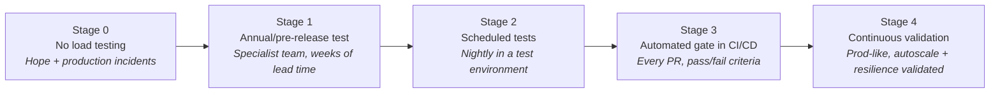

# 01 — Introduction to Load Testing

> **Section goal:** Establish shared vocabulary and make the business case *before* touching any Azure UI. For a financial services audience, anchor everything in risk, regulation and revenue — not in "requests per second".

**Duration:** 20 minutes · **Format:** Slides · **Audience:** Mixed (leadership + engineering)

---

## 1.1 Open with the business problem, not the tool

Cover these talking points:

- **Performance is a regulated concern in financial services, not just an engineering nicety.**
  - Operational resilience regimes (e.g. DORA in the EU, PRA/FCA operational resilience in the UK, and equivalent regulator expectations elsewhere) require firms to define **impact tolerances** for important business services and to **test** that they can stay within them under severe-but-plausible scenarios.
  - "We can handle month-end volume" is an assertion. A load test result is **evidence**.
  - *Talking point:* a load test report is an artefact you can hand to an auditor.
- **The cost of a performance failure in FSI is asymmetric.**
  - Payment rails, trading, card authorisation and onboarding journeys fail *loudest* precisely when volume is highest (payday, month-end, market open, tax deadline, Black Friday).
  - Downtime cost is not just lost transactions — it is customer remediation, regulatory reporting, reputational damage, and potentially fines.
- **Performance defects are the most expensive class of defect to find late.**
  - A functional bug is usually reproducible on a laptop. A concurrency bug, a connection-pool exhaustion, or an N+1 query only appears under load — i.e. **in production**, unless you deliberately create load earlier.
- **Ask the room a question early:** *"How do you know today that your API can handle 3× peak? Who ran that test, when, and where is the report?"* The answers are usually uncomfortable and set up the rest of the session.

---

## 2 Define the vocabulary (get this out of the way early)

Present a simple table — teams routinely conflate these, and the confusion causes bad tests.

| Test type | Question it answers | Typical shape |
|---|---|---|
| **Smoke / shakeout** | Does the test script itself work? Is the environment up? | 1–5 users, a few minutes |
| **Load test** | Does the system meet its SLOs at *expected* peak? | Ramp to expected peak, hold |
| **Stress test** | Where does it break, and *how* does it break? | Ramp past peak until failure |
| **Spike test** | Can it survive a sudden surge (market open, promo, payday)? | Instant jump to N× load |
| **Soak / endurance test** | Does it degrade over hours? (memory leaks, connection leaks, log disk fill) | Moderate load for 4–24h |
| **Scalability test** | Does throughput scale linearly as I add instances? | Repeat at increasing capacity |
| **Capacity test** | What infrastructure do I need for target volume? | Find max sustainable throughput |
| **Regression / gate test** | Did this code change make performance worse? | Short, fixed, automated, every build |

> **Emphasise the last row.** The regression gate is the one that changes engineering culture, and it is the one Azure Load Testing makes trivially cheap to adopt (see doc 08).

### Key metrics — and how to talk about them correctly

| Metric | Definition | Why it matters |
|---|---|---|
| **Virtual user (VU)** | A simulated concurrent user executing the test script | The unit Azure Load Testing bills on (see doc 12) |
| **Throughput (RPS)** | Requests completed per second | The business capacity number |
| **Response time** | Full elapsed time for a request | What the customer feels |
| **Latency** | Time to first byte | Separates network/queueing from processing |
| **Percentiles (p90/p95/p99)** | The nth-percentile response time | **Averages lie.** p99 is the experience of your most valuable/highest-volume customers |
| **Error rate %** | Failed requests / total | The cliff edge indicator |
| **Ramp-up** | Time taken to reach target VUs | Prevents an artificial thundering-herd |
| **Think time** | Pause between user actions | Makes the simulation realistic rather than a DoS |

> **Slide-worthy line:** *"If your SLO is stated as an average, you don't have an SLO. Averages hide the 1% of transactions that generate 100% of your complaints."*

### Concepts specific to how Azure Load Testing works
Introduce these now so they're not new in doc 03:
- **Test** — the definition: script + configuration + criteria.
- **Test run** — one execution of a test, with its own results and dashboard.
- **Test engine / engine instance** — the managed compute that generates load. More engines = more VUs.
- **Pass/fail criteria** — thresholds evaluated automatically; this is what turns a test into a **quality gate**.
- **App components** — the Azure resources whose server-side metrics get correlated with the test.

---

## 3 Where load testing fits in the SDLC — the shift-left story

Walk the audience left-to-right through this progression, and be honest that most organisations sit at stage 1 or 2:

| Stage | Feedback loop | Cost to fix a defect |
|---|---|---|
| 0 — none | Production incident | Highest — customer impact + incident response |
| 1 — pre-release only | Weeks | Very high — architectural rework at the worst time |
| 2 — scheduled | ~1 day | Moderate |
| 3 — CI/CD gate | Minutes | Low — the developer still has the context in their head |
| 4 — continuous | Continuous | Lowest |

**The point to land:** the blocker to reaching stage 3 has historically been *infrastructure and operational effort*, not intent. Removing that blocker is exactly what a managed service does — which is the bridge into doc 02.

---

## 4 Why teams don't load test today (name the objections up front)

Naming these makes the rest of the session feel like it was designed for them. Put them on one slide and promise to answer each:

| Objection | Where it's answered |
|---|---|
| "We don't have infrastructure to generate that much load." | Doc 03 (managed engines), doc 02 (TCO) |
| "Maintaining our JMeter grid is a project in itself." | Doc 02 |
| "Our APIs are on a private network / behind a firewall." | Doc 11, doc 13 (VNet injection) |
| "Our team doesn't know JMeter." | Doc 04 (URL-based tests), doc 10 (Copilot-generated scripts) |
| "We already have JMeter scripts — we'd have to start over." | Doc 06 (upload your existing `.jmx` unchanged) |
| "It takes too long to set up for every release." | Doc 08 (CI/CD, config-as-code) |
| "We can't correlate results with what the backend was doing." | Doc 07 (App Components / Azure Monitor) |
| "Security won't approve a load-generation tool." | Doc 11 (data residency, CMK, RBAC, private networking) |
| "We can't justify the cost." | Doc 12 (VUH model, pay per use) |
| "We don't know what 'good' looks like." | Doc 07 (baselines and run comparison) |

---

## 5 Financial-services scenarios worth naming explicitly

Tailor to whichever lines of business are in the room:

- **Retail banking** — payday / month-end salary credit surge; balance-check storms after a market event or outage notification.
- **Payments & cards** — authorisation throughput at peak retail hours; instant/faster payments cut-off windows; scheme-mandated response-time SLAs.
- **Digital onboarding** — marketing campaign spike hitting KYC/AML third-party API dependencies (and their rate limits).
- **Trading / capital markets** — market-open burst; volatility events driving order and quote volume.
- **Open banking / APIs** — third-party TPP aggregator polling; regulated availability and response-time reporting obligations.
- **Statement & reporting** — month-end / quarter-end batch overlapping with online traffic.
- **Core-banking modernisation** — proving a new microservice can match or beat the mainframe path it replaces. *This is a very common and very fundable use case.*

> **Transition line into doc 02:** *"So we agree we need to do this continuously. The question is whether you build and operate the load-generation platform yourselves, or consume it as a service. Let's look at that honestly."*

---

## Reference links

- [What is Azure Load Testing?](https://learn.microsoft.com/en-us/azure/app-testing/load-testing/overview-what-is-azure-load-testing)
- [Key concepts](https://learn.microsoft.com/en-us/azure/app-testing/load-testing/concept-load-testing-concepts)
- [Azure Well-Architected Framework — Performance Efficiency: Performance testing](https://learn.microsoft.com/en-us/azure/well-architected/performance-efficiency/performance-test)
- [Azure Well-Architected Framework — Reliability: Testing strategy](https://learn.microsoft.com/en-us/azure/well-architected/reliability/testing-strategy)
