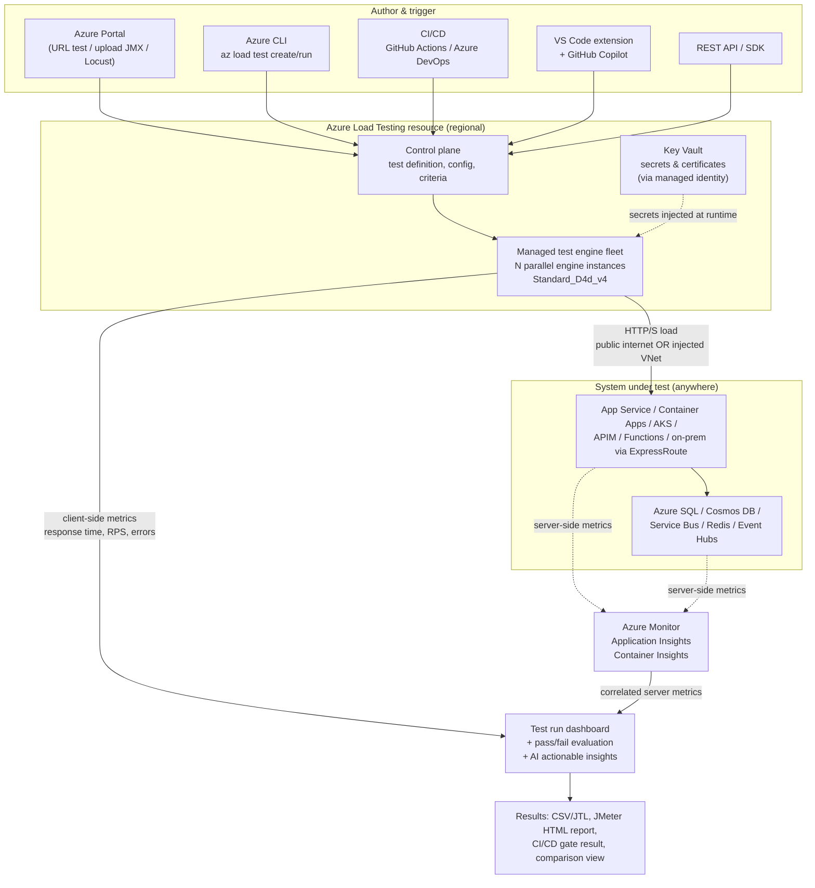
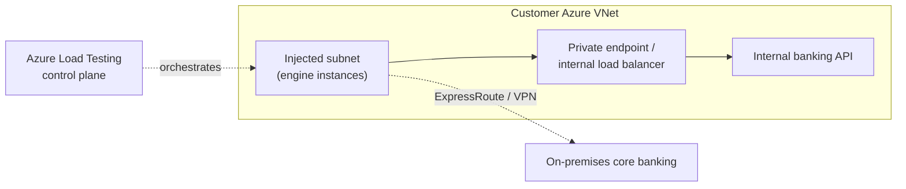

# 03 — How It Works: Architecture

> **Section goal:** Give the engineers in the room a correct mental model of what actually happens when they click "Run". Cover the resource hierarchy, the engine model, how scale is calculated, and how load reaches a private endpoint. This is the section where technical credibility is won or lost.

**Duration:** 20 minutes · **Format:** Slides + whiteboard · **Audience:** Engineering, architecture, network/security

---

## 3.1 The resource model

Start here — it's small and it explains the whole portal navigation later.

```
Azure subscription
└── Resource group
    └── Azure Load Testing resource        (Microsoft.LoadTestService/loadTests)
        │   • pinned to one Azure region
        │   • carries identity (system/user-assigned), RBAC, CMK, diagnostics
        │
        ├── Test  (definition: script + config + criteria)      — up to 10,000 per resource
        │   └── Test run  (one execution + its results)         — up to 5,000 per test
        ├── Test
        └── Test
```

Points to make:
- The **resource** is the governance and security boundary — RBAC, customer-managed keys, managed identity and diagnostic settings all attach here.
- A **test** is a reusable definition. A **test run** is an immutable execution record — which is exactly what you want for audit evidence.
- The resource is **regional**. Engines run in the resource's region unless you configure multi-region load generation.

---

## 3.2 End-to-end request flow



Narrate it in this order: **author → configure → engines spin up → load is generated → two metric streams converge → criteria are evaluated → results and artefacts.**

---

## 3.3 Test engines — the part everyone asks about

| Property | Value |
|---|---|
| **Engine VM size** | Microsoft-managed `Standard_D4d_v4` — 4 vCPU, 16 GB RAM, Azure Linux |
| **JMeter runtime** | Apache JMeter 5.6.3 on JDK 21 |
| **Locust runtime** | Locust 2.33.2 on Python 3.9.19 |
| **Execution model** | Every engine instance runs the **full test script independently, in parallel** |
| **Placement** | Same Azure region as the load testing resource (unless multi-region config is used) |
| **Billing** | You are **not billed for the VMs** — billing is virtual user hours (doc 12) |
| **Lifecycle** | Provisioned on run start, destroyed on completion — nothing idles |

### The scale formula — put this on a slide

For **JMeter** tests:

```
Total virtual users = (threads defined in the JMX thread group) × (engine instances)
```

Worked examples to walk through live:

| Target VUs | Threads per engine | Engine instances |
|---|---|---|
| 250 | 250 | 1 |
| 1,000 | 250 | 4 |
| 5,000 | 250 | 20 |
| 20,000 | 250 | 80 |

**Guidance:** keep threads per engine **≤ 250**. Beyond that the engine itself becomes the bottleneck and you end up measuring your load generator, not your application. Scale **out** (more engines), not **up** (more threads).

For **Locust** tests, set total users and spawn rate globally (e.g. via `LOCUST_USERS`, `LOCUST_SPAWN_RATE`, `LOCUST_RUN_TIME`); engine count controls parallelism.

### Throughput estimation

```
RPS ≈ VUs × (1 / average response time in seconds)
```

Example: 2,000 VUs against an endpoint responding in 20 ms → 2,000 × (1 / 0.02) = **100,000 RPS**.

> **Important coaching point for the customer:** the same VU count produces wildly different RPS depending on response time. As their app gets *slower*, RPS *drops* at constant VUs. That is why you should express capacity targets in **RPS/TPS**, not in virtual users.

### Engine health — the "is my test valid?" check
The dashboard reports per-engine CPU %, memory %, network throughput and VU count. **An engine is considered healthy if average CPU and memory stay below 75%** for the test duration. If they don't, the results are suspect — reduce threads per engine and add engines. Show this in the demo; it pre-empts "how do we know the tool isn't the bottleneck?"

---

## 3.4 Scale limits (quota-gated)

| Dimension | Default | Maximum |
|---|---|---|
| Engine instances per test run | 1–400 (varies by subscription type) | 400 |
| Concurrent engine instances (all runs) | 5–400 (varies) | 1,000 |
| Concurrent test runs | 5–50 (varies) | 1,000 |
| Test duration | 3–24 hours (varies) | 24 hours |
| Tests per resource | 10,000 | — |
| Test runs per test | 5,000 | — |
| Pass/fail criteria per test | 50 | — |
| App components per test/run | 100 | — |

Defaults can be raised to the documented maxima via a **free support request**. Flag this in the demo — a bank planning a 50,000-VU market-open simulation must raise quota *before* the test week, not during it.

---

## 3.5 Networking: three ways load reaches the target

This is the slide the network and security team came for.

### (a) Public endpoint — default
Engines run in Microsoft-managed networking and call your public HTTPS endpoint. Zero configuration. Works for any reachable endpoint — Azure, other clouds, or on-prem with a public front door.

### (b) VNet injection — private and restricted endpoints
Set `subnetId` in the test configuration and the **engine VMs are injected into your VNet subnet**. This unlocks:
1. **Azure-hosted private endpoints** — internal load balancers, private IPs, services with public access disabled.
2. **Public endpoints with IP restrictions** — pair with a NAT Gateway so engine egress uses a static, allow-listable IP (App Gateway, WAF, App Service access restrictions).
3. **On-premises systems** — reachable over ExpressRoute or VPN from the injected subnet. *This is the answer for core banking systems that will never be internet-facing.*

Practical notes to state honestly:
- VNet injection deploys an **Azure Load Balancer and a public IP in your subscription** — these are billed to you separately.
- Set `publicIPDisabled: true` for a fully private configuration.
- The subnet needs enough address space for the engine count you plan to run — size it generously.



### (c) Multi-region load generation
`regionalLoadTestConfig` distributes engine instances across multiple Azure regions in a single test — so you can simulate a genuinely geographically distributed customer base, and validate Front Door / Traffic Manager routing and regional failover behaviour under load.

---

## 3.6 The two metric streams (set up doc 07 here)

| Stream | Source | Examples | Retention |
|---|---|---|---|
| **Client-side** | The test engines | Response time, latency, RPS, error %, percentiles, active VUs | 365 days |
| **Server-side** | Azure Monitor, via **App Components** | App Service CPU, SQL DTU, Cosmos RU, Container Apps replica count, queue depth, dependency failures | 90 days |

Also retained: test results (CSV/JTL) and engine logs for **6 months**.

> **The single most important architectural point in this section:** a load test that only shows client-side numbers tells you *that* you're slow. Correlating both streams tells you *why*. Doc 07 is where this pays off.

---

## 3.7 Where the data lives — pre-empt the compliance question

- Test scripts, configuration files, secrets and environment variables are **encrypted at rest** with Microsoft-managed keys by default; **customer-managed keys** can add a second layer.
- **Data residency:** the service does not store or process customer data outside the region where the instance is deployed.
- Secrets are **referenced** from Key Vault by URI and retrieved at runtime via managed identity — they are never stored in plaintext in the test definition.
- Full detail in doc 11.

---

## 3.8 Whiteboard exercise (optional, high value)

If the room is engaged, spend 5 minutes sketching **their** architecture:

1. What is the system under test, and is it public or private?
2. Where would the engines sit — Microsoft networking or their VNet?
3. Which Azure resources should be added as App Components?
4. What is the peak TPS target, and what response time do they expect at that TPS?
5. Compute the engine count together using the formulas above.

This converts the session from a product demo into a **design conversation**, which is where deals actually move.

---

## Reference links

- [Key concepts](https://learn.microsoft.com/en-us/azure/app-testing/load-testing/concept-load-testing-concepts)
- [Configure for high-scale load](https://learn.microsoft.com/en-us/azure/app-testing/load-testing/how-to-high-scale-load)
- [VNet injection concepts](https://learn.microsoft.com/en-us/azure/app-testing/load-testing/concept-azure-load-testing-vnet-injection)
- [Test private endpoints](https://learn.microsoft.com/en-us/azure/app-testing/load-testing/how-to-test-private-endpoint)
- [Limits, quotas and capacity](https://learn.microsoft.com/en-us/azure/app-testing/load-testing/resource-limits-quotas-capacity)
- [Supported Azure resource types for server-side metrics](https://learn.microsoft.com/en-us/azure/app-testing/load-testing/resource-supported-azure-resource-types)
