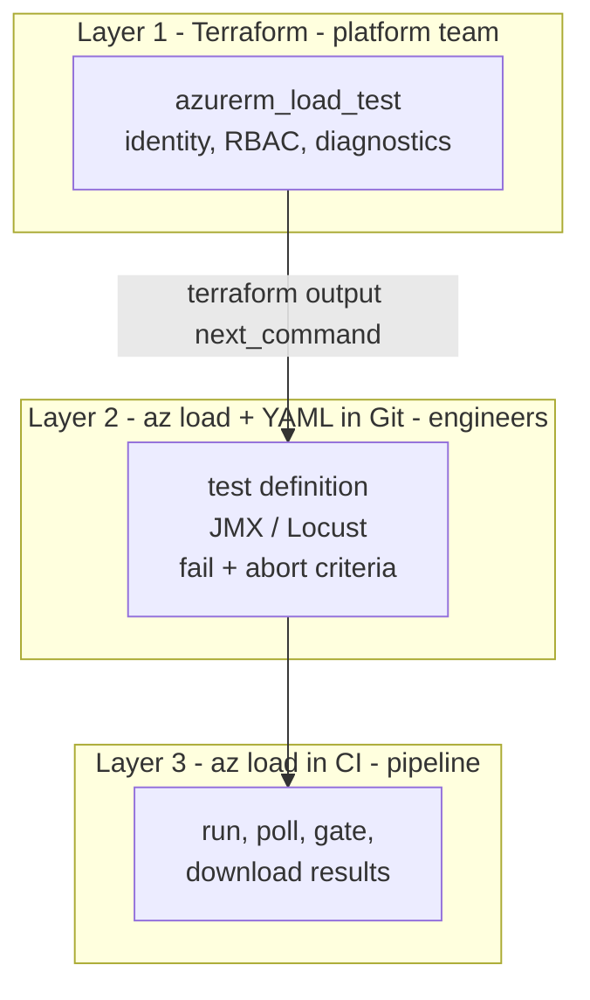

# 05 — Deploying & Operating Azure Load Testing as Code

> **Section goal:** Show that the load testing platform is governed like every other piece of regulated infrastructure — versioned, reviewed, policy-compliant, repeatable — **and that it can be operated entirely without the Azure Portal.**
>
> **Changed after review.** This section was originally Bicep-only. It is now **Terraform-first**, with the Azure CLI as a co-equal operating path, because:
> - Terraform is the internally recommended IaC tool for this customer.
> - **Portal interactions are not permitted in higher environments**, so a portal-free path is a gating requirement, not a preference.
>
> Bicep/AVM is retained as [Appendix A](#appendix-a--bicep--avm) — it is still the Microsoft-native option and some platform teams standardise on it.

**Duration:** 15–20 minutes · **Format:** Code walkthrough (VS Code) + live terminal · **Audience:** Platform engineering, cloud governance, security

---

## 5.1 Framing: why IaC for a *testing* tool

Points to make before showing code:

- The load testing resource holds **secret references, network configuration, encryption keys and RBAC** — it is a security-relevant resource, not a developer toy.
- FSI customers typically require every resource to be deployable from a pipeline with approved modules, mandatory tags, diagnostic settings and policy compliance. Load testing must fit that model or it won't get approved.
- IaC enables **ephemeral test environments**: stand up the resource, run the suite, tear it down. Billing is consumption-based, so there's no reason to keep it if you don't need it.

---

## 5.2 The three-layer model — the most important slide in this section

This is the framing that makes everything else make sense. **Terraform and the CLI are not alternatives; they are layers.**

| Layer | What it owns | Tool | Owner | Cadence |
|---|---|---|---|---|
| **1. Resource** | ALT resource, managed identity, RBAC, diagnostics, CMK, VNet | **Terraform** | Platform team | Rarely |
| **2. Test definitions** | Test plan, JMX/Locust scripts, fail + abort criteria, app components | **`az load` + YAML in Git** | Performance engineers | Per change |
| **3. Execution** | Run, poll, gate, collect results | **`az load` in CI/CD** | Pipeline | Per commit |

### Why the split exists (and why it's correct)

> **`azurerm_load_test` manages the resource container only.** It cannot create test definitions, upload a JMX file, or set fail criteria.

Those are **data-plane** operations, and no IaC tool — Terraform or Bicep — manages them. Don't present this as a gap; present it as the right separation of concerns:

- The **resource** is stable, security-relevant, and changes through a platform change process.
- The **tests** change every sprint and belong to the engineers who own the service.

Putting both behind the same slow approval gate is exactly why in-house performance testing programmes stall.



---

## 5.3 Layer 1 — Terraform

### 5.3.1 The resource

`azurerm_load_test`, available in `hashicorp/azurerm` **>= 3.70.0**.

```hcl
resource "azurerm_load_test" "this" {
  name                = local.load_test_name
  location            = var.location
  resource_group_name = local.rg_name
  description         = "Contoso Bank performance testing - managed by Terraform"

  identity {
    type = "SystemAssigned"
  }

  tags = var.tags
}
```

### 5.3.2 The role assignment everyone forgets

```hcl
resource "azurerm_role_assignment" "monitoring_reader" {
  scope                = coalesce(var.monitoring_reader_scope_id, local.rg_id)
  role_definition_name = "Monitoring Reader"
  principal_id         = azurerm_load_test.this.identity[0].principal_id

  # Avoids the "principal does not exist" failure caused by Entra ID
  # replication delay immediately after the identity is created.
  skip_service_principal_aad_check = true
}
```

> **Say this out loud.** Without Monitoring Reader, you can add App Components to a test, run it, and get an **empty server-side metrics chart with no error message telling you why**. It is the single most common cause of "the demo doesn't work", and the entire bottleneck-hunting demo in doc [`07-analyzing-results-and-bottlenecks.md`](07-analyzing-results-and-bottlenecks.md) depends on it.
>
> If the system under test lives in a **different resource group**, scope the assignment there — that's what `monitoring_reader_scope_id` is for.

### 5.3.3 Governance surface to walk through

Open [`../infra/variables.tf`](../infra/variables.tf) and point at each variable, naming the governance requirement it satisfies:

| Variable / resource | Governance requirement |
|---|---|
| `identity { type = "SystemAssigned" }` | No credentials in config; Key Vault access by identity |
| `load_test_contributor_principal_ids` | Least privilege, separation of duties — **groups, not users** |
| `azurerm_monitor_diagnostic_setting` | Central log collection for audit retention |
| `tags` | Cost allocation, ownership, data classification |
| `backend "azurerm"` (in `providers.tf`) | State in a locked-down storage account, not on a laptop |
| `version = "~> 3.70"` | Change control and reproducibility — **always pin** |
| `create_resource_group = false` | Works where the platform team pre-creates RGs |

### 5.3.4 Deploy it

```bash
cd infra
cp terraform.tfvars.example terraform.tfvars   # then edit
terraform init
terraform plan
terraform apply
terraform output next_command
```

That last line prints the exact **layer 2** command to run next — making the handover explicit instead of implied.

### 5.3.5 Two honest caveats

> ⚠️ **The Terraform AVM module.** An AVM module (`Azure/avm-res-loadtestservice-loadtest/azurerm`) is expected, but at the time of writing it is **pre-1.0 and could not be confirmed as published on the public Terraform Registry**. **Verify before the session.** The configuration in this repo therefore uses the raw `azurerm_load_test` resource, which is GA in the provider and carries no such risk. If the customer mandates AVM modules, raise this early — it may be a real blocker.

> ⚠️ **Terraform cannot destroy what it doesn't own.** Test definitions and run history live in the data plane. `terraform destroy` removes the resource and everything in it, including your **run history — which is your audit evidence trail**. Say so before someone finds out the hard way.

---

## 5.4 Layer 2 — test definitions as code

The resource is Terraform. The **test** is YAML.

```yaml
version: v0.1
testId: contoso-bank-peak
displayName: Contoso Bank - Peak Hour Transfers
testType: JMX
testPlan: loadtests/jmeter/contoso-bank.jmx
engineInstances: 4

failureCriteria:
  clientMetrics:
    - percentage(error) > 1
    - p95(response_time_ms) > 800

autoStop:
  errorPercentage: 90
  timeWindow: 60
```

```bash
az load test create \
  --load-test-resource alt-contoso-demo \
  --resource-group rg-contosobank-loadtest \
  --test-id contoso-bank-peak \
  --load-test-config-file loadtests/config/peak-load.yaml
```

In this repo, `azd up` runs that create/update step automatically after the app
deploys. Keep the command in the story: it is what the hook is doing under the
covers, and it is the escape hatch for higher environments that do not use `azd`.

> **Say out loud:** *"The resource is Terraform. The test is YAML. Both are in Git, both go through pull request review, both are auditable. A performance test is now a reviewable change like any other."*

**Always include `failureCriteria`.** A test without criteria completes with `testResult = NOT_APPLICABLE` — a green tick that means nothing, even if 100% of requests failed. See §7.2.

---

## 5.5 Layer 3 — execution without the portal

Because portal access won't exist in higher environments, this layer matters more than usual. It has its own section: doc [`17-portal-free-operations-and-observability.md`](17-portal-free-operations-and-observability.md), covering the full CLI lifecycle, the three-way result gate, and getting results into their own Grafana/LGTM stack.

The short version:

```bash
az load test-run create      ... --test-run-id $RUN_ID
az load test-run show        ... --query "{status:status, result:testResult}"
az load test-run download-files ... --path ./out --result --log --report
```

---

## 5.6 Environment promotion — how this lands in their world

Rather than arguing about whether the portal is allowed, show that the product fits their existing promotion model:

| Environment | Portal | Layer 1 | Layers 2 & 3 |
|---|---|---|---|
| **Sandbox / dev** | ✅ Exploration, URL-based tests | Terraform | CLI or portal |
| **Test / pre-prod** | ⚠️ Read-only or none | Terraform via pipeline | CLI in pipeline |
| **Production-adjacent** | ❌ Not permitted | Terraform via pipeline + approval | CLI in pipeline only |

> *"The portal is where your engineers learn the product. The pipeline is where they operate it. That's the same pattern you already apply to every other Azure service."*

---

## 5.7 Governance patterns worth mentioning

- **Azure Policy** — enforce tagging, region restriction, diagnostic settings and CMK on `Microsoft.LoadTestService/loadTests` like any other resource type.
- **Landing zone placement** — workload subscription (team autonomy, easier VNet injection) vs shared testing subscription (central cost control). Discuss the trade-off; there's no single right answer.
- **Naming & tagging** — apply their CAF naming standard; tag with cost centre, environment, data classification and owner.
- **Cost guardrails** — budgets and alerts on the resource group; combine with AutoStop (§7.9) and engine quota limits (doc 12).
- **Ephemeral vs persistent** — persistent for the audit history of test runs (6-month retention); ephemeral for one-off capacity exercises.
- **State security** — Terraform state for this resource contains resource IDs and identity object IDs. Standard locked-down remote state applies.

---

## Appendix A — Bicep / AVM

Retained because it is Microsoft-native, because the AVM Bicep module **is** published and GA-quality, and because `azd up` uses it to stand up this entire demo (app under test included) in one command.

### The AVM module

```bicep
module loadTest 'br/public:avm/res/load-test-service/load-test:<version>' = {
  name: 'loadTestDeployment'
  params: {
    name: loadTestName
    location: location
    tags: tags
    managedIdentities: { systemAssigned: true }
    roleAssignments: [
      {
        principalId: performanceTeamGroupObjectId
        roleDefinitionIdOrName: 'Load Test Contributor'
        principalType: 'Group'
      }
    ]
    diagnosticSettings: [ { workspaceResourceId: logAnalyticsWorkspaceId } ]
    customerManagedKey: {
      keyName: cmkKeyName
      keyVaultResourceId: keyVault.id
      userAssignedIdentityResourceId: userAssignedIdentity.id
    }
    lock: { kind: 'CanNotDelete' }
  }
}
```

Repo: `Azure/bicep-registry-modules` → `avm/res/load-test-service/load-test`. **Always pin a version.**

### The demo's own Bicep

Walk [`../infra`](../infra) in this order:

1. **`main.bicep`** — subscription-scope entry point; creates the RG, wires the modules.
2. **`core/monitoring.bicep`** — Log Analytics + Application Insights. *"Observability first — the load test is only half the picture."*
3. **`core/host.bicep`** — App Service plan + Contoso Bank API. Note the deliberately modest SKU, so the bottleneck is reachable in a demo.
4. **`core/loadtest.bicep`** — the load testing resource with a system-assigned identity.
5. **`core/rbac.bicep`** — the Monitoring Reader assignment. *The step everyone forgets.*

```bash
azd auth login
azd up
# ... run the demo ...
azd down --purge --force
```

> **Presenter tip:** don't run a full `azd up` live — it takes minutes and adds risk. Deploy *just* the load testing resource live (fast), and have the full environment pre-deployed.

---

## Reference links

- [Terraform `azurerm_load_test`](https://registry.terraform.io/providers/hashicorp/azurerm/latest/docs/resources/load_test)
- [Terraform `azurerm_role_assignment`](https://registry.terraform.io/providers/hashicorp/azurerm/latest/docs/resources/role_assignment)
- [Azure CLI `az load` reference](https://learn.microsoft.com/en-us/cli/azure/load)
- [Load test YAML configuration reference](https://learn.microsoft.com/en-us/azure/app-testing/load-testing/reference-test-config-yaml)
- [ARM template reference — Microsoft.LoadTestService/loadTests](https://learn.microsoft.com/en-us/azure/templates/microsoft.loadtestservice/loadtests)
- [Azure Verified Modules — Bicep load test module](https://github.com/Azure/bicep-registry-modules/tree/main/avm/res/load-test-service/load-test)
- [Use a managed identity](https://learn.microsoft.com/en-us/azure/app-testing/load-testing/how-to-use-a-managed-identity)
- [Configure customer-managed keys](https://learn.microsoft.com/en-us/azure/app-testing/load-testing/how-to-configure-customer-managed-keys)
