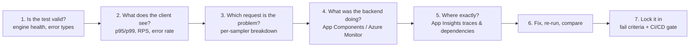
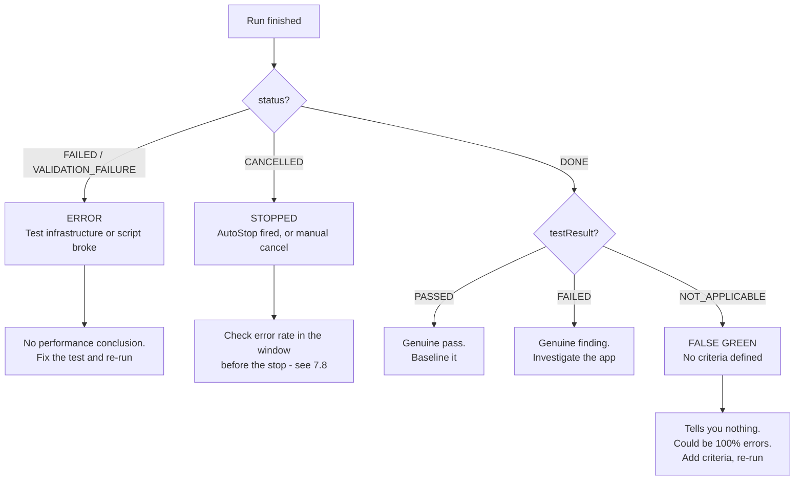

# 07 — Analysing Results & Finding Bottlenecks (NEW SECTION)

> **Section goal:** Running a test is easy. **Interpreting it is where the value is**, and it's where most in-house load testing programmes quietly fail — teams generate charts nobody can act on. This section shows how Azure Load Testing closes the loop from "it's slow" to "here's the line of code / the SKU / the connection pool setting to change".
>
> **Why this is a new section:** your original agenda had "inspect test" folded into the demo. It deserves its own slot — it is the single strongest differentiator versus a self-hosted grid, and it's the part a performance engineering lead will judge you on.

**Duration:** 25 minutes · **Format:** Live · **Audience:** Engineering, SRE, performance engineering

---

## 7.1 The analysis workflow



**Teach the customer this workflow, not just the tool.** It's transferable, and it's what makes them successful after you leave.

---

## 7.2 Step 1 — Read the run status correctly, *then* validate the test

### 7.2.1 There are two fields, not one — and this is where teams get burned

Azure Load Testing reports **two independent outcomes** for every run. Almost everyone conflates them, and the conflation is dangerous.

| Field | Question it answers | Values |
|---|---|---|
| **`status`** | *Did the run execute?* | `ACCEPTED`, `NOTSTARTED`, `PROVISIONING`, `PROVISIONED`, `CONFIGURING`, `CONFIGURED`, `EXECUTING`, `EXECUTED`, `DEPROVISIONING`, `DEPROVISIONED`, `DONE`, `CANCELLING`, `CANCELLED`, `FAILED`, `VALIDATION_SUCCESS`, `VALIDATION_FAILURE` |
| **`testResult`** | *Did it meet your criteria?* | `PASSED`, `FAILED`, `NOT_APPLICABLE` |

`status` is about **the test infrastructure**. `testResult` is about **your application**. A run can execute flawlessly and tell you nothing at all.

### 7.2.2 The four outcomes that matter

| What people say | `status` | `testResult` | What it *actually* means | What to do |
|---|---|---|---|---|
| "**Error**" | `FAILED` / `VALIDATION_FAILURE` | — | Engine, script or configuration failure. **Your test is broken, not your app.** No performance conclusion is available | Fix the test. Check engine health, JMX validity, secrets, network reachability |
| "**Failed**" | `DONE` | `FAILED` | Ran cleanly, **breached a fail criterion**. This is a *successful test* that found a *real problem* | Investigate the app. This is the outcome you want your gate to produce |
| "**Completed**" ✅ | `DONE` | `PASSED` | Ran cleanly, met every criterion. A genuine pass | Baseline it |
| "**Completed**" 🚨 | `DONE` | `NOT_APPLICABLE` | **No fail criteria were defined.** The run is green because nothing was asked of it — *including runs where 100% of requests failed* | **Never accept this.** Add criteria and re-run |

> ### 🚨 The silent-failure trap — say this out loud in the session
>
> **A load test where every single request returned HTTP 500 will still show as "Completed" if you did not define fail criteria.**
>
> The status field is telling you *"the load generator did its job"*. It is **not** telling you your application is healthy. Teams read the green tick, close the tab, and ship.
>
> `testResult = NOT_APPLICABLE` is the tell. Treat it as a **failure of the testing process**, not a pass.

### 7.2.3 Decision tree — how to read any run



### 7.2.4 The standard to recommend

> **Every test defines at least one error-percentage criterion.**
>
> This single rule makes `NOT_APPLICABLE` structurally impossible. It is trivially enforceable in code review, and it converts a silent failure mode into a loud one. See §7.8 for the syntax, and doc [`08-cicd-integration.md`](08-cicd-integration.md) for the pipeline guard that enforces it automatically.

### 7.2.5 Then validate the test itself

Never analyse a result you haven't sanity-checked. Cover:

- **Engine health:** average CPU and memory should stay **below 75%**. Above that, you are measuring your load generator. Reduce threads per engine (≤250) and scale out.
- **Did the load actually ramp as designed?** Check the virtual users chart against your intended pattern.
- **What kind of errors?** Distinguish:
  - *Script errors* (404s, assertion failures, bad correlation) — the test is wrong.
  - *Application errors* (500s, timeouts) — the app is wrong.
  - *Infrastructure errors* (connection resets, TLS failures) — the environment is wrong.
- **Was the environment representative?** A test against a scaled-down environment tells you about *shape*, not *capacity*.
- **Was the test data realistic?** If 1,000 VUs all query the same account, you've tested your cache, not your database. This is why `splitAllCSVs` matters.

> **Slide line:** *"The first question about any load test result is not 'is the app fast enough'. It's 'is this test telling me the truth'."*

---

## 7.3 Step 2 — Read the client-side metrics properly

| What to look at | What it tells you |
|---|---|
| **Response time at p90 / p95 / p99** | The real customer experience. Toggle from average to p99 live — the visual jump is the most persuasive moment in the demo. |
| **The RPS plateau** | Where throughput stops increasing even as VUs increase = **your actual capacity ceiling**. This is the number for capacity planning. |
| **The knee of the curve** | The load level where response time starts rising non-linearly. Operate below it. |
| **Error rate onset** | Usually starts shortly after the RPS plateau — the system is saturated and shedding load. |
| **Latency vs response time** | Latency = time to first byte. If latency is fine but response time is bad, the problem is payload/streaming/serialisation. If both rise together, it's queueing or processing. |

### The three canonical shapes — draw these on a whiteboard

| Shape | Diagnosis |
|---|---|
| Response time flat, RPS rises linearly | Healthy — you haven't found the limit yet, push harder |
| RPS plateaus, response time climbs steeply | **Saturation** — a resource is exhausted (CPU, connections, threads, IOPS, RUs) |
| RPS *drops* while response time explodes | **Collapse** — retry storms, thread pool starvation, GC death spiral, cascading timeouts. Far more dangerous than saturation |

The third shape is the one that causes real incidents in banks: the system doesn't degrade gracefully, it falls over and takes its dependencies with it.

---

## 7.4 Step 3 — Narrow to a request

Use the per-request (per-sampler) breakdown. In the Contoso Bank demo:

- `GET /accounts/{id}/balance` — fast and flat → not the problem
- `GET /accounts/{id}/transactions` — moderate
- `POST /transfers` — **p95 degrading sharply** → the offender
- `GET /statements/{id}` — the heavy report endpoint

**Say out loud:** *"'The banking app is slow' is not actionable. 'The transfer endpoint's p95 goes from 120ms to 4 seconds above 400 concurrent users, while balance lookups are unaffected' is a work item with an owner."*

Request-level pass/fail criteria let you encode this: a strict threshold on `POST /transfers`, a looser one on the statement report.

---

## 7.5 Step 4 — Correlate with server-side metrics (the differentiator)

This is where you explicitly call back to doc 02.

### 7.5.1 Client-side vs server-side metrics

| Metric family | Measured by | Answers | Examples |
|---|---|---|---|
| **Client-side metrics** | Azure Load Testing engines | *What did the user see?* | response time, latency, requests/sec, error percentage |
| **Server-side metrics** | Azure Monitor for the resources in **App Components** | *What was the system under test doing?* | App Service CPU, memory, HTTP queue length, server request duration |

The distinction matters. A 20-second `CreateTransfer` p95 tells you the customer is waiting. It does **not** tell you whether the app is CPU-bound, memory-bound, queueing at the front door, or blocked behind an in-process lock. App Components add that second half of the picture.

### 7.5.2 How App Components are configured

App Components are the Azure resources Azure Load Testing watches during a run. The service reads their Azure Monitor metrics and renders them next to the load-generator charts. Microsoft documents two ways to configure them:

| Method | What it is good for | Important detail |
|---|---|---|
| **YAML `appComponents`** | Static, environment-specific test files | The current `v0.1` schema supports `appComponents`, and each component can include a `metrics` list with `name`, `namespace`, and `aggregation`. |
| **`az load test app-component add` + `az load test server-metric add`** | Repeatable automation where resource IDs are discovered after deployment | This demo uses the CLI in `tools/provision_loadtests.*`, because the App Service, App Insights and App Service Plan IDs come from `azd` outputs and must not be hardcoded into YAML. |

`failureCriteria.serverMetrics` is a related YAML feature, but it is a **gate** ("fail the run if CPU > 80%"), not the same thing as choosing which charts to collect. For this demo we keep the gates client-side and use server metrics for diagnosis.

> ⚠️ **The step everyone forgets:** the load testing resource's managed identity needs permission to read metrics from those resources, typically **Monitoring Reader** at the resource group or resource scope. If it is missing, the run can complete and the server-side charts are simply empty. In this environment it is already assigned at the resource group — verify it live and make that a teaching point rather than re-granting it.

### 7.5.3 Metrics available in this deployed app

Verified with `az monitor metrics list-definitions` against the live Linux App Service, App Service Plan and Application Insights component.

| Resource type | Available metric names |
|---|---|
| `Microsoft.Web/sites` | `CpuTime`, `Requests`, `BytesReceived`, `BytesSent`, `Http101`, `Http2xx`, `Http3xx`, `Http401`, `Http403`, `Http404`, `Http406`, `Http4xx`, `Http5xx`, `MemoryWorkingSet`, `AverageMemoryWorkingSet`, `AverageResponseTime` (deprecated), `HttpResponseTime`, `InstanceCount`, `IoReadBytesPerSecond`, `IoWriteBytesPerSecond`, `IoReadOperationsPerSecond`, `IoWriteOperationsPerSecond`, `HealthCheckStatus`, `FileSystemUsage` |
| `Microsoft.Web/serverfarms` | `CpuPercentage`, `MemoryPercentage`, `DiskQueueLength`, `HttpQueueLength`, `BytesReceived`, `BytesSent`, `TcpSynSent`, `TcpSynReceived`, `TcpEstablished`, `TcpFinWait1`, `TcpFinWait2`, `TcpClosing`, `TcpCloseWait`, `TcpLastAck`, `TcpTimeWait`, `SocketInboundAll`, `SocketOutboundAll`, `SocketOutboundEstablished`, `SocketOutboundTimeWait`, `SocketLoopback` |
| `microsoft.insights/components` | `availabilityResults/availabilityPercentage`, `availabilityResults/count`, `availabilityResults/duration`, browser timing metrics, `dependencies/count`, `dependencies/duration`, `dependencies/failed`, `pageViews/count`, `pageViews/duration`, `performanceCounters/requestExecutionTime`, `performanceCounters/requestsInQueue`, `performanceCounters/requestsPerSecond`, `performanceCounters/exceptionsPerSecond`, `performanceCounters/processIOBytesPerSecond`, `performanceCounters/processCpuPercentage`, `performanceCounters/processorCpuPercentage`, `performanceCounters/memoryAvailableBytes`, `performanceCounters/processPrivateBytes`, `requests/duration`, `requests/count`, `requests/failed`, `requests/rate`, `exceptions/count`, `exceptions/browser`, `exceptions/server`, `traces/count` |

### 7.5.4 The metrics this demo enables — and why

The recent run was not an error story: `CreateTransfer` averaged **14.1s** with **zero errors**. That is the signature of queueing or lock contention, not a crash. Enable a focused set that proves or disproves saturation:

| Component | Metric | Aggregation | Question it answers | Healthy vs unhealthy shape |
|---|---|---:|---|---|
| App Service Plan | `CpuPercentage` | Average | Is the worker plan CPU-saturated? | Healthy/lock contention: low or moderate while p95 rises. CPU bottleneck: pinned high with latency rising. |
| App Service Plan | `MemoryPercentage` | Average | Are we paging or memory-bound? | Healthy: stable. Memory issue: climbs toward the limit during the run. |
| App Service Plan | `HttpQueueLength` | Maximum | Are requests backing up before the app workers accept them? | Healthy/inside-app lock: near zero. Front-door/worker saturation: sustained queue. |
| App Service | `HttpResponseTime` | Average | Does Azure see the app taking longer, not just the load engines? | Rises with client p95 when the backend is genuinely slow. |
| App Service | `Requests` | Total | Did throughput plateau while VUs kept increasing? | Lock/pool ceiling: flat request count rate despite more users. |
| App Service | `Http5xx` | Total | Is slowness turning into server failures? | The observed run had zero errors; a spike changes the diagnosis. |
| App Service | `MemoryWorkingSet` | Average | Is the process footprint growing? | Stable for this demo; rising trend hints at leak or caching side effect. |
| App Service | `InstanceCount` | Average | Did scale-out happen during the test? | Useful when explaining why a single in-process lock does not disappear just because the plan scales. |
| Application Insights | `requests/duration` | Average | What duration did the instrumented app report? | Should move with client latency if the wait is inside the app. |
| Application Insights | `requests/count` | Count | How many server requests did the app process? | Confirms request volume from the server's perspective. |
| Application Insights | `requests/failed` | Count | Did the app report failed requests? | Should stay at zero in the lock-contention story. |
| Application Insights | `requests/rate` | Average | What request rate did the app actually process? | Plateaus when the serialized transfer path caps throughput. |
| Application Insights | `performanceCounters/requestsInQueue` | Maximum | Is there an application queue visible to App Insights? | If populated and high, investigate worker queueing. If empty/low while p95 rises, the queue is likely inside application code. |
| Application Insights | `performanceCounters/processCpuPercentage` | Average | Is the Python process itself CPU-bound? | Should stay lower for transfer lock contention; rises for statement CPU work. |
| Application Insights | `performanceCounters/processPrivateBytes` | Average | Is process memory pressure part of the problem? | Should be stable for this demo. |

We deliberately do **not** enable every available metric. Data-in/out, TCP socket states, filesystem usage and IO rates are useful for other incidents, but they distract from this customer's bottleneck story.

### 7.5.5 Reading the shapes together

| Pattern | What the charts say | Diagnosis |
|---|---|---|
| **CPU saturation** | Client p95 rises, `HttpResponseTime` rises, plan/process CPU high, request rate plateaus or errors start | The server is out of compute. Statement generation is the demo endpoint most likely to show this. |
| **Front-door / worker queueing** | Client p95 rises, `HttpQueueLength` or `requestsInQueue` rises, CPU may be high or low | Requests are waiting before useful work starts. Scale out or fix worker/thread limits. |
| **In-process lock contention** | `CreateTransfer` p95 explodes, errors stay near zero, CPU and memory stay modest, HTTP queue length may stay low, request rate plateaus | The app is idle-ish but serialized behind `TRANSFER_LOCK`. Azure metrics prove it is **not** a simple "add CPU" problem. |
| **Connection pool queueing / N+1** | Read endpoints slow, CPU modest, request duration rises with request volume; no real SQL dependency metric appears because the demo database is in-memory | Use App Insights traces or app counters next. The platform metrics show queueing, not the exact semaphore. |

Be honest: an `asyncio.Lock` or `asyncio.Semaphore` inside one Python worker is not a first-class Azure Monitor resource. Server-side metrics can rule out CPU, memory and platform queue saturation, but they cannot name the exact lock. That final step belongs in Application Insights traces, code review, or custom application metrics.

### 7.5.6 Which tests get these metrics

| Test | Server metrics? | Why |
|---|---:|---|
| `contoso-bank-peak-load` | ✅ | Flagship four-engine JMeter test; this is the main bottleneck diagnosis demo. |
| `contoso-bank-peak-load-locust` | ✅ | Same business journey and load profile in Python; proves the server view is script-agnostic. |
| `contoso-bank-pr-gate` | ✅ | Lower scale, but useful in CI when a regression needs a quick saturation-vs-queueing hint. |
| URL basic / URL smoke / URL cURL / false-green / Key Vault secrets tests | ❌ | One-engine teaching tests. They are about authoring modes, false-green behaviour and RBAC/secrets, not backend diagnosis. Keeping them lean reduces noise. |

The post-deploy hook attaches these App Components and metrics after every `azd up`, so repeated provisioning keeps the definitions intact without hardcoding environment-specific resource IDs.

### The correlation moment
Put the two charts on screen together and narrate:
> *"Response time p95 starts climbing at 14:03. App Service CPU is not saturated, memory is stable and the HTTP queue is flat. That means the server is not 'too small' — the request path is serialising inside the app. Now we know where to look."*

---

## 7.6 Step 5 — Go deeper with Application Insights

Azure Load Testing tells you *which resource* is saturated. Application Insights tells you *which line of code*. Show the handoff:

- **Performance blade** — slowest operations, with the load test window selected.
- **End-to-end transaction view** — a single slow `POST /transfers` request, showing its dependency calls.
- **Dependency chart** — is the time in SQL, in an HTTP call to a downstream service, in Redis?
- **Failures blade** — exception types and counts during the run.
- **Live Metrics** — leave this open on a second screen *during* the test run for a compelling real-time view.

**Common FSI bottleneck patterns to name:**

| Pattern | Signature |
|---|---|
| **N+1 queries** | Dependency call count scales with user count; DB CPU high but each query fast |
| **Connection pool exhaustion** | Response time cliff at a specific VU count; app CPU *low*; requests queueing |
| **Thread pool starvation** | Sync-over-async; throughput collapses rather than plateaus |
| **Missing cache** | Identical repeated queries; DB load proportional to request rate |
| **Lock contention / serialisation** | Throughput flat regardless of added instances; one CPU core pegged |
| **Chatty downstream / third-party API** | Latency dominated by an external dependency; often rate-limited (very common with KYC/AML/credit-bureau providers) |
| **Cosmos RU throttling** | 429s and consumed RU pinned at provisioned limit |
| **Cold starts** | First-request latency spikes after scale-out events |

---

## 7.7 Step 6 — AI-powered actionable insights

In the test run dashboard, the **AI summary and insights** section (click **Generate insights** on first visit):

- Correlates **client-side and server-side** data automatically.
- Surfaces latency spikes, throughput drops and backend resource bottlenecks.
- **View detailed insights** gives: what went wrong, the supporting evidence, and recommended next steps.
- Works best when **server-side metrics are configured** — another reason App Components matter.

**Be straight about the caveat** (the docs are, and it builds trust): AI-generated insights might not always be accurate; review the evidence and validate against your own telemetry.

**Positioning line:** *"This doesn't replace your performance engineer. It gives a developer who isn't a performance engineer a running start — which is the difference between a report that gets actioned and one that gets ignored."*

---

## 7.8 Step 7 — Baselines, comparison and regression detection

This is how load testing becomes a *practice* rather than an event.

1. **Establish a baseline** — a known-good run against a known configuration. Record: build/commit SHA, environment, test config, engine count, and the headline numbers (p95, RPS, error %).
2. **Compare runs** — overlay multiple runs in the portal to see the delta visually.
3. **Watch trends over time** — is p95 creeping up release over release? A 5% regression per sprint is invisible individually and catastrophic annually.
4. **Encode the baseline as fail criteria** — turn "we think 300ms is OK" into `avg(response_time_ms) > 300`. Now the pipeline enforces it (doc 08).
5. **Keep the evidence** — test runs are retained (results and logs 6 months, client metrics 365 days) and downloadable. That's your audit and release-board evidence pack.

**Recommended criteria starting set for an FSI API:**
```yaml
failureCriteria:
  clientMetrics:
    - percentage(error) > 1              # near-zero tolerance for financial transactions
    - avg(response_time_ms) > 300
    - p95(response_time_ms) > 800
    - p99(response_time_ms) > 2000
    - GetBalance: p95(response_time_ms) > 300
    - PostTransfer: p95(response_time_ms) > 1000
    - avg(requests_per_sec) < 500        # throughput floor, not just a latency ceiling
  serverMetrics:
    - resourceId: <app service resource id>
      metricNamespace: Microsoft.Web/sites
      metricName: CpuPercentage
      aggregation: Average
      condition: GreaterThan
      value: 80
```

> **Don't skip the throughput floor.** A test can pass every latency threshold while serving a fraction of the required volume. Always assert both "fast enough" *and* "enough".

---

## 7.9 Abort criteria (AutoStop) — the circuit breaker, not the gate

Fail criteria and abort criteria are constantly confused. They do **completely different jobs** and fire at different times.

| | **Fail criteria** | **Abort criteria (AutoStop)** |
|---|---|---|
| Evaluated | **At the end** of the run | **Continuously, during** the run |
| Effect | Sets `testResult` | **Terminates the run immediately** |
| Purpose | **Quality gate** — did the app meet its SLO? | **Circuit breaker** — is this run still worth running? |
| Resulting `status` | `DONE` | `CANCELLED` |
| Resulting `testResult` | `PASSED` / `FAILED` | ⚠️ *Verify before asserting — see doc 16* |
| Config key | `failureCriteria` | `autoStop` |

### 7.9.1 Configuration

```yaml
# Default behaviour — stop if >90% of requests error over a rolling 60-second window
autoStop:
  errorPercentage: 90
  timeWindow: 60
```

```yaml
# Explicitly disable — you must do this deliberately
autoStop: disable
```

**Defaults:** `errorPercentage: 90`, `timeWindow: 60` (seconds). AutoStop is **on by default** — which is the right default, but it means it can fire without you having configured anything.

### 7.9.2 Three reasons a bank cares about this

1. **Cost protection.** A misconfigured 20,000-VU run that is failing 100% of requests burns virtual user hours for no information. AutoStop caps the damage. Tie this to doc [`12-pricing-and-cost-governance.md`](12-pricing-and-cost-governance.md).
2. **Shared-environment protection.** In most enterprises the performance environment is shared. A runaway test doesn't just waste money — it blocks other teams and can trip downstream dependencies. **This is usually the argument that lands.**
3. **Fast feedback.** If the target is down, you learn in 60 seconds instead of 30 minutes.

### 7.9.3 When to *disable* it

> **If you are deliberately testing failure modes, AutoStop will kill your test.**

Chaos/resilience testing, circuit-breaker validation, graceful-degradation testing and dependency-outage simulation all intentionally drive high error rates. In those tests, set `autoStop: disable` — and **write a comment in the YAML saying why**, so the next engineer doesn't "fix" it.

### 7.9.4 The interaction to make explicit

A `CANCELLED` run is **not** a pass and **not** a criteria failure — it's an *incomplete* run. Your pipeline must handle three outcomes, not two:

- `DONE` + `PASSED` → proceed
- `DONE` + `FAILED` → block, real finding
- `CANCELLED` or `FAILED` status → block, **but report it differently** — this is "we don't know", not "it's bad"

Doc [`08-cicd-integration.md`](08-cicd-integration.md) implements exactly this.

---

## 7.10 Exporting the evidence

| Artefact | Use |
|---|---|
| **Results CSV / JTL** (one per engine, Apache JMeter format) | Deep analysis, feeding into existing FSI reporting tooling |
| **JMeter HTML dashboard report** | Offline sharing, attaching to a change record |
| **Engine logs** | Diagnosing a broken *script* rather than a broken *app* |
| **CI/CD artefact** | Results published to the workflow run — the release-gate evidence |
| **Backend Listener / Locust event hooks / storage account** | Streaming results for very large runs (>45 engines or >3 hours, where direct download isn't available) |
| **Power BI** | The `Azure-Samples/azure-load-testing-samples` repo includes a Power BI results-integration sample — worth mentioning for exec-level trend dashboards |

> **Operating without portal access?** Everything in this table is reachable from the `az load` CLI, and results can be routed into a self-hosted Grafana/LGTM stack. That is a large enough topic to have its own section — see doc [`17-portal-free-operations-and-observability.md`](17-portal-free-operations-and-observability.md).

---

## Reference links

- [Tutorial: identify performance bottlenecks](https://learn.microsoft.com/en-us/azure/app-testing/load-testing/tutorial-identify-bottlenecks-azure-portal)
- [Monitor server-side application metrics](https://learn.microsoft.com/en-us/azure/app-testing/load-testing/how-to-monitor-server-side-metrics)
- [Configure a load test in YAML](https://learn.microsoft.com/en-us/azure/app-testing/load-testing/reference-test-config-yaml)
- [Supported Azure resource types](https://learn.microsoft.com/en-us/azure/app-testing/load-testing/resource-supported-azure-resource-types)
- [Analyze results using actionable insights](https://learn.microsoft.com/en-us/azure/app-testing/load-testing/how-to-analyze-test-results-using-actionable-insights)
- [Compare multiple test runs](https://learn.microsoft.com/en-us/azure/app-testing/load-testing/how-to-compare-multiple-test-runs)
- [Define test fail criteria](https://learn.microsoft.com/en-us/azure/app-testing/load-testing/how-to-define-test-criteria)
- [Export test results](https://learn.microsoft.com/en-us/azure/app-testing/load-testing/how-to-export-test-results)
- [Diagnose failing load tests](https://learn.microsoft.com/en-us/azure/app-testing/load-testing/how-to-diagnose-failing-load-test)
