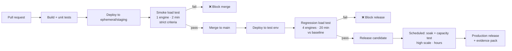

# 08 — Integration with CI/CD

> **Section goal:** Move load testing from "an event before a big release" to "a gate on every change". This is the section that changes engineering behaviour, and it is usually the strongest ROI argument for a platform engineering audience.

**Duration:** 20 minutes · **Format:** Live (GitHub Actions) + code walkthrough (Azure DevOps) · **Audience:** Platform engineering, DevOps, release management

---

## 8.1 Framing: three levels of automation maturity

| Level | Pattern | Runs when | Duration | Purpose |
|---|---|---|---|---|
| **1 — Smoke gate** | Short, small test on every PR | Every pull request | 2–5 min | Catch catastrophic regressions early; keep the loop fast |
| **2 — Regression gate** | Fuller test after merge to main / on release candidate | Every merge, or nightly | 15–30 min | Detect creeping degradation against a baseline |
| **3 — Capacity / soak** | High-scale or long-duration test | Scheduled, or pre-release | 1–24 h | Prove peak capacity, find leaks, validate autoscale |

**Key advice for the customer:** *"Don't try to run a 30-minute 10,000-user test on every pull request — you'll create a bottleneck in your own pipeline and the team will disable it within a month. Layer it."*

---

## 8.2 Tests as code — the config YAML

Everything starts with the test config file in the repo. This is what makes the test reviewable.

```yaml
version: v0.1
testId: contoso-bank-pr-gate
displayName: Contoso Bank - PR performance gate
description: Fast smoke gate on every pull request
testType: JMX
testPlan: loadtests/jmeter/contoso-bank.jmx
engineInstances: 1
configurationFiles:
  - loadtests/data/accounts.csv
splitAllCSVs: true
env:
  - name: BASE_URL
    value: contoso-bank-api-staging.azurewebsites.net
  - name: DURATION_SECONDS
    value: '120'
  - name: THREADS
    value: '50'
secrets:
  - name: API_KEY
    value: https://kv-contoso-demo.vault.azure.net/secrets/demo-api-key
failureCriteria:
  clientMetrics:
    - percentage(error) > 1
    - avg(response_time_ms) > 300
    - p95(response_time_ms) > 800
autoStop:
  errorPercentage: 90
  timeWindow: 60
appComponents:
  - resourceId: /subscriptions/<sub>/resourceGroups/<rg>/providers/Microsoft.Web/sites/<app>
    kind: web
```

### Full schema reference — worth showing on screen

| Property | Purpose |
|---|---|
| `version` | Always `v0.1` |
| `testId` | Unique ID, 2–50 chars, `[a-z0-9_-]` |
| `displayName` / `description` | Portal display (description max 100 chars) |
| `testType` | `URL`, `JMX` or `Locust` |
| `testPlan` | Path to the `.jmx`, `.py`, or URL-requests JSON |
| `engineInstances` | Parallel engine count — your scale dial |
| `configurationFiles` | CSVs, JMX fragments, supporting assets |
| `splitAllCSVs` | Split CSV rows evenly across engines |
| `zipArtifacts` | Large test data as ZIPs |
| `properties.userPropertyFile` | JMeter `.properties` or Locust `.conf`/`.ini`/`.toml` |
| `failureCriteria` | Client and/or server metric thresholds — **the gate** |
| `autoStop` | `disable`, or `{errorPercentage, timeWindow}` |
| `env` / `secrets` / `certificates` | Parameters; secrets and certs are Key Vault URIs |
| `appComponents` | Azure resources for server-side metrics |
| `subnetId` / `publicIPDisabled` | VNet injection |
| `regionalLoadTestConfig` | Multi-region load generation |
| `referenceIdentities` / `keyVaultReferenceIdentity` | Managed identities for `KeyVault`, `Metrics`, `Engine` scenarios |

**Say out loud:** *"This file is the entire performance contract for the service — scale, thresholds, data, secrets and monitoring. It's diffed in a pull request. Someone has to approve a change to your performance SLO, the same way they approve a code change."*

---

## 8.3 GitHub Actions — the live demo

### The workflow

See [`../.github/workflows/load-test.yml`](../.github/workflows/load-test.yml).

```yaml
name: Performance gate

on:
  pull_request:
    branches: [ main ]
  workflow_dispatch:

permissions:
  id-token: write        # OIDC — no stored secrets
  contents: read

jobs:
  loadtest:
    runs-on: ubuntu-latest
    steps:
      - uses: actions/checkout@v4

      - name: Azure login (OIDC federated credential)
        uses: azure/login@v2
        with:
          client-id: ${{ secrets.AZURE_CLIENT_ID }}
          tenant-id: ${{ secrets.AZURE_TENANT_ID }}
          subscription-id: ${{ secrets.AZURE_SUBSCRIPTION_ID }}

      - name: Run Azure Load Test
        uses: azure/load-testing@v1
        with:
          loadTestConfigFile: loadtests/config/pr-gate.yaml
          loadTestResource: ${{ vars.LOAD_TEST_RESOURCE }}
          resourceGroup: ${{ vars.LOAD_TEST_RESOURCE_GROUP }}

      - name: Publish results
        uses: actions/upload-artifact@v4
        if: always()
        with:
          name: load-test-results
          path: ${{ github.workspace }}/loadTest
```

Notes to call out:
- Action is `azure/load-testing@v1` (versions below 1.1 are deprecated — use the `v1` tag or pin a specific version).
- Runs on Linux, Windows and macOS runners.
- **Authenticate with OIDC federated credentials rather than a stored service principal secret** — no secret to rotate, which matters to an FSI security team. `azure/login@v2` supports this.
- The service principal / workload identity needs the **Load Test Contributor** role on the load testing resource.
- Results land in `$GITHUB_WORKSPACE/loadTest` and can be uploaded as a workflow artifact.

### The live demo script (this is the memorable bit)

1. Open a pull request that introduces a **deliberate performance regression** in the Contoso Bank API — e.g. remove the cache, or add an artificial delay:
   ```
   PR title: "Add fraud-check enrichment to transfer endpoint"
   ```
   *Make it look like a plausible, well-intentioned feature — not obviously a bug. That's the whole point: it passes code review.*
2. Show the PR checks running. Functional unit tests **pass** ✅.
3. The **Performance gate** check goes red ❌.
4. Open the workflow log → the failed criterion is printed: `p95(response_time_ms) > 800 — actual 2,340ms`.
5. Click through to the **test run in the portal** from the log link — full dashboard, server-side metrics, the lot.
6. **Merge is blocked** (show the branch protection rule requiring the check).
7. Push a fix commit → the check goes green → merge is allowed.

> **The line to land:** *"That regression passed code review and passed every unit test. The only thing that caught it was a load test running automatically on the pull request. That is the difference between finding it now, for free, and finding it at month-end with your payments queue backing up."*

---

## 8.4 Azure DevOps

Many FSI customers are on Azure DevOps — cover this even if you demo GitHub.

```yaml
trigger:
  branches:
    include: [ main ]

pool:
  vmImage: ubuntu-latest

steps:
  - task: AzureLoadTest@1
    inputs:
      azureSubscription: 'contoso-azure-service-connection'
      loadTestConfigFile: 'loadtests/config/pr-gate.yaml'
      loadTestResource: '$(loadTestResource)'
      resourceGroup: '$(loadTestResourceGroup)'

  - publish: $(System.DefaultWorkingDirectory)/loadTest
    artifact: loadTestResults
    condition: always()
```

Points:
- Task is **`AzureLoadTest@1`**, available from the Azure DevOps Marketplace ("Azure Load Testing" by Microsoft).
- Authenticates via an **ARM service connection**; the associated service principal needs **Load Test Contributor**.
- Wire the result into a **release gate** on your pipeline environment approvals — that's how it becomes a formal release control, which maps neatly onto FSI change-management processes.

---

## 8.5 Where in the pipeline?



**Practical guidance to give them:**
- Test against an environment that is **shaped like production**, even if it's smaller. A test against a dev SKU proves nothing about capacity — but it still catches N+1 queries and lock contention, which is worth a lot.
- Use **ephemeral environments** for PR gates where possible (`azd up` / `azd down`), so tests don't contend for a shared staging environment.
- Keep PR gates **short and strict**; keep nightly runs **long and broad**.
- Parameterise scale via `env` so the *same script* serves the PR gate and the capacity test — only the YAML differs.

---

## 8.6 Scripting it directly (CLI / REST)

For teams with a bespoke pipeline or a non-GitHub/ADO toolchain:

```powershell
az extension add --name load

az load test create `
  --load-test-resource $ltResource --resource-group $rg `
  --test-id contoso-bank-pr-gate `
  --load-test-config-file loadtests/config/pr-gate.yaml

az load test-run create `
  --load-test-resource $ltResource --resource-group $rg `
  --test-id contoso-bank-pr-gate `
  --test-run-id "pr-$env:BUILD_ID" `
  --description "PR $env:PR_NUMBER"

az load test-run download-files `
  --load-test-resource $ltResource --resource-group $rg `
  --test-run-id "pr-$env:BUILD_ID" --path ./results --result --log
```

Also available: the **REST API** and language SDKs. The `Azure-Samples/azure-load-testing-samples` repo has .NET SDK examples that create a URL-based quick test and a JMeter test programmatically, including fail criteria and server metrics — useful if the customer wants to build a self-service internal portal on top.

---

## 8.6a The gate guard — three outcomes, not two

**Raised in review, and it is a genuine bug in most people's pipelines.**

Almost every load-testing gate ever written looks like this:

```bash
if [ "$RESULT" != "PASSED" ]; then exit 1; fi     # ← subtly broken
```

That's wrong in one direction and dangerously incomplete in another:

| Outcome | Naive gate says | Should say |
|---|---|---|
| `DONE` + `PASSED` | pass ✅ | pass ✅ |
| `DONE` + `FAILED` | fail ✅ | fail — **real regression** ✅ |
| `DONE` + `NOT_APPLICABLE` | **fail, with a confusing message** | fail — **"your test has no criteria"** |
| `FAILED` / `VALIDATION_FAILURE` | fail, indistinguishable from a regression | fail — **"the test broke, not the app"** |
| `CANCELLED` (AutoStop fired) | fail, indistinguishable | fail — **"run aborted, no conclusion"** |

The distinction is not pedantry. A developer who sees "performance gate failed" when the *test harness* broke will start ignoring the gate — and then the gate is worthless.

### The guard

```yaml
- name: Enforce load test outcome
  shell: bash
  run: |
    set -euo pipefail

    read -r STATUS RESULT < <(az load test-run show \
      --load-test-resource "$ALT_RESOURCE" --resource-group "$RG" \
      --test-run-id "$RUN_ID" \
      --query "[status, testResult]" -o tsv | tr '\n' ' ')

    echo "status=$STATUS testResult=$RESULT"

    case "$STATUS" in
      DONE) ;;
      CANCELLED)
        echo "::error title=Load test aborted::AutoStop fired or the run was cancelled. No performance conclusion is available. Check the error rate in the window before the stop."
        exit 1 ;;
      *)
        echo "::error title=Load test infrastructure failure::status=$STATUS. The TEST broke, not necessarily the application. Check engine health, JMX validity and secrets."
        exit 1 ;;
    esac

    if [ "$RESULT" = "NOT_APPLICABLE" ]; then
      echo "::error title=No fail criteria defined::This test ran without failureCriteria, so it cannot pass or fail - even if 100% of requests errored. Add at least one criterion (e.g. percentage(error) > 5) to loadtests/config/*.yaml."
      exit 1
    fi

    if [ "$RESULT" != "PASSED" ]; then
      echo "::error title=Performance regression::Fail criteria breached. See the run dashboard or the downloaded results artefact."
      exit 1
    fi

    echo "Load test passed with criteria enforced."
```

### Shift it further left — catch it before the test even runs

Even better than failing after spending VUH: refuse to run a criteria-less test at all.

```bash
# Cheap pre-flight check in the PR gate
for f in loadtests/config/*.yaml; do
  grep -q 'failureCriteria' "$f" || {
    echo "::error file=$f::Every load test config must define failureCriteria."; exit 1; }
done
```

> **Say this out loud:** *"This is a five-line check that makes an entire class of silent failure structurally impossible. It costs nothing, and it's the thing I'd add to your pipeline first."*

See §7.2 for the status taxonomy this enforces, §7.9 for abort criteria, and doc [`06-demo-create-run-inspect.md`](06-demo-create-run-inspect.md) §6.4a for the live demo of the failure mode.

---

## 8.7 Operational practices to recommend

- **Version your baselines.** Store the accepted p95/RPS numbers alongside the code, and change them via pull request. Performance targets should require approval to weaken.
- **Tag test runs with the commit SHA** (`--description`) so a result is traceable to a build. This matters for audit.
- **Fail loudly, but with a documented override path.** An engineering lead must be able to accept a regression with a recorded justification — otherwise teams will just delete the gate.
- **Notify on failure** via notification rules and action groups (Teams / email / ServiceNow).
- **Watch pipeline cost.** Every gated PR consumes VUH — keep PR gates to 1–2 engines and a couple of minutes (doc 12).
- **Don't gate on flaky criteria.** If a threshold fails intermittently, it's too tight or the environment is too noisy. Fix that immediately or the whole gate loses credibility.

---

## Reference links

- [Configure load tests in CI/CD](https://learn.microsoft.com/en-us/azure/app-testing/load-testing/how-to-configure-load-test-cicd)
- [Load test YAML configuration reference](https://learn.microsoft.com/en-us/azure/app-testing/load-testing/reference-test-config-yaml)
- [GitHub Action — Azure/load-testing](https://github.com/Azure/load-testing)
- [az load CLI reference](https://learn.microsoft.com/en-us/cli/azure/load)
- [Define test fail criteria](https://learn.microsoft.com/en-us/azure/app-testing/load-testing/how-to-define-test-criteria)
- [Azure-Samples/azure-load-testing-samples (SDK examples)](https://github.com/Azure-Samples/azure-load-testing-samples)
