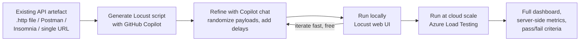

# 09 — VS Code Extension

> **Section goal:** Show that a developer never has to leave their editor — write a test, run it locally against localhost, then run the *same* test at cloud scale. This closes the "we don't have a performance testing team / we don't know JMeter" objection completely.

**Duration:** 10 minutes (combined with doc 10) · **Format:** Live in VS Code · **Audience:** Developers

---

## 9.1 What the extension is

The **Azure Load Testing extension for Visual Studio Code** brings test authoring, local iteration and cloud-scale execution into the editor. It is oriented around **Locust** (Python) test scripts, and it uses **GitHub Copilot** to generate them.

- **Install:** <https://aka.ms/malt-vscode/get>
- **Prerequisites:**
  - Python (for local runs)
  - Locust (`pip install locust`)
  - GitHub Copilot (for AI-assisted script generation)
  - An Azure account with a Load Testing resource (for cloud-scale runs)

> ⚠️ **Verify before the session.** Extension packaging and marketplace identifiers move around, and some load-testing capability also surfaces via the **GitHub Copilot for Azure** extension. Install from the `aka.ms` link above and confirm the commands below appear in your command palette during rehearsal.

---

## 9.2 The core loop to demonstrate



**The message:** *"Iterate locally for free until the script is right. Then run the identical script at 10,000 users in the cloud with one command."*

---

## 9.3 Demo script

### Step 0 — Open the walkthrough (10 seconds, high impact)
Command palette (`Ctrl+Shift+P`) → **`Load Testing: Open Walkthrough`**.
Point out that Microsoft ships a guided onboarding — *"a developer who has never load tested anything is productive in about ten minutes."*

### Step 1 — Generate a test from something the team already has
This is the killer feature. The extension can create a Locust script from:
- a **`.http` file** (REST Client format — most .NET/VS Code teams already have these)
- a **Postman collection** (almost every bank's API team has these)
- an **Insomnia collection**
- a **single endpoint URL**

Demo with the repo's [`../src/contoso-bank.http`](../src/contoso-bank.http), which contains the real banking journey:
```
GET  {{baseUrl}}/api/accounts/{{accountId}}/balance
GET  {{baseUrl}}/api/accounts/{{accountId}}/transactions
POST {{baseUrl}}/api/transfers
GET  {{baseUrl}}/api/statements/{{accountId}}
```

Command palette → **`Load Testing: Create Locust test`** → choose the `.http` file.
Copilot generates a `locustfile.py` with the requests **sequenced as a user journey**, not just four unrelated calls.

> **Say out loud:** *"Your API team already maintains Postman collections for functional testing. That existing artefact just became a load test. Nobody wrote a line of JMeter XML."*

### Step 2 — Refine it with Copilot chat
Show 2–3 refinements live, asking in natural language:
- *"Randomize the request payloads so each virtual user transfers a different amount between different accounts."*
- *"Add realistic think time of 1–3 seconds between requests."*
- *"Add a debug mode that logs response bodies when an environment variable is set."*
- *"Weight the tasks so balance checks happen 10× more often than transfers."*

Apply the changes in-editor. Show the diff.

> **Say out loud:** *"That last one matters. Realistic traffic mix is the difference between a load test and a denial-of-service attack on your own API. Getting the mix right used to be the slow part."*

### Step 3 — Run it locally
Command palette → **`Load Testing: Run load test (local)`**.
The **Locust web UI** opens in the browser. Start a run with a handful of users against `localhost` or the deployed dev instance.

Points to make:
- Instant feedback loop — seconds, not minutes.
- **Zero Azure cost** while you're debugging the script.
- You're validating *the script*, not the app's capacity. Local machines can't generate meaningful load — and that's exactly the point of the next step.

### Step 4 — Run the same script at cloud scale
Command palette → **`Load Testing: Run load test (Azure Load Testing)`**.
Select the subscription and Load Testing resource. The same `locustfile.py` now runs on managed engines at full scale.

> **Say out loud:** *"Same file. Same script. On my laptop it was 5 users. In Azure it's 5,000, from managed infrastructure, with server-side metrics correlated. That transition is the whole product in one sentence."*

### Step 5 — Land back in the portal
Follow the link to the run in the portal and connect it to what you showed in docs 06/07 — the dashboard, App Components, criteria, AI insights.

---

## 9.4 Commands cheat sheet

| Command | Purpose |
|---|---|
| `Load Testing: Open Walkthrough` | Guided onboarding |
| `Load Testing: Create Locust test` | Generate a script from `.http` / Postman / Insomnia / URL |
| `Load Testing: Run load test (local)` | Run locally via the Locust web UI |
| `Load Testing: Run load test (Azure Load Testing)` | Run at cloud scale on managed engines |

**Copilot model note:** the VS Code Copilot Chat model picker applies; the docs recommend a GPT-4o-class model for script generation. Pick your model before the demo so you're not fiddling with dropdowns live.

---

## 9.5 Why this section matters commercially

Tie it back to the objections from doc 01 §4:

| Objection | How this section answers it |
|---|---|
| *"Our developers don't know JMeter."* | They don't need to. It's Python, and Copilot writes the first draft. |
| *"Writing load test scripts is slow."* | Generated from an artefact the team already maintains (Postman/`.http`). |
| *"Only the performance team can run tests."* | Any developer can, from their editor, before they even open a PR. |
| *"We can't iterate — every test costs money and time."* | Local Locust runs are free and instant; only the real run costs VUH. |
| *"Load testing is separate from development."* | It's now in the same editor, same repo, same PR. |

> **Positioning line:** *"Shift-left doesn't mean 'do the same slow thing earlier'. It means the developer who writes the endpoint also writes the test for it, in the same tool, in the same afternoon."*

---

## 9.6 Presenter notes & risks

- **Rehearse Copilot generation.** Output is non-deterministic — have a known-good `locustfile.py` in the repo as a fallback, and be ready to say *"here's one I generated earlier"* without embarrassment.
- **Have Python and Locust pre-installed** and verified (`locust --version`). Don't install live.
- **Pre-authenticate** VS Code to Azure and GitHub Copilot.
- **Increase editor font size** and hide the minimap.
- **Have the `.http` file open** and ready before you start.
- If corporate policy blocks Copilot for this customer, the extension still provides local run + cloud run — lead with those and treat generation as a bonus.

---

## Reference links

- [Quickstart: create and run load tests from Visual Studio Code](https://learn.microsoft.com/en-us/azure/app-testing/load-testing/quickstart-create-run-load-tests-from-visual-studio-code)
- [Extension download](https://aka.ms/malt-vscode/get)
- [Create and run a Locust-based load test](https://learn.microsoft.com/en-us/azure/app-testing/load-testing/quickstart-create-run-load-test-with-locust)
- [Locust documentation](https://docs.locust.io/)
