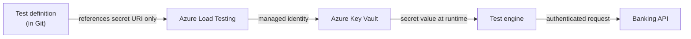

# 11 — Security, Compliance & Network Isolation (NEW SECTION)

> **Section goal:** For a regulated financial services customer, this section decides whether the service is *adoptable at all*. Everything else is a nice demo; this is the gate.
>
> **Why it's new:** your original agenda had no security section. In practice, the CISO team's questions arrive within 48 hours of the demo — via email, in writing, to someone who wasn't in the room. Far better to answer them live.

**Duration:** 15 minutes · **Format:** Slides + portal · **Audience:** Security architecture, risk, compliance, network engineering

---

## 11.1 The questions this audience will ask

Put these on a slide up front and then answer them one by one. It signals you've done this before.

1. Where is our data stored and processed?
2. Who at Microsoft can see our test scripts, our test data, our results?
3. How is data encrypted, and can we control the keys?
4. How do we test APIs that are not exposed to the internet?
5. How do we handle credentials in test scripts?
6. Who can create, run and delete tests — and can we prove it?
7. Can our load generators be given a static, allow-listable egress IP?
8. What does this do to our attack surface?
9. Can we produce evidence for an auditor or regulator?

---

## 11.2 Data residency

> **Documented position:** Azure Load Testing does not store or process customer data outside the region in which you deploy the service instance.

Why this matters and how to use it:
- Deploy the load testing resource in the **same region as the workload** (and the same as your data residency commitments).
- This is a direct, documented answer for **GDPR**, **DORA**, and jurisdiction-specific data residency requirements — as well as for internal data classification policy.
- Practical guidance: for multi-region banks, deploy **one load testing resource per data-residency boundary** rather than a single global one.
- ⚠️ Note the interaction with **multi-region load generation**: if you enable `regionalLoadTestConfig`, engines run in the additional regions you specify. Make sure that's a deliberate, approved decision.

---

## 11.3 Encryption

| Layer | What you get |
|---|---|
| **At rest — default** | All data at rest — test scripts, configuration files, secrets and environment variables — is encrypted with **Microsoft-managed keys**, automatically, with no configuration |
| **At rest — customer-managed keys (CMK)** | Optional second layer using an **RSA key in your Azure Key Vault** |
| **In transit** | HTTPS/TLS to the service; your test traffic uses whatever protocol your test script specifies (use HTTPS) |

### CMK — the constraints you must state honestly
Getting these wrong causes a failed deployment weeks later, so put them on the slide:

- CMK **can only be enabled on a new resource** — you cannot retrofit it to an existing one.
- Once enabled, CMK **cannot be disabled**.
- **Key rotation is manual** — there is no automatic rotation. Build it into your key management runbook.
- Requires a **user-assigned managed identity** with access to the key.
- The Key Vault must have **soft delete and purge protection enabled**.
- Key Vault and the load testing resource may be in **different regions/subscriptions within the same tenant**.
- **What CMK does *not* encrypt:** metrics data, including sampler/request names. Microsoft has access to this.
  - 👉 **Practical guidance to give them:** don't put sensitive values (account numbers, customer names) in JMeter sampler names or Locust request names. Name them `POST /transfers`, not `Transfer for 12345678`.
- ⚠️ Documented limitation: retrieving a CMK from a **private Key Vault with access restrictions** is not supported in the US Gov Virginia region. Check current status if that's relevant to them.

---

## 11.4 Identity and secrets — no credentials in scripts

This is a strong story; make the most of it.

- **Secrets** are stored in **Key Vault** and referenced from the test config by **secret identifier URI** (with or without version). Only the URI is in Git.
- Access is granted to the load testing resource's **managed identity** (system-assigned or user-assigned) with `Get` on secrets. Multiple user-assigned identities are supported for accessing different resources.
- In **JMeter**, retrieve with the `GetSecret` function; in **Locust**, secrets arrive as environment variables.
- **Client certificates** for **mTLS** are also supported via Key Vault — important, because mutual TLS is extremely common on banking and open-banking APIs.
- `referenceIdentities` in the YAML lets you use *different* identities for different purposes (`KeyVault`, `Metrics`, `Engine`) — good least-privilege hygiene.

### Testing secured endpoints
Azure Load Testing supports load testing endpoints protected by:
- **OAuth 2.0 / bearer tokens** (including acquiring tokens as part of the test flow)
- **Client certificates (mTLS)**
- **Managed identity**–based authentication
- API keys / shared secrets held in Key Vault

> **Say out loud:** *"At no point does a credential exist in a test script, in a repository, or in a build log. The identity that fetches it is auditable in Key Vault logs."*

---

## 11.5 Access control (RBAC)

Built-in roles — show them in the portal IAM blade:

| Role | Can do | Typical assignee |
|---|---|---|
| **Load Test Owner** | Everything, including managing access (`Microsoft.LoadTestService/*`) | Platform team lead |
| **Load Test Contributor** | Create, edit, delete and run tests and test profiles — **cannot manage access** | Performance engineers, **CI/CD service principals** |
| **Load Test Reader** | List and view tests and runs; cannot create or run | Auditors, developers, management dashboards |

Practices to recommend:
- Assign to **Entra ID groups**, never individuals.
- CI/CD gets **Load Test Contributor** — and, better, uses **OIDC federated credentials** so there is no client secret to store or rotate.
- Use **Load Test Reader** for auditors so they can inspect evidence without any ability to generate load.
- Enable **diagnostic settings** on the resource → Log Analytics / Event Hub / Storage, for a durable control-plane audit trail.
- Consider a **resource lock** to prevent deletion of a resource holding audit evidence.

---

## 11.6 Network isolation

### Option A — public endpoint (default)
Engines run in Microsoft-managed networking and call your public endpoint. Simplest; fine for public-facing sites and pre-production environments with public endpoints.

### Option B — VNet injection (the FSI answer)
Set `subnetId` and the **engine VMs are injected into your VNet subnet**, so load originates from *inside* your network:

1. **Private endpoints / internal load balancers** — test services with public access fully disabled.
2. **Firewall-restricted public endpoints** — combine with a **NAT Gateway** so engine egress uses a static IP you can allow-list on App Gateway, WAF or App Service access restrictions.
3. **On-premises systems over ExpressRoute or VPN** — the answer for core banking and mainframe-fronting services that will never be internet-facing.

Practical points, stated honestly:
- VNet injection creates an **Azure Load Balancer and public IP in your subscription**, billed to you. Set **`publicIPDisabled: true`** for a fully private configuration.
- **Size the subnet for your engine count** — a 400-engine test needs address space. Get this agreed with the network team before test week.
- The subnet needs the appropriate delegation/configuration — follow the docs when designing it.
- NSGs and route tables apply. If egress is force-tunnelled through an NVA/firewall, **the firewall must be sized for the test traffic** — otherwise you will load test your own firewall. *(This is a real and common failure mode; mention it, it earns credibility with network engineers.)*

### Option C — hybrid
Public tests in pre-production for speed, VNet-injected tests for the regulated internal services. Most customers land here.

---

## 11.7 Reducing your own attack surface — the "it's a load generator" concern

Security teams are rightly wary of a tool whose purpose is to flood a system with traffic. Address it head-on:

- **AutoStop** aborts runs that exceed an error threshold within a time window (default 90% over 60s) — a built-in circuit breaker against runaway tests.
- **Engine and concurrency quotas** cap the maximum load anyone can generate from the subscription.
- **RBAC** controls who can run tests at all.
- **Test runs are recorded** — every execution has an auditable record of who, what, when and against what.
- **Budgets and cost alerts** on the resource group provide a second, financial guardrail.
- Recommend a **written rule of engagement**: which environments may be load tested, by whom, in which change windows, and who is notified. This is standard practice and reassures operational risk teams.

---

## 11.8 Evidence and auditability

Map the service's outputs to the artefacts a regulator or internal audit will ask for:

| Audit question | Where the evidence comes from |
|---|---|
| "Show that this service was tested to its stated capacity." | Test run record + downloadable results and JMeter HTML report |
| "When was it last tested, and against which build?" | Test run history; tag runs with the commit SHA via `--description` |
| "What thresholds did you test against, and who approved them?" | The `failureCriteria` in the YAML config, versioned in Git with PR approval history |
| "Who can trigger these tests?" | RBAC assignments + Entra ID group membership |
| "Show that performance is continuously validated, not annually." | CI/CD pipeline history + run comparison trends |
| "How long do you retain results?" | Client metrics 365 days · server metrics 90 days · results and logs 6 months. **Export to your own storage if you need longer retention** — say this explicitly, as FSI retention requirements are often multi-year |

> **Recommendation to give them:** add a pipeline step that archives the results artefact to your own long-term storage (immutable blob storage with a legal hold, if the retention policy requires it). Service retention is generous but is *not* an archival system.

---

## 11.9 Compliance certifications

Azure Load Testing is an Azure service and inherits the Azure compliance programme (ISO 27001, SOC 1/2/3, PCI DSS, and regional financial services frameworks).

⚠️ **Do not quote a specific certification list from memory.** Direct the customer to the **Microsoft Trust Center / Service Trust Portal** for the authoritative, current, per-service coverage, and follow up in writing:
- <https://servicetrust.microsoft.com/>
- <https://learn.microsoft.com/en-us/azure/compliance/>

Similarly, check the current **SLA** at <https://www.microsoft.com/licensing/docs/view/Service-Level-Agreements-SLA-for-Online-Services> rather than asserting a number live.

---

## Reference links

- [What is Azure Load Testing? (data residency statement)](https://learn.microsoft.com/en-us/azure/app-testing/load-testing/overview-what-is-azure-load-testing)
- [Configure customer-managed keys](https://learn.microsoft.com/en-us/azure/app-testing/load-testing/how-to-configure-customer-managed-keys)
- [Use a managed identity](https://learn.microsoft.com/en-us/azure/app-testing/load-testing/how-to-use-a-managed-identity)
- [Assign roles (RBAC)](https://learn.microsoft.com/en-us/azure/app-testing/load-testing/how-to-assign-roles)
- [VNet injection concepts](https://learn.microsoft.com/en-us/azure/app-testing/load-testing/concept-azure-load-testing-vnet-injection)
- [Test private endpoints](https://learn.microsoft.com/en-us/azure/app-testing/load-testing/how-to-test-private-endpoint)
- [Test secured endpoints (OAuth, certificates, managed identity)](https://learn.microsoft.com/en-us/azure/app-testing/load-testing/how-to-test-secured-endpoints)
- [Parameterize load tests (secrets & certificates)](https://learn.microsoft.com/en-us/azure/app-testing/load-testing/how-to-parameterize-load-tests)
- [Microsoft Service Trust Portal](https://servicetrust.microsoft.com/)
