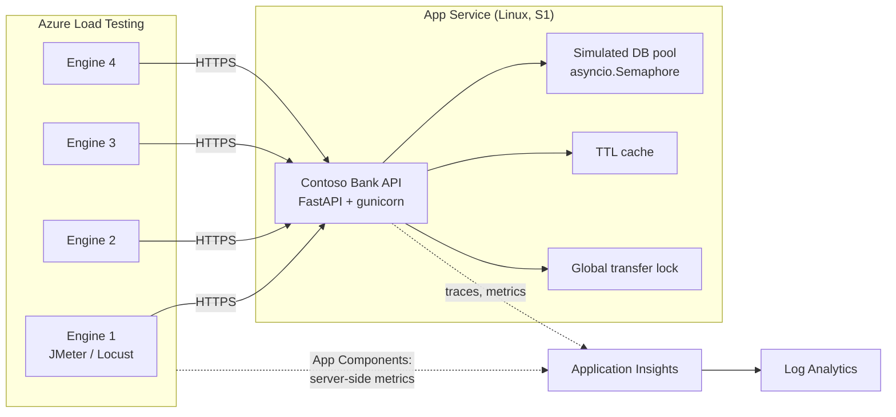

# 15. The Demo Application — Contoso Bank

> **Purpose of this section:** explain the system under test, so the audience trusts the numbers.
> **Time:** 5–8 minutes (or skip entirely and reference it — this is the section you cut when running late).
> **Audience:** engineers and architects. Business stakeholders can safely tune out.

---

## 15.1 Why we built our own app

We deliberately did **not** use an off-the-shelf sample.

| Option | Why we rejected it |
|---|---|
| eShopOnWeb / Contoso Traders | Retail, not finance. The scenarios don't resonate with a banking audience. |
| A public demo API | We don't control it, can't plant faults, and can't legally load test it. |
| The customer's own app | Ideal eventually — but not for a first session. Too many unknowns, too many ways for the demo to fail live. |

What we needed was an app where:

1. The scenarios are **recognisably banking** — balance enquiry, payments, statements.
2. We can **plant a performance defect and remove it in one HTTP call**, so the "find it → fix it → prove it" arc is repeatable and never fails in front of a customer.
3. The bottlenecks are **real** — genuine lock contention, genuine connection-pool queueing, genuine CPU burn — not `sleep()` calls pretending to be slow. If an engineer in the room opens the source, the story has to hold up.

> **Presenter note.** Say this out loud: *"The bottlenecks in this app are planted, but they are not faked. The connection pool is a real semaphore. The lock is a real lock. The CPU burn is real SHA-256. You'll recognise every one of these from your own estate."* That sentence buys you credibility for the rest of the session.

---

## 15.2 Architecture



**Stack:** Python 3.12, FastAPI, gunicorn + uvicorn workers, on Azure App Service Linux.

**Why this stack:**
- Deploys with `azd up` and **no Docker and no local build toolchain** — App Service builds it remotely with Oryx.
- Python aligns with the Locust story, which is what the VS Code extension and Copilot generate (docs 09, 10).
- Single file, ~700 lines, readable on a projector.

**Deliberately in-memory.** There is no real database. A real SQL backend would add a deployment dependency, a cost, a firewall rule, and a failure mode — for zero demo value. The connection pool is simulated with an `asyncio.Semaphore` and a latency delay, which produces *exactly* the same queueing curve as a real pool.

> **If challenged on this:** *"The queueing behaviour of a connection pool is a function of pool size and service time. I've modelled both. Little's Law doesn't care whether the 25 milliseconds is spent on a network hop or in `asyncio.sleep`."*

---

## 15.3 Endpoint catalogue

| Endpoint | Method | Banking scenario | Traffic mix | Bottleneck exposed |
|---|---|---|---|---|
| `/api/accounts/{id}/balance` | GET | Balance enquiry | 60% | 1 — no caching |
| `/api/accounts/{id}/transactions` | GET | Transaction history | 20% | 4 — N+1 queries |
| `/api/transfers` | POST | Payment / transfer | 15% | 3 — global lock, 5 — sequential fraud checks |
| `/api/transfers/{id}` | GET | Payment status | (correlated) | — |
| `/api/statements/{id}` | GET | Statement generation | 5% | 6 — CPU-bound handler |
| `/api/accounts` | GET | Account list | — | — |
| `/health`, `/ready` | GET | Probes | — | — |
| `/` | GET | HTML status page showing current mode | — | — |
| `/admin/config` | GET / POST | Read and flip bottlenecks at runtime | — | — |
| `/admin/reset` | POST | Reset counters and cache | — | — |

The 60/20/15/5 mix is not arbitrary — it approximates real retail banking traffic, where balance enquiry dwarfs everything else. Both `contoso-bank.jmx` and `locustfile.py` implement this same weighting, which is why the two flavours produce comparable results.

---

## 15.4 The six planted bottlenecks

Each one is a defect we have all shipped at some point. That is the point — they should feel familiar, not contrived.

| # | Defect | Toggle | What it teaches |
|---|---|---|---|
| 1 | **No caching on balance enquiry.** Every request performs three DB round-trips (account row, pending authorisations, ledger sum) through a small pool. | `enable_cache` | The highest-volume endpoint is where caching pays. Also shows why *read* optimisation often beats scaling out. |
| 2 | **Tiny connection pool.** A real `asyncio.Semaphore`, so pool exhaustion produces a genuine queueing knee. | `db_pool_size`, `db_query_ms` | The classic hockey-stick. Response time is flat, flat, flat, then vertical. This is the single most recognisable chart in the demo. |
| 3 | **Global lock on the write path.** One `asyncio.Lock` serialises every transfer in the process. | `enable_transfer_lock` | Throughput stops scaling with users no matter how much hardware you add. Amdahl's Law, live. |
| 4 | **N+1 queries.** One query for the list, then one per row. | `enable_n_plus_one` | Invisible at one user, catastrophic at a thousand. The defect functional testing *cannot* catch. |
| 5 | **Sequential third-party checks.** Fraud, sanctions and limit checks run one after another instead of concurrently. | `fraud_check_parallel`, `fraud_check_ms` | Latency is additive when it doesn't need to be. Highly relevant to FSI, where every payment hits several downstream services. |
| 6 | **CPU-bound statement generation.** Repeated SHA-256 — real CPU burn, not a sleep. | `statement_cpu_rounds` | Shows up as *application CPU saturation* rather than latency alone, and is the one that autoscale actually fixes. Sets up the autoscale demo in doc 13. |

Plus `error_rate_percent` for deliberate failure injection — used to demo AutoStop and error-percentage failure criteria.

### Measured effect

Validated locally with `tools/validate_bottlenecks.py` (single worker, so absolute numbers are modest — the *ratios* are the point):

| Endpoint | Bottlenecked p95 | Optimized p95 | Improvement |
|---|---|---|---|
| Balance | 1844 ms | 516 ms | **3.6x** |
| Transactions | 16531 ms | 453 ms | **36.5x** |
| Transfers | 4625 ms | 812 ms | **5.7x** |
| Statements | 625 ms | 328 ms | **1.9x** |

> **Presenter note.** Run this harness during your dry run and screenshot the output. If the Azure environment misbehaves on the day, this table is your fallback proof.

---

## 15.5 The admin API — how the demo stays repeatable

This is the mechanism that makes the whole session work. Two HTTP calls flip the app between "before" and "after".

**Check current state:**
```bash
curl https://$API_HOSTNAME/admin/config
```

**Flip to the broken state (start here):**
```bash
curl -X POST https://$API_HOSTNAME/admin/config \
  -H "Content-Type: application/json" \
  -d '{"preset":"bottlenecked"}'
```

**Flip to the fixed state (the reveal):**
```bash
curl -X POST https://$API_HOSTNAME/admin/config \
  -H "Content-Type: application/json" \
  -d '{"preset":"optimized"}'
```

**Tune one knob individually** (useful for questions — "what if the pool were 8 instead of 2?"):
```bash
curl -X POST https://$API_HOSTNAME/admin/config \
  -H "Content-Type: application/json" \
  -d '{"db_pool_size": 8, "enable_cache": true}'
```

The `/` root page renders the current mode in large text — **put it on a second screen**. When you flip the preset, the audience sees `BOTTLENECKED` become `OPTIMIZED`. It removes any suspicion that you swapped environments.

> **Obvious but essential:** an unauthenticated admin endpoint that degrades the app is a demo device, not a pattern. Say so before an FSI security architect says it for you. In the repo it is guarded only by obscurity; in anything real it would be an authenticated, RBAC-controlled feature flag.

### Preset values

| Setting | `bottlenecked` | `optimized` |
|---|---|---|
| `enable_cache` | `false` | `true` |
| `db_pool_size` | `2` | `64` |
| `db_query_ms` | `25` | `25` |
| `enable_transfer_lock` | `true` | `false` |
| `enable_n_plus_one` | `true` | `false` |
| `fraud_check_parallel` | `false` | `true` |
| `statement_cpu_rounds` | `30000` | `1500` |

Note `db_query_ms` is **identical** in both. The fix is caching and pool sizing — not pretending the database got faster. Keep it honest.

---

## 15.6 Deploying it

```bash
azd auth login
azd up
```

That single command provisions Log Analytics, Application Insights, the App Service plan, the API, the Azure Load Testing resource, and the Monitoring Reader role assignment — then deploys the app. Roughly 5–8 minutes.

Outputs you'll need are written to the azd environment:

| Output | Used by |
|---|---|
| `SERVICE_API_HOSTNAME` | `BASE_URL` in the load test configs |
| `LOAD_TEST_NAME` | `az load` commands, CI/CD variables |
| `AZURE_RESOURCE_GROUP` | `az load` commands, CI/CD variables |
| `APPLICATIONINSIGHTS_RESOURCE_ID` | App Components |
| `SERVICE_API_RESOURCE_ID` | App Components |

Then confirm it's alive and in the right state:

```bash
curl https://$SERVICE_API_HOSTNAME/health
curl https://$SERVICE_API_HOSTNAME/admin/config
```

Terraform sets the app settings so a fresh deployment **starts in the bottlenecked state**. You want the demo to open with the problem, not the solution.

---

## 15.7 Local development

```powershell
cd src
python -m venv .venv
.\.venv\Scripts\pip install -r requirements-dev.txt
.\.venv\Scripts\python -m uvicorn main:app --reload --port 8000
```

Then browse to `http://127.0.0.1:8000` for the status page or `/docs` for the generated OpenAPI UI.

**Two requirements files, and why:**

| File | Contents | Used by |
|---|---|---|
| `requirements.txt` | Full set, including `uvicorn[standard]`-equivalents and `azure-monitor-opentelemetry` | Azure deployment (Linux x86_64) |
| `requirements-dev.txt` | Minimal subset | Local development |

This split exists because several transitive dependencies (`cryptography`, `httptools`, `geventhttpclient`, `brotli`) have **no prebuilt wheels for Windows ARM64** and need MSVC build tools to compile. They install without complaint on the Azure Load Testing engines and on App Service, both of which are Linux x86_64. If you're presenting from an ARM laptop, this will bite you — hence the split.

`locust` is in the same category: it will not `pip install` on Windows ARM64 without build tools. Run Locust in Azure, or from an x64 machine or WSL.

---

## 15.8 Mapping the app to the session

| Demo moment | Endpoint | Bottleneck | Doc |
|---|---|---|---|
| "Let's just point it at a URL" | `/health`, `/api/accounts/{id}/balance` | — | 06 |
| The queueing knee | `/api/accounts/{id}/balance` | 1, 2 | 06, 07 |
| "Functional tests would never catch this" | `/api/accounts/{id}/transactions` | 4 | 07 |
| Throughput won't scale with users | `/api/transfers` | 3 | 07 |
| Downstream latency is additive | `/api/transfers` | 5 | 07, 13 |
| CPU saturation → autoscale proof | `/api/statements/{id}` | 6 | 13 |
| AutoStop / error criteria | any, with `error_rate_percent` | — | 04, 06 |
| Copilot generates the script | `contoso-bank.http` | — | 10 |

---

## 15.9 Repo map

```
azure-load-test/
├── azure.yaml                       # azd configuration
├── infra/
│   ├── main.tf                      # Terraform stack used by azd provision
│   ├── variables.tf
│   ├── outputs.tf                   # azd environment outputs for hooks/CI
│   └── providers.tf
├── src/
│   ├── main.py                      # the Contoso Bank API
│   ├── contoso-bank.http            # REST Client collection (Copilot source)
│   ├── requirements.txt             # Azure deploy
│   └── requirements-dev.txt         # local (ARM64-safe)
├── loadtests/
│   ├── jmeter/contoso-bank.jmx      # JMX flavour
│   ├── jmeter/user.properties
│   ├── locust/locustfile.py         # Locust flavour
│   ├── locust/locust.conf
│   ├── data/accounts.csv            # test data, split across engines
│   ├── config/pr-gate.yaml          # small, fast, every PR
│   ├── config/peak-load.yaml        # 1,000 VUs, nightly
│   ├── config/peak-load-locust.yaml
│   ├── config/secrets-demo.yaml
│   ├── config/url-basic.yaml
│   ├── config/url-smoke.yaml
│   ├── config/url-curl.yaml
│   ├── config/url-false-green.yaml
│   └── url-tests/contoso-bank-smoke.json
├── tools/
│   └── validate_bottlenecks.py      # proves the bottlenecks actually bite
├── .github/workflows/load-test.yml  # OIDC, PR gate + nightly
└── docs/                            # this documentation set
```

---

## 15.10 Known limitations — say these before you're asked

- **In-memory state.** Restarting the app resets balances and transfers. Irrelevant for load testing; worth stating so nobody thinks we're testing durability.
- **Unauthenticated admin endpoint.** A demo device. Covered in 15.5.
- **Single worker by default.** Deliberate — multiple workers multiply the connection pool and dilute the bottleneck. The `db_pool_size` is per process, so effective pool = workers × `db_pool_size`. Scale out **on camera** when you want to make that point.
- **Simulated database.** Covered in 15.2.
- **Absolute numbers differ between local and App Service.** Always do a dry run against the deployed app and re-baseline your failure criteria before the customer session.

---

## References

- [`../src/main.py`](../src/main.py) — the application
- [`../tools/validate_bottlenecks.py`](../tools/validate_bottlenecks.py) — bottleneck proof harness
- [Doc 06 — Create, run and inspect a test](./06-demo-create-run-inspect.md)
- [Doc 07 — Analysing results and finding bottlenecks](./07-analyzing-results-and-bottlenecks.md)
- [Doc 13 — Advanced scenarios](./13-advanced-scenarios.md)
- [Quickstart: deploy with azd](https://learn.microsoft.com/azure/developer/azure-developer-cli/get-started)
