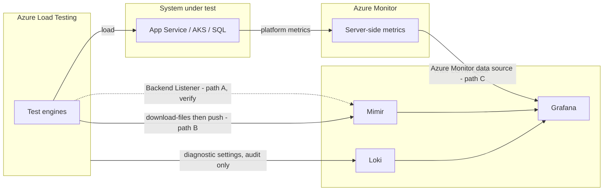

# 17 — Operating Without the Portal: CLI, Results Export & LGTM Integration (NEW SECTION)

> **Section goal:** Show that Azure Load Testing is fully operable **without ever opening the Azure Portal**, and that its results can be surfaced in the customer's own Grafana/LGTM stack rather than in a Microsoft-hosted dashboard.
>
> **Why this section exists:** it was raised directly in review — *"in higher environments Azure Portal interactions won't be permitted"* and *"result inspection without portal access is also an interesting aspect"*. For a regulated financial institution this is not a nice-to-have; if the answer is "you have to use the portal", the product fails their operating model.

**Duration:** 20 minutes · **Format:** Live terminal + slides · **Audience:** Platform engineering, SRE, security

---

## 17.1 Reframing the portal

Say this early, because it defuses the objection before it's raised:

> **The portal is a learning surface, not an operating surface.**

| Environment | Portal | How work actually gets done |
|---|---|---|
| **Sandbox / dev** | ✅ Allowed | Portal for exploration, URL-based tests, learning the product |
| **Test / pre-prod** | ⚠️ Read-only or none | `az load` CLI + pipeline |
| **Production-adjacent** | ❌ Not permitted | Pipeline only, with approvals |

This is a **promotion model**, not a limitation. Engineers learn in the portal and operate through code — the same pattern they already apply to every other Azure service. Everything demonstrated in the portal walkthrough (doc [`04-portal-feature-walkthrough.md`](04-portal-feature-walkthrough.md)) has a CLI equivalent, and §17.2 is that mapping.

---

## 17.2 The full lifecycle in the CLI

Install once:

```bash
az extension add --name load
az extension update --name load
```

> ⚠️ **Disclose this before they find it:** the `az load` extension is a **preview** extension. For a bank's tooling review that matters. The underlying service is GA; the CLI extension carries the preview label. Say it first — it buys credibility.

### 17.2.1 Portal action → CLI equivalent

| Portal action | CLI command |
|---|---|
| Create a test | `az load test create` |
| Upload a JMX / Locust / CSV / config | `az load test file upload` |
| Add an app component to monitor | `az load test app-component add` |
| Add a server-side metric | `az load test server-metric add` |
| Set fail / abort criteria | `az load test create --load-test-config-file` (YAML) |
| Run a test | `az load test-run create` |
| Watch a run | `az load test-run show` |
| Stop a run | `az load test-run stop` |
| Download results / logs | `az load test-run download-files` |
| Read metrics | `az load test-run metrics list` |
| Compare runs | `az load test-run list` + local diff |

**The point to land:** there is no portal-only capability in the core workflow. Everything is scriptable.

### 17.2.2 A complete portal-free run

This is the sequence to run live in a terminal. It is the whole demo, without a browser.

```bash
RG=rg-loadtest-demo
LT=alt-contoso-demo
TEST_ID=contoso-bank-peak

# 1. Create/update the test definition from version-controlled YAML
az load test create \
  --load-test-resource $LT --resource-group $RG \
  --test-id $TEST_ID \
  --load-test-config-file loadtests/config/peak-load.yaml

# 2. Kick off a run
RUN_ID="run-$(date +%Y%m%d-%H%M%S)"
az load test-run create \
  --load-test-resource $LT --resource-group $RG \
  --test-id $TEST_ID --test-run-id $RUN_ID

# 3. Read BOTH outcome fields - see doc 07 for why one is not enough
az load test-run show \
  --load-test-resource $LT --resource-group $RG \
  --test-run-id $RUN_ID \
  --query "{status:status, result:testResult, reason:description}" -o table

# 4. Pull the evidence down
az load test-run download-files \
  --load-test-resource $LT --resource-group $RG \
  --test-run-id $RUN_ID \
  --path ./results --result --log --report
```

> **Demo tip:** run step 3 in a `watch`-style loop so the audience sees `PROVISIONING → CONFIGURING → EXECUTING → DONE` tick past. It makes the state machine from §7.2 concrete instead of theoretical.

> **The same four steps, one command:** [`tools/run_loadtest.sh`](../tools/run_loadtest.sh) (and [`tools/run_loadtest.ps1`](../tools/run_loadtest.ps1)) does exactly this sequence — start, poll, read both outcome fields, derive the verdict from the criteria, optionally `--download` the evidence — and exits non-zero on a breach, so it drops straight into a non-Azure scheduler or a cron job. Keep the raw commands above for the session; use the runner for real operations.

### 17.2.3 Gating on the result, not the status

The single most important line in this whole section:

```bash
RESULT=$(az load test-run show ... --query testResult -o tsv)
STATUS=$(az load test-run show ... --query status -o tsv)

if [ "$STATUS" != "DONE" ]; then
  echo "::error::Run did not complete (status=$STATUS). No performance conclusion available."
  exit 1
fi
if [ "$RESULT" = "NOT_APPLICABLE" ]; then
  echo "::error::No fail criteria defined - this run proves nothing. Refusing to pass."
  exit 1
fi
if [ "$RESULT" != "PASSED" ]; then
  echo "::error::Fail criteria breached."
  exit 1
fi
```

Three distinct failure modes, three distinct messages. Most teams write `if result != PASSED` and silently accept `NOT_APPLICABLE`.

---

## 17.3 Getting results into their own Grafana / LGTM stack

This is the part that needs **honesty about what does and doesn't work**, because the intuitive answer is wrong.

### 17.3.1 The thing everyone assumes — and why it's wrong

> ❌ **Azure Load Testing does *not* publish client-side metrics (RPS, response time percentiles, error rate) to Azure Monitor.**

So pointing Grafana's Azure Monitor data source at the load test resource will **not** give you your test results. Get this wrong in front of the customer and the whole section collapses.

What the ALT resource *does* emit:

| Emission | Contains | Useful for dashboards? |
|---|---|---|
| **Diagnostic settings → Log Analytics / Event Hub / Storage** | `OperationLogs` only — who created/ran/deleted a test | ✅ **Audit and governance**, ❌ not performance |
| **Azure Monitor metrics for the ALT resource** | Not a source of test result data | ❌ |

The audit angle is still worth a slide for an FSI audience — *"every test run is an auditable operation with an immutable log record"* — just don't oversell it as observability.

### 17.3.2 The four real paths, ranked

| # | Path | Fidelity | Effort | Confidence |
|---|---|---|---|---|
| **A** | **JMeter Backend Listener → their metrics store → Grafana** | Real-time, full client-side detail | Medium | ✅ Supported; InfluxDB listener confirmed in `Azure-Samples`. ⚠️ Prometheus remote-write to Mimir **unverified** |
| **B** | **`az load test-run download-files` → transform → push** | Post-run, full detail | Low | ✅ Always works. No network dependency |
| **C** | **Server-side metrics via Azure Monitor → Grafana** | Real-time, but *system under test* only | Low | ✅ Works today with zero ALT-specific work |
| **D** | **CI artefacts + JMeter HTML report** | Post-run, human-readable | Trivial | ✅ Often genuinely sufficient |

### 17.3.3 The recommendation

> **Start with C + B. Treat A as the aspiration to validate during the POC.**

- **C** gives them the server-side half of the picture in their existing Grafana **immediately** — App Service, AKS, SQL, Cosmos and Redis all publish to Azure Monitor, and the Grafana Azure Monitor data source is a solved problem in their stack. This is where bottlenecks are actually *found* (doc [`07-analyzing-results-and-bottlenecks.md`](07-analyzing-results-and-bottlenecks.md)).
- **B** gives them the client-side half **reliably**, as a pipeline step. Post-run rather than live, but complete and dependency-free.
- **A** is the only way to get live client-side charts in *their* Grafana. Worth doing, but scope it as a spike rather than promising it on a slide.

Together C + B cover the full "what did the user see / what was the server doing" picture without a single portal login.

### 17.3.4 Two ALT-specific gotchas — this is the value of the section

Their LGTM adoption is a big topic in its own right, and they explicitly want to lean on their own documentation for it. So spend the time on the things **only** an Azure Load Testing specialist would tell them:

> **1. VNet injection is not just for testing private applications.**
>
> If the LGTM stack is on a private network — which for a bank it certainly is — the **test engines need a network path to it**. That means deploying the engines into a VNet (`subnetId`), exactly as you would to test a private API. Most people only think of VNet injection as inbound-to-the-app; here it's outbound-to-observability. This has cost implications too (load balancer + public IP — see doc [`12-pricing-and-cost-governance.md`](12-pricing-and-cost-governance.md)) and needs firewall rules agreed **before** the POC.

> **2. Locust has no Backend Listener equivalent.**
>
> The real-time streaming path (A) is a **JMeter capability**. If live streaming into Grafana is a hard requirement, that is a genuine input into the JMeter-vs-Locust decision in doc [`06-demo-create-run-inspect.md`](06-demo-create-run-inspect.md). Locust can emit from event hooks, but it's custom code you own, not a supported plugin. Flag it as a trade-off rather than a blocker.

### 17.3.5 What a joined-up view looks like



---

## 17.4 What to demo live

Keep it to three moves — this section is about proving a capability, not exhausting it.

1. **The whole test, in a terminal.** Run §17.2.2 end to end. No browser at any point. *"Everything you just saw me do in the portal, done from a pipeline agent in a locked-down subscription."*
2. **The three-way gate.** Show the §17.2.3 script rejecting a `NOT_APPLICABLE` run. Pairs directly with the false-green demo in doc [`06-demo-create-run-inspect.md`](06-demo-create-run-inspect.md).
3. **Server-side metrics in Grafana.** If a Grafana instance is available, show the Azure Monitor data source rendering the demo app's CPU and connection-pool metrics during a run. If not, show the App Components view and say *"this is the data; path C puts it in your Grafana."*

---

## 17.5 Questions to settle before the POC

Put these on a slide. Asking them is more impressive than guessing.

| Question | Why it matters |
|---|---|
| Is your Grafana reachable from an Azure VNet? | Determines whether path A needs VNet injection, firewall rules and a change request |
| Does Mimir accept Prometheus remote-write from outside the cluster? | The unverified link in path A |
| Do you already run an InfluxDB or an OTel collector? | The confirmed Backend Listener target is InfluxDB; a collector can bridge to Mimir |
| Is `az` extension preview status acceptable to your tooling governance? | Could require an exception; better to know now |
| Which subscriptions permit portal access at all? | Defines where the "learning surface" lives |

---

## Reference links

- [Azure CLI `az load` reference](https://learn.microsoft.com/en-us/cli/azure/load)
- [Azure CLI `az load test-run` reference](https://learn.microsoft.com/en-us/cli/azure/load/test-run)
- [Get started with Azure Load Testing from the CLI](https://learn.microsoft.com/en-us/azure/app-testing/load-testing/quickstart-create-and-run-load-test-cli)
- [Export test results](https://learn.microsoft.com/en-us/azure/app-testing/load-testing/how-to-export-test-results)
- [Monitor server-side application metrics](https://learn.microsoft.com/en-us/azure/app-testing/load-testing/how-to-monitor-server-side-metrics)
- [Configure tests for private endpoints / VNet injection](https://learn.microsoft.com/en-us/azure/app-testing/load-testing/how-to-test-private-endpoint)
- [JMeter Backend Listener samples](https://github.com/Azure-Samples/azure-load-testing-samples/tree/main/jmeter-backend-listeners)
- [Grafana Azure Monitor data source](https://grafana.com/docs/grafana/latest/datasources/azure-monitor/)
