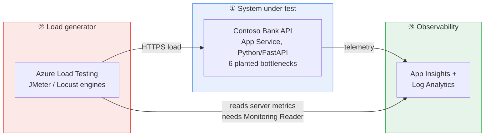

# 18 — Deploy and first run: a hands-on walkthrough

> **Who this is for:** you, the presenter, sitting in front of an empty Azure subscription with about an hour before you need this working. It takes you from `git clone` to a completed load test with a bottleneck you can point at on screen.
>
> **This is the operator's guide.** Doc [`04-portal-feature-walkthrough.md`](04-portal-feature-walkthrough.md) is the *presenter's* portal tour for the customer session. This doc is how you get there the first time.

**Time:** ~45–60 minutes end to end, most of it waiting on deployments · **Cost:** ~$5–15 for a day of demoing (see §18.9)

---

## ⚠️ Verification status — read this first

The commands in this document were written by reading the repo's Terraform, `azure.yaml`, app code and test configs, and they are internally consistent with them. Rehearse them against the live subscription before presenting.

Treat this as a **carefully-derived runbook, not a transcript.** Budget an hour for your first run and expect to hit one or two environment-specific snags. Every step below has a "how you know it worked" check so you find problems immediately rather than three steps later.

> **The fastest way to close this gap is [§18.5a](#185a-validate-everything-at-once--e2e-testps1).** `tools/e2e-test.ps1` turns this runbook into an executable check — it verifies every claim in this document against your live deployment and prints a pass/fail table. Run `-SkipLoadTests` first; it takes five minutes and costs nothing.

§18.10 lists the specific things most likely to need adjusting.

### What *was* verified by inspection

These are the wiring mistakes that fail silently — the test runs, produces numbers, and the numbers are meaningless. All four were checked against the actual files:

| Check | Why it matters | Result |
|---|---|---|
| `azure.yaml` service key `api` ↔ `azd-service-name: api` tag in `infra/main.tf` | A mismatch makes `azd deploy` fail with "no matching resource" | ✅ match |
| JMX sampler names ↔ per-sampler `failureCriteria` in `peak-load.yaml` | A typo means the criterion **never evaluates** and the test always passes | ✅ all four match (`GetBalance`, `GetTransactions`, `CreateTransfer`, `GenerateStatement`) |
| `accounts.csv` header ↔ JMX `variableNames` | A mismatch sends literal `${accountId}` in the URL — every request 404s | ✅ match, `ignoreFirstLine=true` correct |
| `gunicorn`/`uvicorn` present; bind port ↔ Oryx default | Wrong port = container never becomes healthy | ✅ both present, port 8000 correct |

**One real bug was found and fixed during this pass.** The JMX had the `BASE_URL` lookup inlined directly into `HTTPSampler.domain`:

```xml
<stringProp name="HTTPSampler.domain">${__BeanShell(System.getenv("BASE_URL"))}</stringProp>
```

That re-invokes the BeanShell interpreter **on every request, for every virtual user**. At 1,000 VUs it would burn engine CPU on script interpretation and you'd end up measuring your load generator rather than the app. It now follows the [documented Microsoft pattern](https://learn.microsoft.com/azure/app-testing/load-testing/how-to-parameterize-load-tests) — resolved once into a User Defined Variable at test-plan start, then referenced cheaply:

```xml
<stringProp name="HTTPSampler.domain">${udv_baseUrl}</stringProp>
```

> Worth keeping in your pocket as a talking point: *"a load test only tells you the truth if the load generator isn't the bottleneck."*

---

## 18.1 The 5-minute mental model

Before touching a terminal, understand the shape of the thing. There are **three moving parts**, and almost every problem you hit is one of them not knowing about another.



| # | Part | What it is | Created by |
|---|---|---|---|
| ① | **System under test** | A deliberately slow banking API. Its defects are togglable at runtime over HTTP — no redeploy needed to fix them on camera. | `azd up` |
| ② | **Load generator** | The Azure Load Testing resource. Runs your JMeter/Locust script on managed engines. | `azd up` |
| ③ | **Observability** | App Insights + Log Analytics. Turns "it's slow" into "it's slow *because*". | `azd up` |

**The single most important arrow** is the dotted one from ② to ③. Azure Load Testing reads your app's server-side metrics through its managed identity. Without the **Monitoring Reader** role assignment, the metrics charts render **empty, with no error message telling you why**. Terraform does this for you in `infra/main.tf` — but it is why so many first-time demos fall flat.

### The demo arc this all exists to support

1. Run a load test against the app in `bottlenecked` mode → **it fails its SLOs**
2. Use the server-side metrics to show **why** (CPU pegged, thread pool starved)
3. Flip the app to `optimized` mode with **one HTTP call** — no redeploy
4. Run the same test again → **it passes**
5. Use **Compare** in the portal to put both runs on one chart

That arc is the demo. Everything in this repo exists to make it repeatable.

---

## 18.2 Repo tour — what is where and why

```
azure-load-test/
├── azure.yaml                 ← azd entry point. Maps ./src to App Service.
├── infra/
│   ├── main.tf                ← Terraform stack used by azd provision
│   ├── variables.tf
│   ├── outputs.tf             ← uppercase azd outputs for hooks and CI
│   └── providers.tf
├── src/
│   ├── main.py                ← the API. 6 bottlenecks + /admin/config to flip them.
│   └── requirements.txt
├── loadtests/
│   ├── config/
│   │   ├── pr-gate.yaml       ← 25 VUs, 3 min, 1 engine. Runs on every PR.
│   │   ├── peak-load.yaml     ← 1,000 VUs, 15 min. THE DEMO TEST.
│   │   ├── peak-load-locust.yaml
│   │   ├── secrets-demo.yaml   ← Key Vault secret resolution via managed identity
│   │   ├── url-basic.yaml
│   │   ├── url-smoke.yaml
│   │   ├── url-curl.yaml
│   │   └── url-false-green.yaml
│   ├── jmeter/contoso-bank.jmx
│   ├── locust/locustfile.py
│   ├── data/accounts.csv      ← split across engines at run time
│   └── url-tests/             ← no-script quick start
├── tools/
│   ├── provision_loadtests.*  ← azd post-deploy hook: retarget + create tests
│   ├── e2e-test.ps1          ← no-VUH and full rehearsal validation
│   ├── set_target_host.py     ← manual repair helper for the same retargeting
│   ├── vuh_calculator.py      ← cost estimates with the customer's rate card
│   └── validate_bottlenecks.py
├── .github/workflows/load-test.yml
└── docs/                      ← the session material (00 is the runbook)
```

### The four files actually worth reading before you present

| File | Why | Read time |
|---|---|---|
| `src/main.py` §PRESETS (~line 120) | The two states the whole demo pivots between | 1 min |
| `infra/main.tf` App Service block | Three deliberate choices with comments explaining each | 3 min |
| `loadtests/config/peak-load.yaml` | The test you'll actually run, incl. fail + abort criteria | 3 min |
| `infra/main.tf` role assignments | The Monitoring Reader and Key Vault RBAC wiring everyone forgets | 1 min |

### The six planted bottlenecks

All live in `src/main.py` and are flipped at runtime via `POST /admin/config`:

| Setting | `bottlenecked` | `optimized` | Symptom it creates |
|---|---|---|---|
| `enable_cache` | `false` | `true` | Every read hits the "database" |
| `db_pool_size` | `2` | `64` | Connection queueing under concurrency |
| `enable_transfer_lock` | `true` | `false` | Global lock serialises all writes |
| `enable_n_plus_one` | `true` | `false` | Classic N+1 on transaction history |
| `fraud_check_parallel` | `false` | `true` | Sequential downstream calls |
| `statement_cpu_rounds` | `30000` | `1500` | CPU burn on the reporting endpoint |

> **Note the naming.** The HTTP API uses **snake_case** (`enable_cache`). The App Service settings in Terraform use **UPPER_SNAKE** (`ENABLE_CACHE`). Sending camelCase to the API returns a `422`.

---

## 18.3 Prerequisites

```powershell
# Check what you have. Python is optional for the azd hook, but useful for tools/.
az version
azd version
python --version    # optional: 3.10+ for the helper scripts
```

| Tool | Install if missing |
|---|---|
| Azure CLI | `winget install Microsoft.AzureCLI` |
| Azure Developer CLI | `winget install Microsoft.Azd` |
| `az load` extension | The hook installs it if missing; install manually when using CLI snippets |
| Python 3.10+ | `winget install Python.Python.3.12` if you want the Python helper tools |

You also need, in the target subscription:

- **Contributor** — to create the resources
- **User Access Administrator** or **Owner** — because Terraform creates role assignments. **Plain Contributor is not enough and this is a common first-run failure.** See §18.10.
- A region where Azure Load Testing is available (`az provider show -n Microsoft.LoadTestService --query "resourceTypes[?resourceType=='loadTests'].locations" -o tsv`)

```powershell
az login
azd auth login
az account set --subscription "<your-subscription-id>"
az account show --output table    # confirm you're in the right place
```

---

## 18.4 Deploy — `azd up`

```powershell
cd C:\dev\azure-load-test
azd up
```

You'll be prompted for three things:

| Prompt | Suggested answer | Why it matters |
|---|---|---|
| Environment name | `contosobank` | Becomes `rg-contosobank`. Keep it short — it's capped at 24 chars and feeds resource names. |
| Subscription | your demo subscription | |
| Location | `uksouth`, `eastus`, `westeurope` | **Must** support Azure Load Testing. |

### What it does, in order

1. Provisions Log Analytics + Application Insights
2. Provisions an **S1** Linux App Service plan (S1 not B1 — Basic can't autoscale, which doc 13 needs) with **one worker** (deliberate: more workers would hide the bottleneck)
3. Provisions the Azure Load Testing resource with a system-assigned identity
4. Assigns **Monitoring Reader** to that identity over the resource group
5. Zips `./src`, uploads it, and **App Service builds it remotely with Oryx** — no local Python or Docker needed
6. Runs a **post-deploy hook** that retargets the load-test artefacts and creates/updates every YAML test definition. Post-deploy matters: the tests point at the deployed app hostname, so creating them before the app is live is the wrong lifecycle point.

**Expect 8–12 minutes.** Most of it is the App Service plan and the remote build.

### Expected output

```
  (✓) Done: Resource group: rg-contosobank
  (✓) Done: Log Analytics workspace: log-contosobank-a1b2c3
  (✓) Done: Application Insights: appi-contosobank-a1b2c3
  (✓) Done: App Service plan: plan-contosobank-a1b2c3
  (✓) Done: App Service: app-contosobank-a1b2c3
  (✓) Done: Load Testing: alt-contosobank-a1b2c3

Deploying service api
  (✓) Done: Deploying service api
  - Endpoint: https://app-contosobank-a1b2c3.azurewebsites.net/

SUCCESS: Your up workflow to provision and deploy to Azure completed in 9 minutes.
```

### ✅ How you know it worked

```powershell
azd env get-values
```

You should see `SERVICE_API_URI`, `LOAD_TEST_NAME`, `AZURE_RESOURCE_GROUP` and friends. Then:

```powershell
$api = (azd env get-values | Select-String 'SERVICE_API_URI').ToString().Split('=')[1].Trim('"')
curl "$api/health"
```

Expect `{"status":"healthy", ...}`.

> **First request may take 30–60 seconds** while the container starts. If it times out, wait and retry once before assuming failure. `alwaysOn` is enabled, so this is a one-time cost.

Confirm the app starts in the *bottlenecked* state — this is what you want, because the demo opens on the problem:

```powershell
curl "$api/admin/config"
```

Look for `"enable_cache": false` and `"db_pool_size": 2`.

---

## 18.5 Retarget and create the load tests — now automatic

The test configs ship with a placeholder hostname, `contoso-bank-api.azurewebsites.net`. Your app has a generated name. If the artefacts are not retargeted the test runs happily and **every single request fails**, and the results dashboard won't tell you the hostname is wrong.

```powershell
pwsh -File tools\provision_loadtests.ps1
```

You normally do **not** run this yourself: `azd up` invokes it as a `postdeploy` hook, after the app is deployed. It installs the `az load` extension if needed, retargets the artefacts, creates or updates every `loadtests/config/*.yaml` definition, and then prints a validation table. It does **not** start a run.

The hook prefers the existing Python helper when Python is present:

```
Retargeting: contoso-bank-api.azurewebsites.net -> app-contosobank-a1b2c3.azurewebsites.net

  ->  loadtests/config/pr-gate.yaml  (1 occurrence updated)
  ->  loadtests/config/peak-load.yaml  (1 occurrence updated)
  ->  loadtests/config/peak-load-locust.yaml  (2 occurrences updated)
  ->  loadtests/locust/locust.conf  (1 occurrence updated)
  ->  loadtests/url-tests/contoso-bank-smoke.json  (5 occurrences updated)

Rewrote 10 occurrence(s) across 5 file(s).
```

If Python is not installed, the hook uses a native PowerShell/POSIX fallback so the `azure.yaml` promise still holds: no local Python toolchain is required for `azd up`. The standalone `python tools\set_target_host.py --from-azd --dry-run` command remains useful when you want to see just the retargeting change, and `--reset` restores the placeholder before committing.

---

## 18.5a Validate everything at once — `e2e-test.ps1`

Before you rely on any of this in front of a customer, run the end-to-end suite. It exercises the whole kit in dependency order and prints a pass/fail table, so anything broken surfaces now rather than on camera.

```powershell
pwsh -File tools\e2e-test.ps1 -SkipLoadTests
```

Requires **PowerShell 7+** (the script checks and exits with an install hint if not). Run it from the repo root after `azd up`; phase 0 refuses to continue if the configs are still on the placeholder host.

### What each phase proves

| Phase | Checks | Why it matters |
|---|---|---|
| 0 Preflight | `az`/`azd` present, `load` extension, login, azd outputs, **configs retargeted** | Catches the §18.5 mistake before spending anything |
| 1 Infrastructure | All five resource types exist, plan has 1 worker, **Monitoring Reader assigned** | Without the role assignment the server-side charts are silently empty |
| 2 Functional smoke | Every endpoint, transfer write→read correlation, camelCase rejected with 422 | Correlation is what the JMeter JSON extractor depends on |
| 3 Bottlenecks | p95 for `bottlenecked` vs `optimized` on three endpoints | Proves the planted defects actually bite on *App Service*, not just locally |
| 4 Load tests | The four status outcomes + abort criteria | See below — this is the reviewer's question, demonstrated |
| 5 Portal-free | List runs, pull metrics, download artefacts, all via CLI | The higher-environment story from doc 17 |
| 6 Reset | Back to `bottlenecked`, error injection off | Leaves the app ready to demo |

### The three ways to run it

| Command | Time | Cost | Use when |
|---|---|---|---|
| `-SkipLoadTests` | ~5 min | ~free | After every `azd up`; fastest confidence check |
| *(no flags)* | ~35 min | ~$3 | **At least once before you present.** Uses the cheap `pr-gate` profile, which exercises identical code paths to the headline run |
| `-IncludePeakLoad` | ~60 min | ~$40 | Rehearsing the actual 1,000-VU demo run |

You can also target individual phases, e.g. `-Phase 0,1,2`.

### Phase 4 is the interesting one

It runs four load tests that deliberately produce four *different* outcomes — the distinction the reviewer asked about, demonstrated rather than described:

| Scenario | Expected | Point being made |
|---|---|---|
| Bottlenecked app, criteria set | `DONE` / `FAILED` | The useful signal — the gate caught a regression |
| Optimized app, same criteria | `DONE` / `PASSED` | A genuine pass |
| **100% errors, no criteria** | `DONE` / `NOT_APPLICABLE` | 🚨 **The false green.** Every request failed and the run still doesn't report failure |
| 60% errors, AutoStop at 20% | `CANCELLED` | Abort criteria cut the run short and stopped burning VUH |

The third row is worth pausing on in the session. It is the strongest argument for the pre-flight guard in [`.github/workflows/load-test.yml`](../.github/workflows/load-test.yml), which refuses to run any config that defines no `failureCriteria`.

> **Capture the AutoStop result.** [Doc 07 §7.9](07-analyzing-results-and-bottlenecks.md) currently records the `testResult` of an auto-stopped run as *unverified*, because it could not be confirmed from documentation alone. Phase 4d prints it. Please paste the observed value back into doc 07 §7.9 so the kit stops carrying an open question.

The script writes a full result table to `.e2e-results/summary.csv` and exits non-zero if anything failed, so it can be dropped into a pipeline later. It creates two temporary configs in `loadtests/config/` prefixed with `_`, and removes them on exit — including on Ctrl-C.

---

## 18.6 Create and run the test from the CLI

This is the path that matters for this customer, since they won't have portal access in higher environments. Doc [`17-portal-free-operations-and-observability.md`](17-portal-free-operations-and-observability.md) covers it in full.

```powershell
# Pull the names azd generated
$rg  = (azd env get-values | Select-String 'AZURE_RESOURCE_GROUP').ToString().Split('=')[1].Trim('"')
$alt = (azd env get-values | Select-String 'LOAD_TEST_NAME').ToString().Split('=')[1].Trim('"')

# 1. Create/update the test definition from YAML.
#    azd up already does this for every config file; this is the command
#    the hook runs under the covers.
#    --test-id is REQUIRED even though the YAML already declares testId.
az load test create `
  --load-test-resource $alt --resource-group $rg `
  --test-id contoso-bank-peak-load `
  --load-test-config-file loadtests/config/peak-load.yaml

# 2. Run it
az load test-run create `
  --load-test-resource $alt --resource-group $rg `
  --test-id contoso-bank-peak-load `
  --test-run-id "peak-before-$(Get-Date -Format yyyyMMdd-HHmmss)"
```

> **Start with `pr-gate.yaml` (25 VUs, 3 min, 1 engine) for your very first run**, not `peak-load.yaml` (1,000 VUs, 15 min). Prove the plumbing works before spending 250 virtual user hours discovering you had a typo in the hostname.

### Wire up App Components — this is what makes it a *diagnosis*

Without this you learn **that** it's slow. With it you learn **why**.

```powershell
$appId = (azd env get-values | Select-String 'SERVICE_API_RESOURCE_ID').ToString().Split('=')[1].Trim('"')

az load test app-component add `
  --load-test-resource $alt --resource-group $rg `
  --test-id contoso-bank-peak-load `
  --app-component-id $appId `
  --app-component-type "Microsoft.Web/sites" `
  --app-component-name "contoso-bank-api"
```

### Check the result properly — both fields

```powershell
az load test-run show `
  --load-test-resource $alt --resource-group $rg `
  --test-run-id "peak-before-..." `
  --query "{status:status, result:testResult}" -o table
```

**Read both fields.** This is the trap doc 07 §7.2 is built around:

| `status` | `testResult` | Means |
|---|---|---|
| `DONE` | `PASSED` | ✅ Genuine pass |
| `DONE` | `FAILED` | ❌ Ran fine, **failed your SLOs** — this is the useful signal |
| `DONE` | `NOT_APPLICABLE` | 🚨 **No fail criteria defined.** Looks green, tells you nothing. Requests may be failing 100%. |
| `FAILED` | — | ⚠️ Infrastructure/config error — the test never produced valid data |

`peak-load.yaml` defines `failureCriteria`, so you'll get a real `PASSED`/`FAILED`. Against the bottlenecked app, **expect `FAILED`** — that's the demo working correctly.

---

## 18.7 Portal walkthrough — click by click

Now do the same thing in the portal, both to learn the surface and to rehearse the customer tour.

### Step 1 — Find the resource
Portal → search **"Azure Load Testing"** → open `alt-contosobank-...`
(It now sits under the **Azure App Testing** umbrella alongside Playwright Workspaces.)

### Step 2 — Tests list
Left nav → **Tests**. Your CLI-created `contoso-bank-peak-load` is here — worth pointing out live: *created from YAML in a pipeline, visible in the portal, same object.*

### Step 3 — Open the run
Click the test → click the run. Land on the **dashboard**.

Walk the four panels in this order:

| Panel | What to say |
|---|---|
| **Statistics** (top) | Response time, throughput, error % — the summary the business cares about |
| **Client-side metrics** | What your *users* experienced. Switch the percentile selector to **p95/p99** and note the gap vs average — averages hide pain |
| **Server-side metrics** | What your *app* was doing. CPU, memory, HTTP queue length. **Empty here = missing Monitoring Reader** |
| **Errors** | Breakdown by sampler and response code |

### Step 4 — The bottleneck reveal
With the app bottlenecked, correlate:
- **`GenerateStatement` p95 is enormous** → CPU-bound (`statement_cpu_rounds: 30000`)
- **`CreateTransfer` throughput flatlines** as VUs climb → the global lock serialising writes
- **App Service CPU pegged near 100%** on the server-side chart → confirms it's the app, not the network

This correlation — client symptom to server cause, on one screen — **is the product demo**. Spend time here.

### Step 5 — Fail criteria
**Configure → Test criteria.** Show the criteria from the YAML rendered in the UI, and which one tripped. Tie it back: *the YAML is the source of truth, this is just a view over it.*

### Step 6 — Fix and re-run
```powershell
curl -X POST "$api/admin/config" -H "Content-Type: application/json" -d '{\"preset\":\"optimized\"}'
```
No redeploy. Re-run the same test. **Expect `PASSED`.**

### Step 7 — Compare
Tests → select **both** runs → **Compare**. Two runs, one chart, same axes.

> 🎯 **This is your closing image.** Before and after, measured, on one screen, with the code change that caused it. Don't rush to the next slide.

---

## 18.8 Recommended first-run sequence

Do this once, alone, before you present:

| # | Action | Expect | Time |
|---|---|---|---|
| 1 | `azd up` | All resources green; Tests blade populated | ~10 min |
| 2 | `curl $api/health` | `healthy` | 1 min |
| 3 | `pwsh -File tools\e2e-test.ps1 -SkipLoadTests` | All PASS | ~5 min |
| 4 | Run **`pr-gate.yaml`** | `DONE` / `FAILED` | ~8 min |
| 5 | Add app components, re-run | Server metrics populated | ~8 min |
| 6 | Flip to `optimized`, re-run | `DONE` / `PASSED` | ~8 min |
| 7 | Compare the two runs | Both on one chart | 2 min |
| 8 | Reset to `bottlenecked` | Opens on the problem | 1 min |

Steps 4–8 are what you will actually *perform* in the session, so walk them manually at least once. If you would rather have all of it checked automatically first, `pwsh -File tools\e2e-test.ps1` (no flags) does the run/compare/reset path plus the false-green and AutoStop scenarios in one pass — see [§18.5a](#185a-validate-everything-at-once--e2e-testps1).

```powershell
# Step 8 — always leave it in the "before" state
curl -X POST "$api/admin/config" -H "Content-Type: application/json" -d '{\"preset\":\"bottlenecked\"}'
```

---

## 18.9 What this costs

```powershell
python tools\vuh_calculator.py --preset all
```

Rough day-of-demo figures (verify against your own rate card — see doc 12):

| Item | Cost |
|---|---|
| S1 App Service plan | ~$0.10/hour (~$73/mo if left running) |
| Log Analytics + App Insights | pennies at demo volume |
| `pr-gate` run (25 VU × 3 min) | 1.25 raw → **4.17 billed** VUH ≈ **$0.63** |
| `peak-load` run (1,000 VU × 15 min) | 250 VUH ≈ **$37.50** |
| A rehearsal + a live session | ~**$5–15** total |

> ⚠️ **The minimum-billing rule bites on small tests.** The `pr-gate` run is 25 VU × 3 min = **1.25 raw VUH**, but bills at **4.17 VUH** — a **3.3× uplift** — because of the `max(10 min duration)` and `max(10 VU per engine)` floors. This is a genuinely useful teaching point, not just an accounting quirk: *consolidate short tests rather than running many tiny ones.*

**Turn it off between sessions** — the S1 plan bills whether or not you're demoing:

```powershell
az appservice plan update --name plan-contosobank-a1b2c3 --resource-group $rg --sku B1   # or:
azd down --purge --force    # tears everything down
```

---

## 18.10 Troubleshooting — the likely first-run snags

| Symptom | Cause | Fix |
|---|---|---|
| `azd up` fails on the role assignment | You're Contributor, not Owner/UAA. **Most likely failure.** | Get User Access Administrator, or have an admin assign Monitoring Reader and Key Vault roles manually if you temporarily remove the role-assignment resources from Terraform |
| `/health` times out on first call | Cold container start | Wait 60s, retry once. Then check **Log stream** in the portal |
| App returns 500s | Oryx build failed | Portal → App Service → **Deployment Center → Logs**, or `azd deploy --debug` |
| **Server-side metrics chart empty** | Missing Monitoring Reader, or no App Components | Verify: `az role assignment list --assignee <alt-principal-id> -o table`. See §18.6 |
| Test runs but 100% errors | **Hostname not retargeted** | Re-run §18.5. Check the Errors tab for DNS/404 |
| `az load` not recognised | Extension missing outside the hook | `az extension add --name load` |
| `testResult: NOT_APPLICABLE` | Either the config genuinely has no `failureCriteria`, **or** you read the field before the pass/fail evaluation settled | Re-query after ~10s. If it still says `NOT_APPLICABLE`, check the test definition: `az load test show ... --query passFailCriteria.passFailMetrics`. Empty means the criteria really are missing. See doc 07 §7.2 |
| Region rejects the ALT resource | Not available in that region | Pick another region and re-run `azd up` |
| Bottleneck isn't visible | App scaled out, or already `optimized` | Confirm plan capacity is 1; `GET /admin/config` |

### If `azd up` fails partway

It's idempotent — fix the cause and re-run. To inspect what ARM actually said:

```powershell
az deployment sub list --query "[0].properties.error" -o json
az deployment group list --resource-group $rg --query "[].{name:name,state:properties.provisioningState}" -o table
```

---

## 18.11 Teardown

```powershell
azd down --purge --force
```

Removes everything including the resource group. `--purge` matters if you later add Key Vault (doc 13), since soft-delete would otherwise block re-deployment under the same name.

> **Before you tear down:** `terraform destroy` and `azd down` also delete **test run history**. For a regulated customer that history may be audit evidence. Export what you need first — doc 05 §5.3.5 and doc 17 cover retention.

---

## 18.12 Where to go next

| You want to… | Go to |
|---|---|
| Present this to the customer | [`00-agenda-and-runbook.md`](00-agenda-and-runbook.md) |
| Run it all without the portal | [`17-portal-free-operations-and-observability.md`](17-portal-free-operations-and-observability.md) |
| Deploy with Terraform instead | [`05-deployment-and-operations-as-code.md`](05-deployment-and-operations-as-code.md) |
| Understand the results dashboard | [`07-analyzing-results-and-bottlenecks.md`](07-analyzing-results-and-bottlenecks.md) |
| Put it in a pipeline | [`08-cicd-integration.md`](08-cicd-integration.md) |
| Know how the app works | [`15-demo-application-contoso-bank.md`](15-demo-application-contoso-bank.md) |
