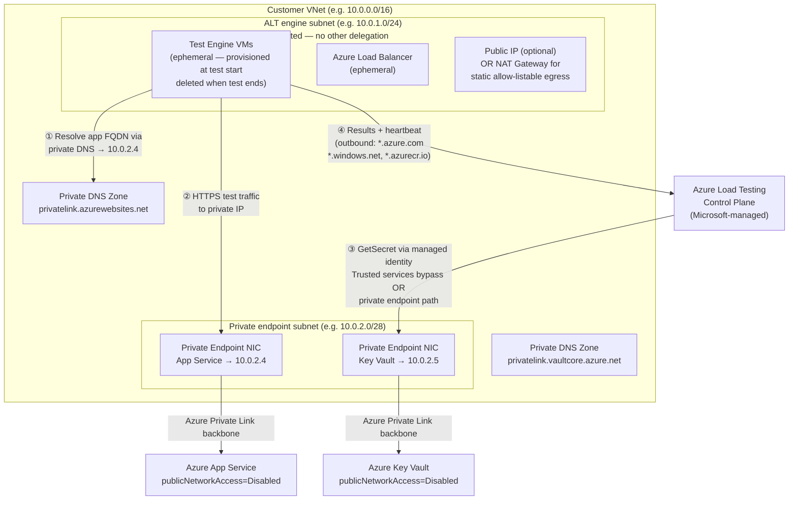

# 20 — Private Network Integration

> **Section goal:** Equip the customer's network architects and security engineers with a complete, honest picture of what Azure Load Testing's VNet injection feature does, what it costs, what it cannot do, and exactly what their network team needs to configure before day one. This doc is a leave-behind that survives the room.
>
> **Cross-references:** Doc 11 covers the security and compliance frame; this doc owns the network design detail. Doc 08 owns CI/CD pipeline mechanics; §20.8 adds a short addendum on private-network runners.

**Audience:** Network architects, security engineers, platform engineering, FinOps
**Format:** Reference document + decision table + Terraform snippets (reference-only, not wired into `infra/`)

---

## 20.1 Should we do this? — Decision table

Use this table to triage which scenario applies before committing to any network design work.

| Scenario | Target endpoint type | Recommended approach | Relative complexity | Cost delta vs. default |
|---|---|---|---|---|
| Public App Service or API with no access restrictions | Public HTTPS | **Default (no VNet)** — engines in Microsoft-managed network | None | None |
| Public endpoint with IP allow-listing (WAF, App Gateway, App Service access restrictions) | Public with IP restriction | **VNet injection + NAT Gateway** — gives engines a static, allow-listable egress IP | Low | Load Balancer + Public IP + NAT Gateway (~£30–50/month at idle; billed per-test otherwise) |
| App Service / API behind Private Link or `publicNetworkAccess=Disabled` | Private endpoint | **VNet injection** — engines reach the private IP directly | Medium | Load Balancer + Public IP (suppressible) — see §20.3 |
| Core banking API behind an internal load balancer on-premises over ExpressRoute | On-premises private | **VNet injection** peered/routed to ExpressRoute circuit | High | Existing ExpressRoute cost; ephemeral load balancer in ALT subnet |
| Key Vault with `publicNetworkAccess=Disabled` (Policy-forced) | Data-plane secret resolution | **Option A:** Enable `bypass = "AzureServices"` on KV network ACL (if Policy permits). **Option B:** VNet injection + KV private endpoint + private DNS. See §20.5. | Low (A) / Medium (B) | None (A) / Private endpoint ~£5/month (B) |
| On-premises mainframe-fronting API, no ExpressRoute or VPN | Fully isolated, no Azure connectivity | ⚠️ **Not feasible with Azure Load Testing alone** — see §20.7 | — | — |

> **The most common FSI landing zone:** Azure Policy forces `publicNetworkAccess=Disabled` on all PaaS services — App Service, Key Vault, Storage. The correct answer is VNet injection for test traffic, private endpoints for App Service and Key Vault, and private DNS zones to make name resolution work inside the VNet.

---

## 20.2 How VNet injection works

Azure Load Testing's VNet injection feature deploys the test engine VMs into a subnet you own, in your subscription. The engines then call your application endpoint from within the VNet — indistinguishable from any other workload in that subnet.

**What gets deployed ephemerally (only while the test runs):**

| Resource | Where | Who pays | Suppressible |
|---|---|---|---|
| Test engine VMs | Your subnet | Microsoft (not billed to you) | — |
| Azure Load Balancer (Standard) | Your subscription | You | No |
| Public IP address | Your subscription | You | Yes — `publicIPDisabled: true` |
| Network Security Group | Attached to subnet | You | Yes — `publicIPDisabled: true` |

**When the test ends,** all injected resources are deleted. You are charged only for the duration they existed.

> ⚠️ **Azure Policy consideration:** If your Policy blocks deployment of Public IP, Standard Load Balancer, or NSG in the VNet subscription, the test will fail at engine provisioning time with error `ALTVNET012`. The fix is either a Policy exemption for the ALT subnet resource group, or setting `publicIPDisabled: true` and providing an alternative egress path (NAT Gateway, Azure Firewall, or NVA). Both options require coordination with your Policy and network teams.

**Confirmed constraints (source: Microsoft Learn):**

- The VNet must be in the **same subscription** and **same region** as the Azure Load Testing resource.
- The `Microsoft.Batch` resource provider must be **registered** in the subscription (error ALTVNET001 if missing — `az provider register --namespace Microsoft.Batch`).
- The subnet must **not** be delegated to another Azure service (ALTVNET003). No positive delegation to ALT is needed.
- The subnet must **not** have IPv6 enabled (ALTVNET005).
- The subnet must **not** be named `AzureFirewallSubnet` (ALTVNET017).
- If a management lock exists on the resource group that contains the VNet, the test cannot start (ALTVNET015).

---

## 20.3 Reference architecture

The diagram below shows the target state for a regulated FSI landing zone: App Service behind a private endpoint, Key Vault similarly isolated, engines injected into a dedicated subnet, and private DNS zones providing name resolution.



**Flow notes:**

1. The engine resolves the App Service FQDN via the private DNS zone linked to the VNet — gets `10.0.2.4`, not a public Azure IP.
2. Test traffic reaches App Service via the private endpoint NIC. No internet traversal.
3. Secret resolution (`GetSecret`) is handled by the **ALT control plane** at test initialisation — this path is separate from VNet injection. It uses the Key Vault trusted services bypass (if Policy permits) or the Key Vault private endpoint (if the control plane can reach it via private DNS — see §20.5).
4. Engines stream telemetry back to the ALT control plane over the documented outbound destinations. The Azure portal shows live results regardless of VNet injection.

---

## 20.4 Subnet design and sizing

### Requirements (confirmed on Microsoft Learn)

- **Dedicated subnet strongly recommended.** Mixing engine VMs with application workloads makes NSG rules ambiguous and complicates incident diagnosis.
- **Not delegated** to any other Azure service.
- **No IPv6** enabled on the subnet.
- **Not named `AzureFirewallSubnet`.**
- **Sufficient free IP addresses** for your planned engine count. Error ALTVNET014 fires at test start — not at configuration time — if IPs run out.

### Sizing guidance

> ⚠️ **The exact per-engine IP allocation is not stated on the Microsoft Learn pages reviewed.** The guidance below is conservative and derived from Azure networking conventions (Azure reserves 5 IPs per subnet; the injected Load Balancer consumes frontend IPs). **Confirm the precise per-engine IP consumption with the Azure Load Testing product team before submitting a subnet design to your network governance team.** See §20.14 for the full list of unverified items.

| Max engine instances | Conservative CIDR | Usable IPs | Notes |
|---|---|---|---|
| Up to 10 | `/27` | 27 | Typical for dev/test or PR gates |
| Up to 50 | `/26` | 59 | Nightly regression or moderate scale |
| Up to 100 | `/25` | 123 | Pre-release capacity tests |
| Up to 400 (max per run) | `/23` | 507 | Full-scale; raise quota request 2+ weeks in advance |

> **Practical advice:** size for your maximum planned engine count, not your average. Running out of IPs is a hard failure at test start with no graceful degradation. The cost of a larger CIDR is zero.

---

## 20.5 Managed identity and private Key Vault — the `contoso-bank-secrets-kv` problem explained

This section explains precisely why the `contoso-bank-secrets-kv` test validates successfully at create time but fails at run time in this subscription, and what the resolution paths are.

### Root cause

The test config stores only Key Vault secret URIs. At run time, the **Azure Load Testing control plane** (not the engine VMs) calls the Key Vault **data plane** on behalf of the load testing resource's managed identity to retrieve the secret value before the engines start.

Key Vault has a **trusted Azure services bypass** (`bypass = "AzureServices"`). When set, Azure Load Testing — as a trusted Microsoft service — can reach the vault data plane even when `publicNetworkAccess=Disabled`. The `infra/main.tf` in this repo **already sets** `bypass = "AzureServices"` in the `network_acls` block.

However, **Azure Policy in this subscription silently overwrites the effective Key Vault configuration**, removing the trusted bypass. The ARM API returns 200 (success), no compliance finding appears in Policy, and the `lifecycle { ignore_changes = [public_network_access_enabled] }` block in Terraform prevents noisy plan drift — but it cannot override what Policy enforces. The result: the vault appears open at create time (validation passes) but is effectively locked at run time (secret resolution fails).

### Resolution paths

| Path | What it does | Policy constraint cleared? | VNet injection required? |
|---|---|---|---|
| **A — Policy exemption** for KV trusted bypass | Network policy team amends or grants exemption to allow `bypass = "AzureServices"` | Requires policy team approval | No |
| **B — VNet injection + KV private endpoint + private DNS** | Engines in VNet → private endpoint → KV data plane. Note: `GetSecret()` uses the ALT control plane path, not the engine path (see below). For the control plane path: the control plane must be able to resolve the private endpoint DNS — which it can via the trusted bypass OR if a KV private endpoint is configured and the private DNS resolves within the ALT control plane's infrastructure. **This nuance requires confirmation with the product team.** | Yes, if private endpoint is configured | Yes (for engine-level KV calls); for GetSecret(), see nuance |
| **C — CI/CD secret store (pipeline variables)** | GitHub Actions / Azure Pipelines passes the secret as an env var before test start, bypassing KV-at-runtime entirely | Not relevant to KV network policy | No |

### The nuance: what the control plane vs. engine VMs can reach

This is the most important architectural clarification in this document.

| Action | Who performs it | Network path | Fixed by VNet injection? |
|---|---|---|---|
| `GetSecret(secret-uri)` in JMeter at test initialisation | **ALT control plane** | Microsoft-managed; uses trusted bypass or KV private endpoint (unverified path — see §20.14) | Not directly |
| Secret available as env var in Locust | **ALT control plane** populates it | Same as above | Not directly |
| Engine Locust/JMeter code calls Key Vault SDK during the test run | **Engine VM** in customer VNet | Private endpoint reachable from VNet | ✅ Yes |
| Engine reaches App Service private endpoint | **Engine VM** in customer VNet | Private endpoint reachable from VNet | ✅ Yes |
| Portal displays results | ALT control plane reads data plane | Not relevant to VNet | Always works |

**Practical summary for this customer:** VNet injection fixes the App Service private endpoint connectivity problem completely. For the Key Vault `GetSecret()` problem, the correct fix is either Path A (Policy exemption for trusted bypass) or verifying with the product team whether configuring a KV private endpoint and linking its private DNS zone to a VNet the ALT control plane can reach solves the control-plane path. Path C (CI/CD secret store) is a valid short-term workaround for pipeline runs but is not suitable where audit evidence requires that secrets never leave Key Vault at runtime.

---

## 20.6 NSG rules, outbound firewall, and DNS

### Required outbound from the ALT subnet

If the subnet has an NSG or if outbound traffic is force-tunnelled through a firewall or NVA, **all of the following destinations must be permitted**:

| Destination | Protocol / Port | Purpose |
|---|---|---|
| `*.azure.com` | TCP 443 | Azure Batch service — engine orchestration and lifecycle |
| `*.windows.net` | TCP 443 | Azure Service Bus, Event Grid — test coordination |
| `*.blob.storage.azure.net` | TCP 443 | Azure Storage — results and artefact upload |
| `*.azurecr.io` | TCP 443 | Azure Container Registry — engine container images |
| Your application endpoint IP range | TCP (app port, usually 443) | The actual load test traffic |
| *(Optional)* `*.maven.org` | TCP 443 | JMeter plugin downloads at test start |
| *(Optional)* `*.github.com` | TCP 443 | JMeter plugin downloads at test start |

> **Azure Government regions:** replace with `*.azure.us`, `*.usgovcloudapi.net`, `*.azurecr.us`.

> ⚠️ **The most dangerous failure mode in regulated networks:** all internet egress is force-tunnelled through an NVA or Azure Firewall sized for management traffic. At 50 engines × 500 RPS, you are generating substantial throughput *through* your own firewall before it reaches the app. This means you may load test your firewall and see the firewall become the bottleneck — while the results look like an application problem. **Tell the network team your expected RPS before the test window and confirm the firewall can handle it.**

### DNS resolution — split-brain DNS

In a private landing zone, your App Service FQDN (`your-app.azurewebsites.net`) has two different DNS answers:
- **Public DNS:** returns the App Service public IP (which may be blocked)
- **Private DNS:** returns the private endpoint NIC IP (what you want)

For the engines in your VNet to get the private answer, you must:

1. Create a private DNS zone `privatelink.azurewebsites.net` and a matching zone `privatelink.vaultcore.azure.net`.
2. **Link both zones to the VNet** that contains the ALT engine subnet. Without this link, engines query public DNS and get the wrong IP.
3. Ensure the private endpoint auto-registers its A record in the private DNS zone (this is the default when using Terraform `azurerm_private_endpoint` with a `private_dns_zone_group` block).

**The #1 cause of "it worked with a public test but fails with VNet injection":** the private DNS zone is created but not linked to the ALT engine VNet. The engines resolve the FQDN to the public IP, which is blocked. The error appears as connection refused or timeout with no DNS-related message.

**Verification before test day:**

```bash
# Deploy a temporary VM in the ALT subnet (delete after testing)
az vm create \
  --resource-group <your-rg> \
  --name diag-vm-temp \
  --image Ubuntu2204 \
  --subnet <your-alt-subnet> \
  --generate-ssh-keys

# Connect via Bastion, then:
nslookup your-app.azurewebsites.net
# Expected: returns 10.0.2.4 (private endpoint IP), NOT a public IP

curl https://your-app.azurewebsites.net/health -I
# Expected: HTTP 200

nslookup your-vault.vault.azure.net
# Expected: returns 10.0.2.5 (private endpoint IP)
```

---

## 20.7 What is NOT possible — common misconceptions

Be explicit with architects. Discovering these in production is expensive.

| Misconception | Reality |
|---|---|
| "VNet injection lets us test anything on-premises." | ✅ **Partially true.** If the on-premises environment is connected to the VNet via ExpressRoute or VPN Gateway and routes are propagated, engines can reach on-prem endpoints. If there is no Azure connectivity from the on-premises environment, Azure Load Testing cannot help. |
| "The portal won't show results because the engines are in our private network." | ❌ **Incorrect.** Engines stream results to the ALT control plane via the documented outbound rules. The Azure portal shows live and historical results exactly as with public tests. |
| "Public endpoint tests stop working once we use VNet injection." | ❌ **Incorrect.** VNet injection is a per-test-run configuration (`subnetId` in the YAML). Other tests in the same ALT resource without `subnetId` continue to run against public endpoints from Microsoft-managed infrastructure. One ALT resource can have a mix. |
| "We need a separate Azure Load Testing resource for private tests." | ❌ **Incorrect.** A single resource supports both VNet-injected and non-VNet tests. |
| "The subnet needs a delegation to 'Azure Load Testing'." | ❌ **Incorrect.** No positive delegation is required. The constraint is that the subnet must NOT already be delegated to another service. |
| "VNet injection works with IPv6 subnets." | ❌ **Not supported.** IPv6-enabled subnets are rejected at test configuration time (ALTVNET005). |
| "The VNet can be in a different region from the ALT resource." | ❌ **Not supported.** Same subscription and same region are hard requirements (ALTVNET011). |
| "Engine startup time is the same with and without VNet injection." | ⚠️ **Unverified.** VNet injection deploys an Azure Load Balancer and (optionally) a public IP, which requires additional provisioning. Anecdotally, initialisation takes longer. Confirm with the product team or benchmark in your own environment. |
| "The `AzureFirewallSubnet` can be reused for load test engines." | ❌ **Not allowed.** This subnet name is reserved and will fail with ALTVNET017. |

---

## 20.8 Cost and operational impact

### Additional cost components with VNet injection

| Cost driver | When incurred | Notes |
|---|---|---|
| Azure Load Balancer (Standard) | During test run only | Billed per-rule-hour and per-GB processed; short tests cost very little |
| Public IP address | During test run only (if not disabled) | Per-hour charge; zero if `publicIPDisabled: true` |
| NAT Gateway | Ongoing (if deployed for static egress) | Per-hour idle cost + per-GB; typically £30–50/month even with zero tests running |
| Private endpoint (App Service) | Ongoing once deployed | ~£5/month per endpoint + data processing |
| Private endpoint (Key Vault) | Ongoing once deployed | ~£5/month per endpoint + data processing |
| Private DNS zones | Ongoing | ~£0.40/zone/month + per-query cost (usually negligible) |
| VNet data transfer | Per GB egressed from subnet | Small relative to test traffic cost; check your region's VNet pricing page |

> ⚠️ **Do not quote prices from this document.** Use the [Azure Pricing Calculator](https://azure.microsoft.com/pricing/calculator/) and the [Azure Load Testing pricing page](https://azure.microsoft.com/pricing/details/app-testing/) on the day. The VUH billing for test execution itself does not change with VNet injection.

### Troubleshooting checklist when a VNet-injected test cannot reach the target

Work through this in order before opening a support ticket:

1. **`Microsoft.Batch` registered?** `az provider show --namespace Microsoft.Batch --query registrationState` → must say `Registered`.
2. **Subnet in `Succeeded` state?** `az network vnet subnet show -g <rg> -n <subnet> --vnet-name <vnet> --query provisioningState` → must say `Succeeded`.
3. **NSG in `Succeeded` state?** Same pattern via `az network nsg show`.
4. **Route table in `Succeeded` state?** Same via `az network route-table show`.
5. **Azure Policy blocking LB/PIP/NSG?** Check ALT portal for error `ALTVNET012`. Set `publicIPDisabled: true` and ensure alternative egress exists.
6. **Resource group management lock?** Error `ALTVNET015`. Remove or adjust the lock scope.
7. **Subnet has enough free IPs?** Error `ALTVNET014`. Expand the CIDR.
8. **DNS resolving correctly?** Deploy a temp VM in the ALT subnet and run `nslookup <app-hostname>`. Must return the private endpoint IP.
9. **Outbound connectivity from subnet?** From the same temp VM, `curl https://azure.com -I` and `curl https://windows.net -I` must succeed.
10. **Still failing?** Open a support ticket with the **run ID** — the engineering team needs it to diagnose backend provisioning failures.

---

## 20.9 Terraform reference snippets

> ⚠️ **All snippets below are reference-only. They are NOT part of `infra/main.tf` and are NOT wired into the live demo template.** Adding VNet injection to the demo environment requires a network design decision, network team involvement, and — in this subscription — a Policy team conversation. These snippets are provided so the customer's platform team can adapt them.

### Dedicated subnet for ALT engine injection

```hcl
# ─────────────────────────────────────────────────────────────────────────────
# REFERENCE ONLY — not in infra/main.tf
# ─────────────────────────────────────────────────────────────────────────────

resource "azurerm_virtual_network" "load_test" {
  name                = "vnet-loadtest-${var.environment_name}"
  location            = var.location
  resource_group_name = azurerm_resource_group.this.name
  address_space       = ["10.100.0.0/16"]
  tags                = var.tags
}

# Dedicated subnet for ALT engine VMs.
# /24 = 251 usable IPs → supports ~100 engines conservatively.
# Scale to /23 if planning up to 400 engines.
# No subnet delegation block — ALT does not use delegation.
# IPv6 must not be enabled.
resource "azurerm_subnet" "alt_engines" {
  name                 = "snet-alt-engines"
  resource_group_name  = azurerm_resource_group.this.name
  virtual_network_name = azurerm_virtual_network.load_test.name
  address_prefixes     = ["10.100.1.0/24"]
}

# NSG allowing required ALT outbound traffic.
resource "azurerm_network_security_group" "alt_engines" {
  name                = "nsg-alt-engines-${var.environment_name}"
  location            = var.location
  resource_group_name = azurerm_resource_group.this.name
  tags                = var.tags

  security_rule {
    name                       = "AllowALTOutbound"
    priority                   = 100
    direction                  = "Outbound"
    access                     = "Allow"
    protocol                   = "Tcp"
    source_port_range          = "*"
    destination_port_range     = "443"
    source_address_prefix      = "VirtualNetwork"
    destination_address_prefix = "Internet"
    description                = "ALT engines: *.azure.com, *.windows.net, *.azurecr.io"
  }

  # Add a rule for your specific app endpoint if it is reachable only via private IP
  # and you want to be more restrictive than "Internet":
  # security_rule {
  #   name                       = "AllowAppEndpoint"
  #   priority                   = 110
  #   direction                  = "Outbound"
  #   access                     = "Allow"
  #   protocol                   = "Tcp"
  #   source_port_range          = "*"
  #   destination_port_range     = "443"
  #   source_address_prefix      = "VirtualNetwork"
  #   destination_address_prefix = "10.100.2.0/28"  # private endpoint subnet
  # }
}

resource "azurerm_subnet_network_security_group_association" "alt_engines" {
  subnet_id                 = azurerm_subnet.alt_engines.id
  network_security_group_id = azurerm_network_security_group.alt_engines.id
}
```

### Private endpoint for App Service

```hcl
# ─────────────────────────────────────────────────────────────────────────────
# REFERENCE ONLY — not in infra/main.tf
# Required when App Service publicNetworkAccess=Disabled.
# ─────────────────────────────────────────────────────────────────────────────

resource "azurerm_subnet" "private_endpoints" {
  name                 = "snet-private-endpoints"
  resource_group_name  = azurerm_resource_group.this.name
  virtual_network_name = azurerm_virtual_network.load_test.name
  address_prefixes     = ["10.100.2.0/28"]  # /28 = 11 usable; enough for a few endpoints
}

resource "azurerm_private_endpoint" "app_service" {
  name                = "pe-app-${var.environment_name}"
  location            = var.location
  resource_group_name = azurerm_resource_group.this.name
  subnet_id           = azurerm_subnet.private_endpoints.id
  tags                = var.tags

  private_service_connection {
    name                           = "psc-app"
    private_connection_resource_id = azurerm_linux_web_app.api.id
    subresource_names              = ["sites"]
    is_manual_connection           = false
  }

  private_dns_zone_group {
    name                 = "default"
    private_dns_zone_ids = [azurerm_private_dns_zone.app_service.id]
  }
}

resource "azurerm_private_dns_zone" "app_service" {
  name                = "privatelink.azurewebsites.net"
  resource_group_name = azurerm_resource_group.this.name
  tags                = var.tags
}

# Link the DNS zone to the VNet so engines in the ALT subnet resolve the private IP.
resource "azurerm_private_dns_zone_virtual_network_link" "app_service" {
  name                  = "link-appservice"
  resource_group_name   = azurerm_resource_group.this.name
  private_dns_zone_name = azurerm_private_dns_zone.app_service.name
  virtual_network_id    = azurerm_virtual_network.load_test.id
  registration_enabled  = false
  tags                  = var.tags
}
```

### Private endpoint for Key Vault (if trusted bypass not available)

```hcl
# ─────────────────────────────────────────────────────────────────────────────
# REFERENCE ONLY — not in infra/main.tf
# Required if Azure Policy blocks the AzureServices trusted bypass AND
# the control-plane path cannot reach the KV data plane via public network.
# Note: GetSecret() is resolved by the ALT control plane, not the engine VMs.
# Consult the product team on whether a KV private endpoint (with private DNS)
# resolves the control-plane path before implementing this.
# ─────────────────────────────────────────────────────────────────────────────

resource "azurerm_private_endpoint" "key_vault" {
  name                = "pe-kv-${var.environment_name}"
  location            = var.location
  resource_group_name = azurerm_resource_group.this.name
  subnet_id           = azurerm_subnet.private_endpoints.id
  tags                = var.tags

  private_service_connection {
    name                           = "psc-kv"
    private_connection_resource_id = azurerm_key_vault.this.id
    subresource_names              = ["vault"]
    is_manual_connection           = false
  }

  private_dns_zone_group {
    name                 = "default"
    private_dns_zone_ids = [azurerm_private_dns_zone.key_vault.id]
  }
}

resource "azurerm_private_dns_zone" "key_vault" {
  name                = "privatelink.vaultcore.azure.net"
  resource_group_name = azurerm_resource_group.this.name
  tags                = var.tags
}

resource "azurerm_private_dns_zone_virtual_network_link" "key_vault" {
  name                  = "link-keyvault"
  resource_group_name   = azurerm_resource_group.this.name
  private_dns_zone_name = azurerm_private_dns_zone.key_vault.name
  virtual_network_id    = azurerm_virtual_network.load_test.id
  registration_enabled  = false
  tags                  = var.tags
}
```

### RBAC: Network Contributor on the VNet

```hcl
# ─────────────────────────────────────────────────────────────────────────────
# REFERENCE ONLY — not in infra/main.tf
# The principal running the load test needs Network Contributor on the VNet
# to allow ALT to inject engine VMs at test start.
# ─────────────────────────────────────────────────────────────────────────────

resource "azurerm_role_assignment" "alt_network_contributor" {
  scope                = azurerm_virtual_network.load_test.id
  role_definition_name = "Network Contributor"
  principal_id         = "<object-id-of-cicd-sp-or-test-runner>"
}
```

### Load test YAML with VNet injection

```yaml
# ─────────────────────────────────────────────────────────────────────────────
# REFERENCE ONLY — adapt subnetId to a real subnet in your VNet.
# The loadtests/ YAML files in this repo intentionally omit subnetId.
# Add it when your network design has been approved and implemented.
# ─────────────────────────────────────────────────────────────────────────────
version: v0.1
testId: contoso-bank-private
displayName: Contoso Bank — Private Network Test
description: VNet-injected test against App Service private endpoint
testType: JMX
testPlan: loadtests/jmeter/contoso-bank.jmx
engineInstances: 5

# VNet injection. VNet must be same subscription and same region as ALT resource.
subnetId: /subscriptions/<sub-id>/resourceGroups/<rg>/providers/Microsoft.Network/virtualNetworks/vnet-loadtest-<env>/subnets/snet-alt-engines

# Set to true if Azure Policy blocks public IP/LB/NSG deployment.
# Requires NAT Gateway, Azure Firewall, or NVA for outbound traffic.
publicIPDisabled: false

secrets:
  - name: API_KEY
    value: https://<your-vault>.vault.azure.net/secrets/demo-api-key

# Managed identity with Key Vault Secrets User on the vault.
keyVaultReferenceIdentity: /subscriptions/<sub-id>/resourceGroups/<rg>/providers/Microsoft.ManagedIdentity/userAssignedIdentities/<identity-name>

failureCriteria:
  clientMetrics:
    - percentage(error) > 1
    - avg(response_time_ms) > 500
    - p95(response_time_ms) > 1500
```

---

## 20.10 Prerequisites checklist for the network team

Hand this list to the network architects. Each item should have a named owner and a completion date before the first private load test.

**Subscription-level**

- [ ] `Microsoft.Batch` resource provider registered: `az provider register --namespace Microsoft.Batch`
- [ ] Public IP quota available (at least 1) in the target region — or `publicIPDisabled: true` with alternative egress path
- [ ] Azure Policy does not block Standard Load Balancer, Public IP, or NSG in the ALT VNet resource group — or `publicIPDisabled: true` with Policy team sign-off on the alternative egress approach

**VNet and subnet**

- [ ] VNet is in the **same region** as the Azure Load Testing resource
- [ ] VNet is in the **same subscription** as the Azure Load Testing resource
- [ ] Dedicated subnet created for ALT engines (not shared with other workloads)
- [ ] Subnet is **not** delegated to any other Azure service
- [ ] Subnet does **not** have IPv6 enabled
- [ ] Subnet is **not** named `AzureFirewallSubnet`
- [ ] Subnet CIDR sized for maximum planned engine count (see §20.4)
- [ ] No ARM management lock on the resource group containing the VNet

**NSG / firewall outbound rules**

- [ ] TCP 443 outbound allowed to `*.azure.com`
- [ ] TCP 443 outbound allowed to `*.windows.net` and `*.blob.storage.azure.net`
- [ ] TCP 443 outbound allowed to `*.azurecr.io`
- [ ] TCP (app port) outbound allowed to the application endpoint address range
- [ ] If JMeter plugins used: TCP 443 to `*.maven.org` and `*.github.com`
- [ ] If force-tunnelled through NVA/firewall: firewall capacity confirmed for expected test RPS

**DNS**

- [ ] Private DNS zone `privatelink.azurewebsites.net` exists and **linked to the ALT engine VNet**
- [ ] Private DNS zone `privatelink.vaultcore.azure.net` exists and linked (if KV private endpoint deployed)
- [ ] DNS verification completed: temp VM in ALT subnet, `nslookup <app-hostname>` returns private IP

**Private endpoints**

- [ ] Private endpoint for App Service created and approved (if `publicNetworkAccess=Disabled`)
- [ ] Private endpoint for Key Vault created and approved (if Policy blocks trusted bypass)
- [ ] Private endpoint connection states are `Approved`

**RBAC**

- [ ] Principal running load tests (human or CI/CD service principal) has **Network Contributor** on the VNet
- [ ] ALT managed identity has **Key Vault Secrets User** on the vault

**Key Vault access strategy confirmed**

- [ ] Policy team has confirmed whether `bypass = "AzureServices"` is permitted — if yes, the `network_acls` bypass setting suffices without a KV private endpoint for the `GetSecret()` path
- [ ] If bypass is blocked: KV private endpoint deployed and private DNS zone linked

---

## 20.11 The CI/CD implication — network-joined runners

> **This is a cross-reference. Doc 08 owns CI/CD detail; refer to that document for pipeline YAML, OIDC configuration, and runner deployment patterns.**

The same Azure Policy that forces `publicNetworkAccess=Disabled` on Key Vault and App Service creates two related CI/CD problems:

1. **Terraform remote state:** the `azurerm` backend requires a Storage Account. If Policy forces `publicNetworkAccess=Disabled` and `allowSharedKeyAccess=false` on all Storage, the backend call fails from a GitHub-hosted (public internet) runner — before Terraform can execute any plan. This is why azd is currently configured with `useAzCliAuth` rather than a remote backend.

2. **`az load` and Key Vault in CI:** if the CI job needs to reach the ALT data plane or a private Key Vault to configure or trigger tests, a public runner similarly cannot connect.

**A network-joined runner fixes both problems at once:**

| Runner option | Description | Idle cost |
|---|---|---|
| **Self-hosted GitHub Actions runner** in the VNet (or peered VNet) | A VM or container inside your network; can reach private Storage, private Key Vault, and the ALT data plane | VM running cost |
| **Azure DevOps Managed DevOps Pool** with VNet injection | Fully managed, Microsoft-patched pool; VNet-injected so it has private network access | Per-pipeline-minute; no idle cost |
| **Azure Container Apps Job** with VNet integration | Ephemeral job triggered by GitHub Actions; no VM to manage; scales to zero | Near-zero when idle |

> See **doc 08** for the implementation details of each runner option.

---

## 20.12 How we'd demo this

### What a realistic 5-minute private-network demo looks like

**Setup (completed in advance — not live):**
- VNet with ALT subnet, private endpoints for App Service and Key Vault, and private DNS zones already deployed and linked.
- App Service configured with `publicNetworkAccess=Disabled`.
- ALT test YAML updated with `subnetId` pointing to the ALT subnet.
- NSG and DNS verified using the temp VM method in §20.6.

**The demo:**

1. **(30 s)** In the Azure portal, open the App Service → Networking → Access restriction. Show `publicNetworkAccess: Disabled`. Try the public URL in a browser — connection refused or 403. Say: *"This API is invisible from the internet."*

2. **(60 s)** Open the load test in ALT. Go to the **Load** tab → **Private** traffic mode. Show the VNet and subnet selected. Show `publicIPDisabled` if relevant. Say: *"The engines will run from inside your network — in that subnet."*

3. **(60 s)** Start the test. Watch the provisioning phase — the ALT portal shows the engine VMs being deployed. Say: *"These VMs appear in your VNet for the duration of the test and disappear afterwards. You can see them in the portal during the run — they're real VMs, in your subnet."*

4. **(90 s)** Live dashboard: VUs climbing, response time, error rate at zero. Say: *"Results stream back to the portal in real time over the outbound rules we set up with your network team. The portal always works — it's the test traffic that stays private."*

5. **(60 s)** Show the private endpoint NIC in the portal — all traffic to App Service is through the private endpoint. No public internet involved.

### What to say if asked for a live demo but the environment isn't network-joined

*"The private networking feature works exactly as I've described — we've walked through the architecture, the subnet requirements, the NSG rules, and the Terraform snippets. The reason we're not running it live right now is the same reason you'd expect: we don't create network peerings to demo tenants. What I can do is show you the configuration screens — the subnet picker, the `publicIPDisabled` flag, and the YAML — so your architects can see exactly what it looks like to configure. And I'll leave behind this document so your network team can run the pre-flight checklist. The complexity here is network design, not the Azure Load Testing product itself."*

> **Do not attempt to live-demo VNet injection without a prepared environment.** The failure mode — test fails at engine provisioning with a cryptic ALTVNET error — is visible and memorable for the wrong reasons.

---

## 20.13 Citations — Microsoft Learn URLs

All technical claims in this document are sourced from these Microsoft Learn pages (retrieved August 2026). If a claim contradicts what you see on the current page, the Learn page takes precedence.

| Topic | URL |
|---|---|
| Load test private endpoints (how-to, including YAML and portal steps) | <https://learn.microsoft.com/en-us/azure/app-testing/load-testing/how-to-test-private-endpoint> |
| VNet injection concepts and scenarios | <https://learn.microsoft.com/en-us/azure/app-testing/load-testing/concept-azure-load-testing-vnet-injection> |
| Troubleshoot private endpoint tests (ALTVNET001–ALTVNET017 error codes) | <https://learn.microsoft.com/en-us/azure/app-testing/load-testing/troubleshoot-private-endpoint-tests> |
| Load test configuration YAML reference (`subnetId`, `publicIPDisabled`, `keyVaultReferenceIdentity`) | <https://learn.microsoft.com/en-us/azure/app-testing/load-testing/reference-test-config-yaml> |
| Configure high-scale load (engine instances, subnet IP guidance) | <https://learn.microsoft.com/en-us/azure/app-testing/load-testing/how-to-high-scale-load> |
| Use a managed identity for Azure Load Testing | <https://learn.microsoft.com/en-us/azure/app-testing/load-testing/how-to-use-a-managed-identity> |
| Parameterize load tests (secrets, Key Vault, GetSecret function) | <https://learn.microsoft.com/en-us/azure/app-testing/load-testing/how-to-parameterize-load-tests> |
| Configure customer-managed keys (CMK + private KV + US Gov Virginia limitation) | <https://learn.microsoft.com/en-us/azure/app-testing/load-testing/how-to-configure-customer-managed-keys> |
| Azure Load Testing — what is it (overview, VNet injection mention) | <https://learn.microsoft.com/en-us/azure/app-testing/load-testing/overview-what-is-azure-load-testing> |
| Key Vault — integrate with Azure Private Link | <https://learn.microsoft.com/en-us/azure/key-vault/general/private-link-service> |
| Key Vault — VNet service endpoints and trusted Azure services bypass | <https://learn.microsoft.com/en-us/azure/key-vault/general/overview-vnet-service-endpoints> |
| Azure subnet delegation overview | <https://learn.microsoft.com/en-us/azure/virtual-network/subnet-delegation-overview> |
| Manage subnets (add/remove, change settings) | <https://learn.microsoft.com/en-us/azure/virtual-network/virtual-network-manage-subnet> |

---

## 20.14 Items flagged as unverified

These items could not be confirmed on a Microsoft Learn page during research. Mark them explicitly in any document version shared with the customer's architects, and follow up with the Azure Load Testing product team or your Microsoft account team before making architectural commitments.

| Item | Why unverified | Suggested action |
|---|---|---|
| **Exact IP address consumption per engine instance** | Learn docs confirm that the subnet needs "enough unassigned IPs" and that ALTVNET014 fires if exhausted, but do not specify a per-engine IP formula. Community guidance exists but is not Microsoft-authoritative. | Ask the product team for the current per-engine IP allocation. The subnet sizing table in §20.4 is deliberately conservative. |
| **Whether the ALT control plane can reach a Key Vault private endpoint to resolve GetSecret()** | The docs say the trusted bypass works; they do not explicitly describe what happens when both `publicNetworkAccess=Disabled` AND the trusted bypass is blocked by Policy. Whether a KV private endpoint (with private DNS linked to a VNet the ALT control plane can reach) fixes the control-plane path is unconfirmed. | Engage the product team with the specific scenario: Policy blocks trusted bypass + KV has only a private endpoint. Run a test in a controlled environment and observe the exact failure mode. |
| **Engine startup time delta with vs. without VNet injection** | Not quantified on any Learn page reviewed. | Benchmark in your environment: time from test submission to first request, with and without `subnetId`. |
| **Azure Load Testing confirmed in the Key Vault trusted services table** | The `how-to-parameterize-load-tests` page references the trusted bypass mechanism and links to the KV VNet service endpoints page, but the specific table listing services was not fully retrieved. | Confirm at: <https://learn.microsoft.com/en-us/azure/key-vault/general/overview-vnet-service-endpoints#trusted-services> |
| **Regional availability gaps for VNet injection** | VNet injection appears broadly available; no explicit regional exclusions were found other than the CMK + private KV limitation in US Gov Virginia. | Verify current regional availability at the [Azure Products by Region](https://azure.microsoft.com/global-infrastructure/services/?products=load-testing) page before committing to a region. |
| **Whether `publicIPDisabled: true` + Azure Firewall is a fully supported and tested pattern** | The docs list Azure Firewall as a valid alternative egress mechanism when disabling the public IP, but do not include a worked example. | Run a proof-of-concept with Azure Firewall as the egress path and validate all required outbound FQDNs are permitted through the firewall policy. |
