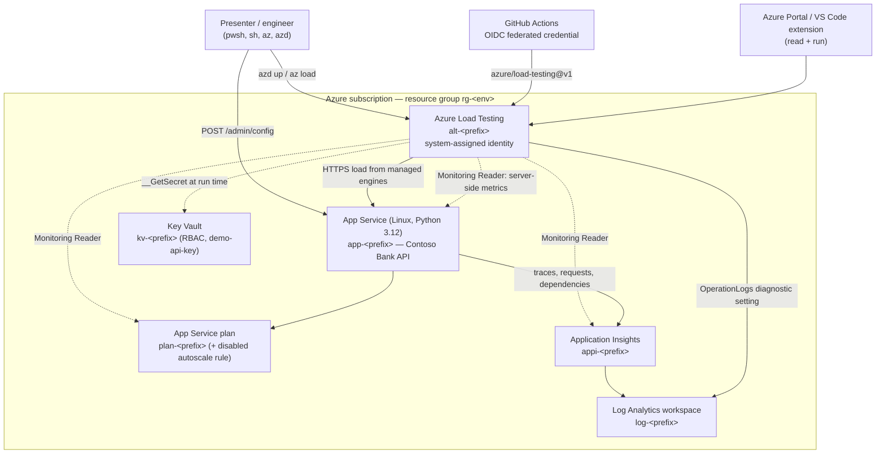
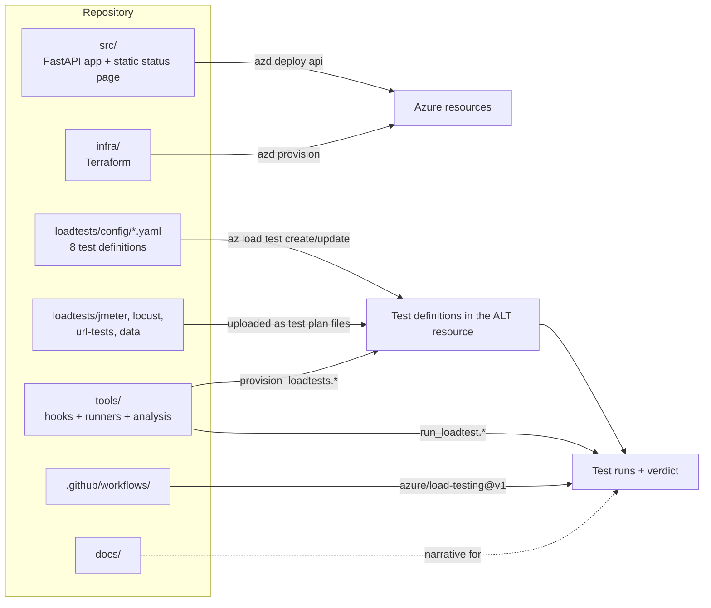
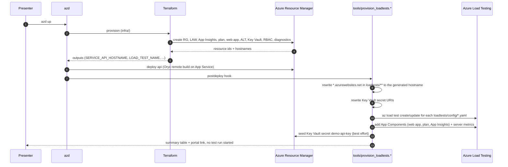
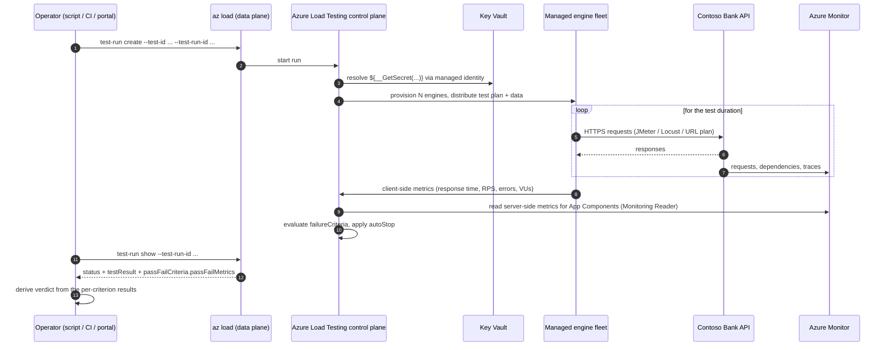
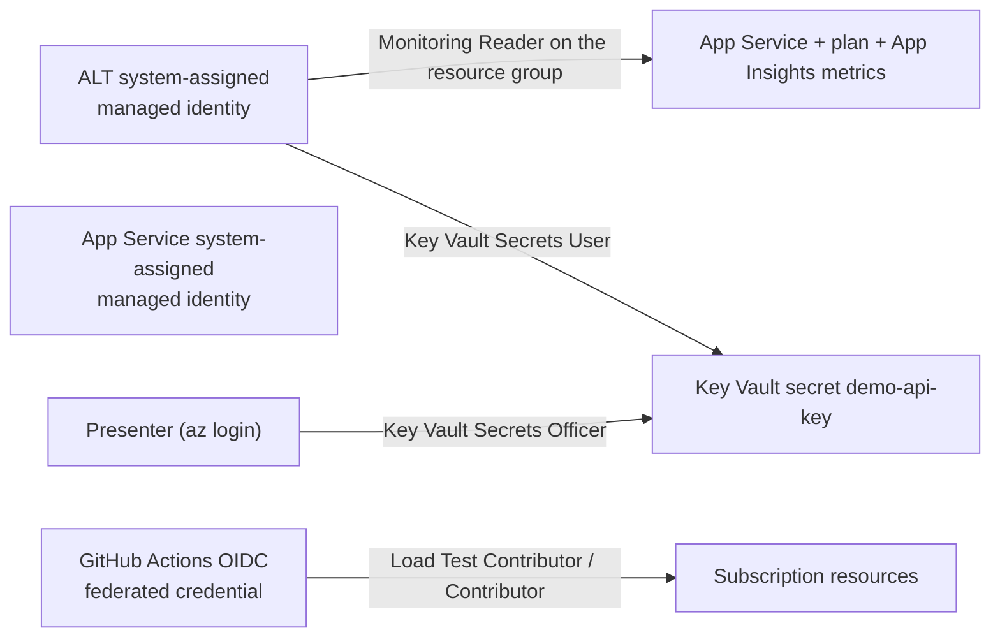
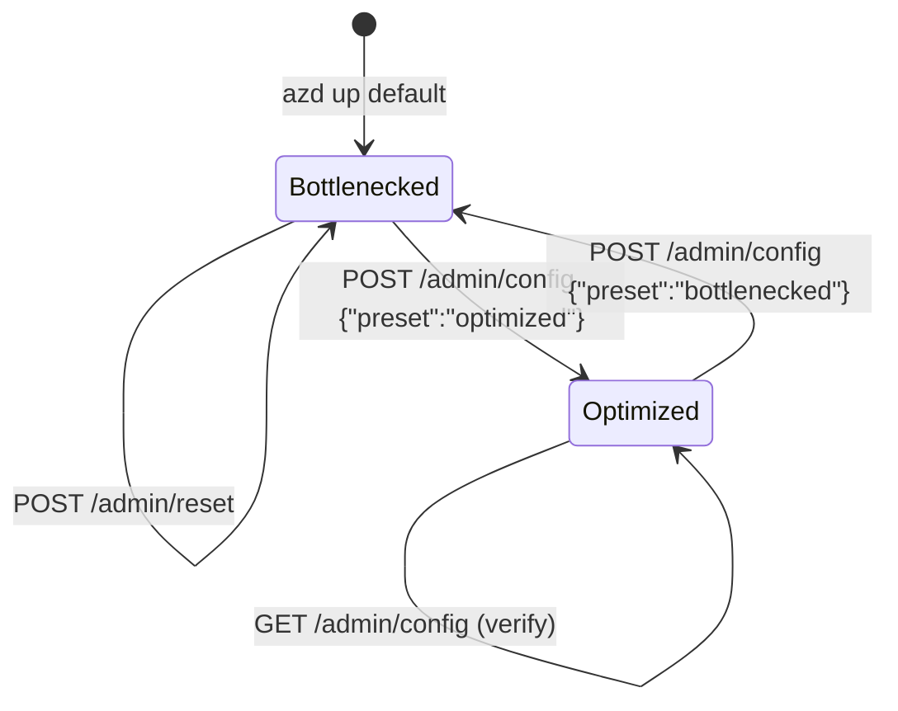
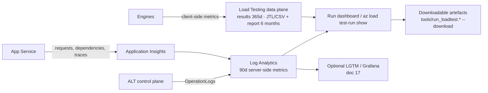
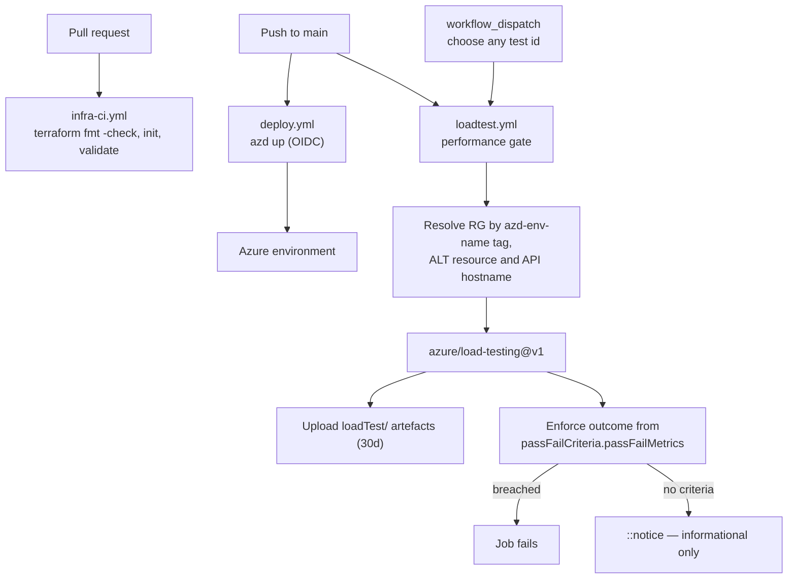

# 21 — Solution Architecture (this repository, end to end)

> **Scope:** [Doc 03](03-architecture-how-it-works.md) explains how the **Azure Load Testing service** works internally — engines, scale formulas, networking. This document explains how **this repository** is put together: every Azure resource it deploys, every artefact it ships, how they are wired to each other, and what happens on each of the three entry points (`azd up`, the runner scripts, GitHub Actions).
>
> Read doc 03 first if you want the product architecture. Read this one if you want the demo kit's architecture.

**Audience:** Engineers who have to deploy, operate, extend or review this kit · **Format:** Reference

---

## 21.1 One-paragraph summary

A Python FastAPI banking API (**Contoso Bank**) with six deliberately planted performance defects is deployed to Linux App Service by `azd up`, which provisions everything through Terraform. The same command creates eight Azure Load Testing definitions from the YAML files in `loadtests/config/`, retargeting them to the generated App Service hostname first. Load is then generated by the managed Azure Load Testing engine fleet against the public HTTPS endpoint, while server-side metrics are read from App Service, the App Service plan and Application Insights through the load test resource's managed identity. Results are evaluated against failure criteria declared in the same YAML, and the verdict is derived from the per-criterion results — by the runner scripts locally and by the gate step in GitHub Actions, using identical logic.

---

## 21.2 System context



Everything in the grey box is created by [`infra/main.tf`](../infra/main.tf). Nothing outside it is required — there is no database, no queue and no VNet in the default deployment. The bottlenecks are simulated in-process precisely so the kit stays cheap, portable and deterministic (see [doc 15](15-demo-application-contoso-bank.md)).

---

## 21.3 Azure resources and why each one exists

| Terraform resource | Azure resource | Why it is in the kit |
|---|---|---|
| `azurerm_resource_group.this` | Resource group | Single blast radius; tagged `azd-env-name` so CI can find it |
| `azurerm_log_analytics_workspace.this` | Log Analytics | Backing store for App Insights and for load test `OperationLogs` |
| `azurerm_application_insights.this` | Application Insights (workspace-based) | Server-side correlation during a run; attached as an App Component |
| `azurerm_service_plan.this` | App Service plan | The capacity that actually saturates in the demo |
| `azurerm_monitor_autoscale_setting.this` | Autoscale rule, **disabled** | Enabled live during the autoscale chapter, then proven with a re-run |
| `azurerm_linux_web_app.api` | App Service (Python 3.12) | System under test. Tagged `azd-service-name: api` so `azd deploy api` resolves it |
| `azurerm_load_test.this` | Azure Load Testing | The product being demonstrated; carries the system-assigned identity |
| `azurerm_role_assignment.monitoring_reader` | **Monitoring Reader** on the resource group | The step everyone forgets. Without it, server-side charts are silently empty |
| `azurerm_role_assignment.load_test_contributor` | Load Test Contributor | Optional — grants named principals (e.g. the CI app registration) run rights |
| `azurerm_key_vault.this` + role assignments | Key Vault (RBAC) | Runtime secret resolution demo; only URIs live in the test definitions |
| `azapi_resource.demo_api_key` | Key Vault secret | Seeded through ARM so `azd up` does not need data-plane access from the workstation |
| `azurerm_monitor_diagnostic_setting.load_test` | Diagnostic setting (logs only) | Governance evidence: who created, ran or deleted a test. Metric export is unsupported for this resource type |

> **Networking:** the default deployment is public-endpoint only — engines run in Microsoft-managed networking. VNet injection is deliberately *not* deployed; it is researched in [doc 20](20-private-network-integration.md) and summarised in [doc 03 §3.5](03-architecture-how-it-works.md).

---

## 21.4 Repository map — what produces what



| Path | Role |
|---|---|
| [`src/main.py`](../src/main.py) | The API: `/health`, `/ready`, `/status`, `/api/accounts/*`, `/api/transfers`, `/api/statements/*`, plus the `/admin/*` control plane |
| [`infra/`](../infra) | Terraform for every resource in §21.3; outputs in [`outputs.tf`](../infra/outputs.tf) form the environment contract (§21.8) |
| [`loadtests/config/`](../loadtests/config) | One YAML per test definition — script reference, engine count, env vars, secrets, failure criteria, AutoStop, App Components |
| [`loadtests/jmeter/`](../loadtests/jmeter), [`locust/`](../loadtests/locust), [`url-tests/`](../loadtests/url-tests), [`data/`](../loadtests/data) | The test plans and CSV data the YAML references |
| [`tools/provision_loadtests.ps1` / `.sh`](../tools) | `azd up` postdeploy hook: retarget artefacts → create/update tests → attach App Components and server metrics → seed the Key Vault secret |
| [`tools/run_loadtest.ps1` / `.sh`](../tools) | Start a run, poll it, derive the verdict, print statistics, optionally download artefacts (§21.6) |
| [`tools/e2e-test.ps1`](../tools/e2e-test.ps1) | Full validation harness across all four result-status outcomes |
| [`tools/set_target_host.py`](../tools/set_target_host.py), [`validate_bottlenecks.py`](../tools/validate_bottlenecks.py), [`vuh_calculator.py`](../tools/vuh_calculator.py) | Retargeting, bottleneck proof, cost modelling |
| [`.github/workflows/`](../.github/workflows) | `infra-ci.yml` (fmt/validate), `deploy.yml` (`azd up` via OIDC), `loadtest.yml` (the performance gate) |

---

## 21.5 Deployment flow — what `azd up` actually does



Two deliberate design decisions here:

1. **`postdeploy`, not `postprovision`.** The Load Testing resource exists after provision, but the target app is not guaranteed to be live until deploy finishes, and a URL test validates its target at creation time.
2. **The hook never starts a run.** Creating definitions is free; running them spends virtual user hours. Running stays an explicit human step — which is what §21.6 is for.

---

## 21.6 Run flow — three ways to execute a test



| Entry point | Command | Notes |
|---|---|---|
| **Runner script (recommended)** | `pwsh -File tools/run_loadtest.ps1 -TestId contoso-bank-pr-gate`<br/>`tools/run_loadtest.sh --test-id contoso-bank-pr-gate` | Resolves the resource from the azd environment, starts the run, polls, prints the verdict and statistics. `-List` / `--list` shows the catalogue without spending VUH. Exit code 1 on a breached criterion |
| **Raw Azure CLI** | `az load test-run create ...` then `az load test-run show ...` | What the scripts run underneath. Documented in [doc 17](17-portal-free-operations-and-observability.md) |
| **GitHub Actions** | [`loadtest.yml`](../.github/workflows/loadtest.yml) → `azure/load-testing@v1` | Resolves the resource group by `azd-env-name` tag, injects `BASE_URL`/`LOCUST_HOST` and the pipeline secret, then enforces the outcome |

### The verdict rule — implemented identically in all three places

`status` and the pass/fail verdict do **not** settle at the same instant. Measured on run `contoso-bank-peak-load-runall-20260915-102506`: at the first `DONE` response `testResult` was `NOT_APPLICABLE` and the six `passFailMetrics` entries carried **no `result` property at all**; 97 seconds later both signals settled together to `FAILED` with 5 of 6 criteria breached. Reading either signal at `DONE` is therefore a false green. So:

```
wait until testResult is PASSED or FAILED   (skip for criteria-less tests - they never leave NOT_APPLICABLE)

no criteria at all                          -> NOT_APPLICABLE  (the real false green - docs/07 §7.2)
any criterion failed OR testResult FAILED   -> FAILED
testResult PASSED and nothing failed        -> PASSED
never settled                               -> UNSETTLED       (never treated as a pass)
```

`tools/run_loadtest.ps1`, `tools/run_loadtest.sh`, `tools/e2e-test.ps1` and the *Enforce load test outcome* step in `loadtest.yml` all apply exactly this rule, and all exit non-zero on anything short of positive proof of a pass.

---

## 21.7 Identity, RBAC and secrets



| Concern | How it is handled |
|---|---|
| Load test → server metrics | System-assigned identity + **Monitoring Reader** at resource-group scope |
| Load test → secrets | Secret **URIs** only in the YAML; values resolved at run time with **Key Vault Secrets User** |
| CI → Azure | **OIDC federated credential**, no stored service principal password |
| CI → test secrets | Pipeline secret `DEMO_API_KEY` injected as the `API_KEY` test secret |
| App → telemetry | App Insights connection string in app settings; system-assigned identity available for extension |

> **Known policy trap:** subscription policy can rewrite the vault's `publicNetworkAccess` to `Disabled` after creation. `contoso-bank-secrets-kv` then validates at create time and fails at run time. That test is kept on purpose as the governance cautionary tale — see [doc 11](11-security-compliance-network.md) and [doc 20](20-private-network-integration.md).

---

## 21.8 The environment contract

Terraform outputs are written into the azd environment and every script reads those exact names. Change one and you must change it in all four places: [`infra/outputs.tf`](../infra/outputs.tf), `tools/provision_loadtests.ps1`, `tools/provision_loadtests.sh` and `tools/run_loadtest.*`.

| Variable | Consumed by |
|---|---|
| `AZURE_RESOURCE_GROUP`, `AZURE_SUBSCRIPTION_ID`, `AZURE_LOCATION` | Every `az load` call in the hooks and runners |
| `SERVICE_API_HOSTNAME`, `SERVICE_API_URI` | Artefact retargeting; `-Preset` / `--preset` switching |
| `SERVICE_API_RESOURCE_ID`, `APP_SERVICE_PLAN_RESOURCE_ID`, `APPLICATIONINSIGHTS_RESOURCE_ID` | App Components and server-side metric registration |
| `LOAD_TEST_NAME`, `LOAD_TEST_RESOURCE_ID`, `LOAD_TEST_DATA_PLANE_URI` | Test creation, run start, portal links |
| `KEY_VAULT_NAME`, `KEY_VAULT_URI` | Secret URI rewriting and seeding |

All of them can also be supplied as plain environment variables or script parameters, so the kit works on a machine that never ran `azd` — useful in CI and in locked-down environments.

---

## 21.9 The demo control plane

The application exposes an unauthenticated admin API so the before/after arc is a single HTTP call rather than a redeploy.



Six switchable defects sit behind that preset: a missing cache, an undersized connection pool, a global lock on the payment path, an N+1 query, sequential fraud checks and a CPU-bound statement generator. `tools/run_loadtest.ps1 -Preset` (and `--preset` in the shell version) flips the preset immediately before starting a run, so *test → diagnose → fix → retest* is two commands.

> This endpoint is deliberately unauthenticated demo software. See the disclaimer in the [README](../README.md).

---

## 21.10 Telemetry and data flows



Two facts worth stating explicitly, because they surprise people:

- **Client-side load test metrics are not in Azure Monitor.** They live in the Load Testing data plane and are reached through the dashboard, the CLI or the downloadable results.
- **Server-side metrics are only as good as your App Components + RBAC.** Missing Monitoring Reader produces empty charts and no error.

---

## 21.11 CI/CD architecture



`loadtest.yml` runs `contoso-bank-pr-gate` (25 VUs, ~3 minutes, 1 engine) by default so the gate stays cheap; any other definition can be selected through `workflow_dispatch`. Full narrative in [doc 08](08-cicd-integration.md).

---

## 21.12 Extension points

| Want to… | Change |
|---|---|
| Point the tests at a different app | `python tools/set_target_host.py --host <host>` (or `--from-azd`), then re-run the provisioning hook |
| Add a new test definition | Drop a YAML in `loadtests/config/`; the hook and both runners pick it up automatically — no code change |
| Run against a private endpoint | Add `subnetId` to the config and deploy the subnet; see [doc 20](20-private-network-integration.md) |
| Replace the simulated backend with real Azure data services | Add the resources in `infra/main.tf` and register them as App Components in `provision_loadtests.*` |
| Ship results to Grafana/LGTM | [Doc 17 §17.4](17-portal-free-operations-and-observability.md) |

---

## Related documents

- [Doc 03 — How the service works](03-architecture-how-it-works.md) (engines, scale, networking)
- [Doc 05 — Deploying and operating as code](05-deployment-and-operations-as-code.md)
- [Doc 07 — Analysing results](07-analyzing-results-and-bottlenecks.md) (the status/result taxonomy the verdict rule comes from)
- [Doc 15 — The demo application](15-demo-application-contoso-bank.md) (the six planted defects)
- [Doc 17 — Portal-free operations](17-portal-free-operations-and-observability.md)
- [Doc 18 — Deploy and first run](18-deploy-and-first-run.md)
