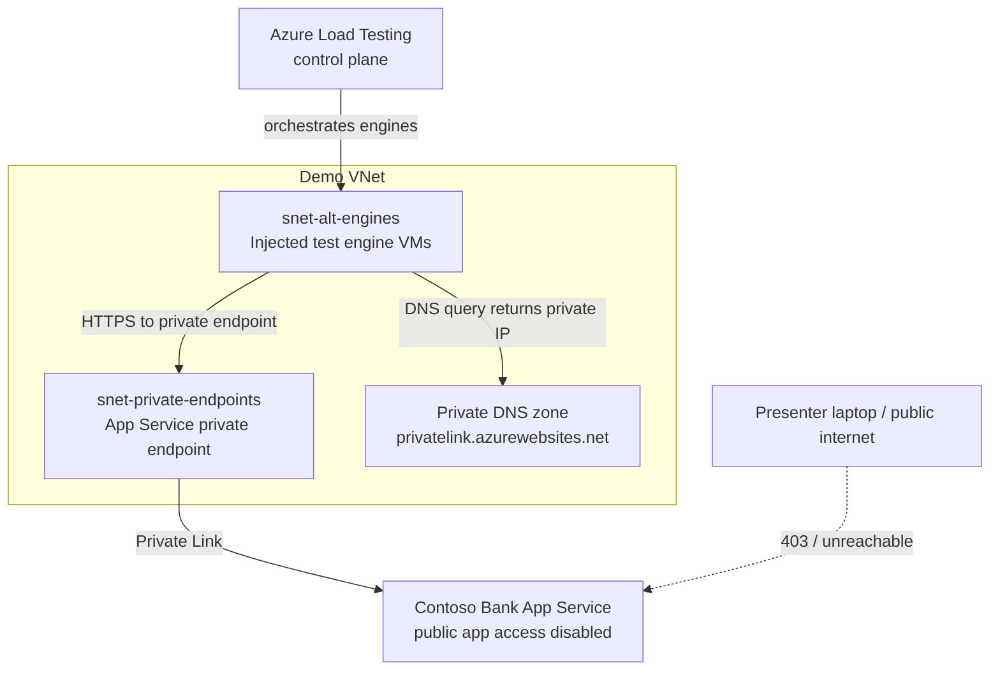

# 23 — VNet-injected test case

> **Section goal:** Turn the private-network research in [doc 20](20-private-network-integration.md) into an implementable, opt-in test case for this repository. The default kit stays public-endpoint only and cheap; this chapter explains exactly what to add when a customer asks, "Can you prove Azure Load Testing can test a private banking API?"

**Audience:** Customer architects, network/security engineers, demo-kit maintainers  
**Format:** Implementation plan + Terraform/YAML sketches + stage proof script

---

## 23.1 Executive answer to the customer feedback

Yes: implement a **VNet-injected Azure Load Testing test** as an opt-in extension to this kit. VNet injection means the Azure Load Testing engine VMs are attached to a subnet in the customer's virtual network for the duration of the run. Those engines then send traffic from inside the VNet, not from the default Microsoft-managed public engine network.

For this repo, the best half-day customer demo is:

1. Keep the existing public deployment path unchanged by default.
2. Add optional Terraform for a VNet, a dedicated Azure Load Testing engine subnet, an App Service private endpoint, private DNS for `privatelink.azurewebsites.net`, and the caller RBAC required to join the subnet.
3. Add a `loadtests/config/private-endpoint.yaml` test definition that is only created when Terraform outputs `LOAD_TEST_ENGINE_SUBNET_ID`.
4. Prove privacy live by showing the App Service public endpoint failing from the internet and from a non-injected load test, then the VNet-injected test succeeding against the same `*.azurewebsites.net` host.

The recommendation is **option A: App Service private endpoint + public app access disabled + injected engines in the same VNet**. It uses the app the kit already deploys, gives the clearest privacy proof, avoids a second target workload, and avoids the ongoing idle cost of NAT Gateway unless the customer's policy forbids the ephemeral public IP/load balancer/NSG that Azure Load Testing creates for private tests.

---

## 23.2 What VNet injection actually unlocks

Microsoft Learn describes three supported VNet-injection scenarios:

| Scenario | What changes | Demo meaning |
|---|---|---|
| **Private endpoints / internal load balancers** | Engines are injected into a subnet that can resolve and route to the private IP of the target. | Test an App Service, API, VM, AKS ingress, Container Apps environment, or internal load balancer that has no public data-plane path. |
| **Public endpoints behind IP allow-lists** | Engines sit in a subnet associated with NAT Gateway; the target allow-lists the NAT public IP or prefix. | Prove "only this test subnet can hit my public endpoint", useful for App Service access restrictions, Application Gateway, WAF and partner APIs. |
| **On-premises targets over ExpressRoute/VPN** | Engines use the customer's existing private routing from Azure to on-premises. | Test a core-banking or mainframe-fronting API that is never internet-facing. |



Important distinction for the room: the target traffic path becomes private, but Azure Load Testing still needs outbound connectivity from the engine subnet to Azure control-plane services so results and heartbeats can get back to the service.

---

## 23.3 Current Microsoft Learn prerequisites and corrections to doc 20

The table below is the implementation contract to use for this repo. Where Microsoft Learn is precise, treat it as authoritative. Where Learn is thin, the item is marked **⚠️ verify** rather than converted into a false rule.

| Area | Current Learn-verified requirement | Repo implementation note |
|---|---|---|
| VNet placement | The VNet must be in the **same subscription** and **same region** as the Azure Load Testing resource. | Create the VNet in `azurerm_resource_group.this` and use `azurerm_resource_group.this.location`, matching `azurerm_load_test.this`. |
| Engine subnet purpose | Use a subnet with enough unassigned IP addresses for the number of load test engines. Separate subnets for Azure Load Testing and the application endpoint are recommended. | Add `snet-alt-engines-${local.prefix}` and `snet-private-endpoints-${local.prefix}`. Do not reuse App Service integration, firewall or private-endpoint subnets for engines. |
| Subnet size / CIDR | Learn requires "enough unassigned IP addresses" but does **not** publish a CIDR formula or per-engine IP allocation. Azure reserves five IPs in every subnet and `/29` is the smallest supported IPv4 subnet. | Use `/24` as this kit's demo default because it is generous for the existing 1-4 engine tests and cheap in address-space terms. **⚠️ verify** the exact per-engine IP consumption with the product team before promising a CIDR for a 100+ engine customer test. |
| Delegation | The Azure Load Testing subnet **must not be delegated to any other Azure service**. There is no Learn requirement to delegate it to Azure Load Testing. | Do **not** add a `delegation {}` block to the engine subnet. This corrects a common misconception, not a Terraform omission. |
| IPv6 | IPv6-enabled subnets are not supported for Azure Load Testing private endpoint tests. | Keep the VNet and engine subnet IPv4-only. |
| Reserved subnet name | A subnet named `AzureFirewallSubnet` cannot be used for Azure Load Testing. | Name the engine subnet `snet-alt-engines-${local.prefix}`. |
| NSG outbound | If an NSG or firewall restricts the VNet, engines need outbound connectivity to `*.azure.com`, `*.windows.net`, `*.blob.storage.azure.net` and `*.azurecr.io`; `*.maven.org` and `*.github.com` are optional for plug-in downloads. The portal how-to shows a broad outbound NSG rule with source `Any`, destination `Any`, port `*`. | NSGs do not express wildcard FQDNs, so the Terraform NSG uses the Learn-supported broad outbound rule. If the customer needs FQDN-level control, put Azure Firewall/NVA in the route path and allow those FQDNs there. |
| Route tables | Learn does not require a specific UDR shape. It does require any attached route table to be in `Succeeded` state; force-tunnelled routes must still permit required outbound connectivity. | Keep the demo subnet without a route table. If a customer attaches one, make "can the engine subnet reach the Learn FQDNs?" a pre-flight check. |
| Injected resources | When a private test runs, Azure Load Testing injects engine VMs plus a public IP address, NSG and Azure Load Balancer into the VNet. The resources are ephemeral and exist only while the run is active. The engine compute is not billed to the customer. | This is visible and useful in the portal during the demo. It also means Azure Policy can block the run if it denies public IP, load balancer or NSG creation. |
| `publicIPDisabled` | The YAML key is top-level `publicIPDisabled`. Current Learn says it disables deployment of the public IP address, load balancer **and** NSG while testing a private endpoint, and requires an alternative outbound route such as NAT Gateway, Azure Firewall or NVA. | **Correction to doc 20:** §20.2 says the load balancer is not suppressible. Current Learn and the YAML reference say `publicIPDisabled` disables the public IP, load balancer and NSG together. Trust Learn because the current YAML reference and how-to agree. |
| Public IP quota | If `publicIPDisabled` is false, the VNet subscription needs at least one public IP quota available. | Keep `publicIPDisabled: false` for the fastest demo path unless customer policy forbids it. |
| Resource provider | `Microsoft.Batch` must be registered in the subscription. | Add a pre-flight check to the implementation checklist; do not make Terraform register providers implicitly for the customer. |
| RBAC for subnet join | The user or CI/CD principal creating, updating or starting the private test needs **Network Contributor**, or a parent role, on the VNet. The documented error is `ALTVNET004` for missing `subnet/join/action`. | Assign Network Contributor on the demo VNet to `var.load_test_network_contributor_principal_ids`. Current Learn does **not** say the Azure Load Testing resource's managed identity needs Network Contributor for VNet injection. |
| Managed identity | Azure Load Testing managed identities are used for Key Vault secrets/certificates and, through `referenceIdentities`, for Key Vault, Metrics and Engine scenarios. | Keep the existing system-assigned identity + Key Vault Secrets User + Monitoring Reader. Use `referenceIdentities` in YAML only when switching from system-assigned to user-assigned identity. |
| CLI surface | The Azure CLI `load` extension supports `az load test create --load-test-config-file`, `--subnet-id` and `--disable-public-ip`. The current CLI reference says the command group is preview and part of the `load` extension. | Existing hooks already use `az load test create/update --load-test-config-file`. Patch a scratch YAML or pass `--subnet-id` only for the private test. |

---

## 23.4 Which demo design should we choose?

| Option | What it is | Cost | Deploy time | Demo impact | Risk |
|---|---|---:|---:|---|---|
| **A — App Service private endpoint + public app access disabled + injected engines** | Add a private endpoint for the existing `azurerm_linux_web_app.api`, private DNS zone link, and VNet-injected test. | Private endpoint + private DNS ongoing; Azure Load Balancer/public IP only during runs unless disabled; normal VUH for test execution. | Medium: Terraform networking plus one hook change. | **Highest.** Same app, same hostname, public path fails, private injected path succeeds. | Medium: can break `azd deploy api` from a public runner if public app access is disabled too early. |
| **B — App Service IP access restrictions + NAT Gateway static egress IP** | Keep App Service public, allow only NAT Gateway public IP, inject engines into NAT-associated subnet. | NAT Gateway + public IP idle cost, data processing, plus VUH. | Medium-low. | Good for allow-listing conversations, but less compelling because the app still has a public endpoint. | Medium: NAT Gateway cost surprise; App Service access restriction mis-ordering can block presenters. |
| **C — Private-only container/VM target** | Add a VM, internal load balancer, Container Apps internal environment, or container app as the target. | Extra compute/container environment plus networking and VUH. | Highest. | Technically clean but distracts from the Contoso Bank story. | High: new workload, image lifecycle, patching, health probes and failure modes unrelated to Azure Load Testing. |

**Recommendation for a half-day customer session:** choose **A**.

Why: this kit already deploys App Service, App Insights, a service plan and the Azure Load Testing resource. Option A turns the existing public Contoso Bank API into a private endpoint target without inventing a second application. It gives a 60-second proof that security architects understand: public client fails; public engines fail; injected engines succeed. It also keeps the optional NAT Gateway story available for customers whose policy forbids service-created public IP/load balancer/NSG resources.

Do **not** make this the default path. Doc 21 is still right: the default deployment is public-endpoint only, and that must remain the cheap path for presenters and CI.

---

## 23.5 Terraform design for this repo

These snippets are written to fit `infra/main.tf`'s current conventions: `local.prefix`, `local.tags`, `azurerm_resource_group.this.location`, AzureRM v4-style resources, uppercase azd outputs, and opt-in variables in `variables.tf`. They are **not** applied by this document; this is the implementation recipe for the follow-up code change.

### Variables to add in `infra/variables.tf`

```hcl
variable "enable_vnet_injection" {
  description = "Opt-in private-network demo path. When false, no VNet, private endpoint, NAT Gateway or private load test is configured."
  type        = bool
  default     = false
}

variable "vnet_address_space" {
  description = "Address space for the optional private-network demo VNet."
  type        = list(string)
  default     = ["10.100.0.0/16"]
}

variable "load_test_engine_subnet_prefix" {
  description = "CIDR for the Azure Load Testing engine subnet. /24 is the demo default; verify exact sizing for large customer runs."
  type        = string
  default     = "10.100.1.0/24"
}

variable "private_endpoint_subnet_prefix" {
  description = "CIDR for private endpoints used by the optional private-network demo."
  type        = string
  default     = "10.100.2.0/28"
}

variable "app_service_public_network_access_enabled" {
  description = "Keep true for normal azd deploys from public machines. Set false only after private endpoint DNS and deployment path are proven."
  type        = bool
  default     = true
}

variable "enable_vnet_nat_gateway" {
  description = "Optional static egress path for VNet-injected engines when publicIPDisabled is true or public endpoint allow-listing is being demonstrated."
  type        = bool
  default     = false
}

variable "load_test_network_contributor_principal_ids" {
  description = "Object IDs of humans, groups or CI principals that can create/update/start VNet-injected tests by joining the engine subnet."
  type        = list(string)
  default     = []
}
```

### Existing App Service block change in `infra/main.tf`

```hcl
resource "azurerm_linux_web_app" "api" {
  name                = "app-${local.prefix}"
  location            = azurerm_resource_group.this.location
  resource_group_name = azurerm_resource_group.this.name
  service_plan_id     = azurerm_service_plan.this.id
  https_only          = true

  # Keep true during the normal public demo and during azd deploy from a public
  # laptop/GitHub-hosted runner. For the private proof, flip this only after the
  # private endpoint and DNS are in place, or deploy from a VNet-joined runner
  # that can reach the scm private endpoint.
  public_network_access_enabled = var.enable_vnet_injection ? var.app_service_public_network_access_enabled : true

  # existing identity, site_config, app_settings and tags stay as they are
}
```

This is the one setting most likely to break the kit if applied too early. App Service Learn says Linux app changes to `publicNetworkAccess` trigger restarts. It also means public `azd deploy api` / Kudu access can fail when public access is disabled unless the runner has private network access and DNS for both the app and SCM endpoints.

### VNet, subnets and NSG

```hcl
resource "azurerm_virtual_network" "load_test" {
  count = var.enable_vnet_injection ? 1 : 0

  name                = "vnet-${local.prefix}"
  location            = azurerm_resource_group.this.location
  resource_group_name = azurerm_resource_group.this.name
  address_space       = var.vnet_address_space
  tags                = local.tags
}

resource "azurerm_subnet" "load_test_engines" {
  count = var.enable_vnet_injection ? 1 : 0

  name                 = "snet-alt-engines-${local.prefix}"
  resource_group_name  = azurerm_resource_group.this.name
  virtual_network_name = azurerm_virtual_network.load_test[0].name
  address_prefixes     = [var.load_test_engine_subnet_prefix]

  # No delegation block: Azure Load Testing requires the subnet not to be
  # delegated to another Azure service.
}

resource "azurerm_subnet" "private_endpoints" {
  count = var.enable_vnet_injection ? 1 : 0

  name                 = "snet-private-endpoints-${local.prefix}"
  resource_group_name  = azurerm_resource_group.this.name
  virtual_network_name = azurerm_virtual_network.load_test[0].name
  address_prefixes     = [var.private_endpoint_subnet_prefix]
}

resource "azurerm_network_security_group" "load_test_engines" {
  count = var.enable_vnet_injection ? 1 : 0

  name                = "nsg-alt-engines-${local.prefix}"
  location            = azurerm_resource_group.this.location
  resource_group_name = azurerm_resource_group.this.name
  tags                = local.tags

  security_rule {
    name                       = "AllowAzureLoadTestingOutbound"
    priority                   = 100
    direction                  = "Outbound"
    access                     = "Allow"
    protocol                   = "*"
    source_port_range          = "*"
    destination_port_range     = "*"
    source_address_prefix      = "*"
    destination_address_prefix = "*"
    description                = "Learn-supported outbound rule for Azure Load Testing engine orchestration."
  }
}

resource "azurerm_subnet_network_security_group_association" "load_test_engines" {
  count = var.enable_vnet_injection ? 1 : 0

  subnet_id                 = azurerm_subnet.load_test_engines[0].id
  network_security_group_id = azurerm_network_security_group.load_test_engines[0].id
}
```

### Optional NAT Gateway path

Use this only for option B or for option A when customer policy requires `publicIPDisabled: true`. Current Learn says disabling public IP deployment requires an alternative outbound mechanism such as NAT Gateway, Azure Firewall or NVA.

```hcl
resource "azurerm_public_ip" "load_test_nat" {
  count = var.enable_vnet_injection && var.enable_vnet_nat_gateway ? 1 : 0

  name                = "pip-nat-alt-${local.prefix}"
  location            = azurerm_resource_group.this.location
  resource_group_name = azurerm_resource_group.this.name
  allocation_method   = "Static"
  sku                 = "Standard"
  tags                = local.tags
}

resource "azurerm_nat_gateway" "load_test" {
  count = var.enable_vnet_injection && var.enable_vnet_nat_gateway ? 1 : 0

  name                = "nat-alt-${local.prefix}"
  location            = azurerm_resource_group.this.location
  resource_group_name = azurerm_resource_group.this.name
  sku_name            = "Standard"
  tags                = local.tags
}

resource "azurerm_nat_gateway_public_ip_association" "load_test" {
  count = var.enable_vnet_injection && var.enable_vnet_nat_gateway ? 1 : 0

  nat_gateway_id       = azurerm_nat_gateway.load_test[0].id
  public_ip_address_id = azurerm_public_ip.load_test_nat[0].id
}

resource "azurerm_subnet_nat_gateway_association" "load_test_engines" {
  count = var.enable_vnet_injection && var.enable_vnet_nat_gateway ? 1 : 0

  subnet_id      = azurerm_subnet.load_test_engines[0].id
  nat_gateway_id = azurerm_nat_gateway.load_test[0].id
}
```

### App Service private endpoint and DNS

```hcl
resource "azurerm_private_dns_zone" "app_service" {
  count = var.enable_vnet_injection ? 1 : 0

  name                = "privatelink.azurewebsites.net"
  resource_group_name = azurerm_resource_group.this.name
  tags                = local.tags
}

resource "azurerm_private_dns_zone_virtual_network_link" "app_service" {
  count = var.enable_vnet_injection ? 1 : 0

  name                  = "link-app-${local.prefix}"
  resource_group_name   = azurerm_resource_group.this.name
  private_dns_zone_name = azurerm_private_dns_zone.app_service[0].name
  virtual_network_id    = azurerm_virtual_network.load_test[0].id
  registration_enabled  = false
  tags                  = local.tags
}

resource "azurerm_private_endpoint" "api" {
  count = var.enable_vnet_injection ? 1 : 0

  name                = "pe-app-${local.prefix}"
  location            = azurerm_resource_group.this.location
  resource_group_name = azurerm_resource_group.this.name
  subnet_id           = azurerm_subnet.private_endpoints[0].id
  tags                = local.tags

  private_service_connection {
    name                           = "psc-app-${local.prefix}"
    private_connection_resource_id = azurerm_linux_web_app.api.id
    subresource_names              = ["sites"]
    is_manual_connection           = false
  }

  private_dns_zone_group {
    name                 = "default"
    private_dns_zone_ids = [azurerm_private_dns_zone.app_service[0].id]
  }
}
```

App Service Learn says `privatelink.azurewebsites.net` is the private DNS zone for the app endpoint, and that the SCM/Kudu endpoint also needs a record in that zone when deployment must happen privately. Azure Private DNS Zone Groups normally add those records when using the recommended zone.

### RBAC for the caller, not the Azure Load Testing managed identity

```hcl
resource "azurerm_role_assignment" "load_test_network_contributor" {
  for_each = var.enable_vnet_injection ? toset(var.load_test_network_contributor_principal_ids) : toset([])

  scope                = azurerm_virtual_network.load_test[0].id
  role_definition_name = "Network Contributor"
  principal_id         = each.value
}
```

Use this for the presenter's Entra group and/or the CI service principal if it will create, update or start private tests. Keep the existing `azurerm_role_assignment.monitoring_reader` and `azurerm_role_assignment.key_vault_secrets_user` unchanged for server-side metrics and Key Vault secrets.

### Outputs to add in `infra/outputs.tf`

```hcl
output "LOAD_TEST_ENGINE_SUBNET_ID" {
  description = "Subnet ID used by VNet-injected Azure Load Testing tests. Empty when the private-network demo is disabled."
  value       = var.enable_vnet_injection ? azurerm_subnet.load_test_engines[0].id : ""
}

output "SERVICE_API_PRIVATE_ENDPOINT_IP" {
  description = "Private endpoint IP for the Contoso Bank App Service. Empty when the private-network demo is disabled."
  value       = var.enable_vnet_injection ? azurerm_private_endpoint.api[0].private_service_connection[0].private_ip_address : ""
}

output "LOAD_TEST_NAT_PUBLIC_IP" {
  description = "Static NAT Gateway egress IP for allow-list demos. Empty unless enable_vnet_nat_gateway is true."
  value       = var.enable_vnet_injection && var.enable_vnet_nat_gateway ? azurerm_public_ip.load_test_nat[0].ip_address : ""
}
```

### Gating rule

Every new resource uses either:

```hcl
count = var.enable_vnet_injection ? 1 : 0
```

or, for optional/identity lists:

```hcl
for_each = var.enable_vnet_injection ? toset(var.load_test_network_contributor_principal_ids) : toset([])
```

Never reference an optional resource without `[0]` behind the same condition. Outputs should return `""` when disabled so existing azd environment consumers keep working.

---

## 23.6 Load test definition and postdeploy hook change

Microsoft Learn's YAML reference puts both VNet keys at the **top level** of the config:

- `subnetId`: resource ID of the subnet that hosts injected test engine VMs.
- `publicIPDisabled`: boolean that disables deployment of the public IP address, load balancer and NSG for private endpoint tests.

The file to add later is `loadtests/config/private-endpoint.yaml`:

```yaml
# =============================================================================
# Contoso Bank - PRIVATE ENDPOINT
# =============================================================================
# Opt-in VNet-injected test. The postdeploy hook must replace
# __LOAD_TEST_ENGINE_SUBNET_ID__ with the Terraform output of the same name.
# Do not create this test when enable_vnet_injection=false.
# =============================================================================

version: v0.1

testId: contoso-bank-private-endpoint
displayName: Contoso Bank - Private Endpoint
description: VNet-injected test proving App Service private endpoint reachability.

testType: JMX
testPlan: ../jmeter/contoso-bank.jmx

engineInstances: 1

configurationFiles:
  - ../data/accounts.csv

splitAllCSVs: true

properties:
  userPropertyFile: ../jmeter/user.properties

# Top-level Azure Load Testing private-network settings.
subnetId: __LOAD_TEST_ENGINE_SUBNET_ID__

# Recommended default for the half-day demo: false. Azure Load Testing then
# creates ephemeral public IP, load balancer and NSG resources for orchestration.
# Set true only when NAT Gateway, Azure Firewall or NVA egress is ready.
publicIPDisabled: false

env:
  - name: BASE_URL
    value: app-loadtest-27d2e5.azurewebsites.net
  - name: threads
    value: "25"
  - name: rampup
    value: "30"
  - name: duration
    value: "180"
  - name: pageSize
    value: "50"

failureCriteria:
  clientMetrics:
    - avg(response_time_ms) > 500
    - percentage(error) > 2
    - GetBalance: p95(response_time_ms) > 800
    - CreateTransfer: p95(response_time_ms) > 1500

autoStop:
  errorPercentage: 90
  timeWindow: 60
```

The existing hooks already retarget `*.azurewebsites.net` and Key Vault URIs, then call:

```powershell
az load test create `
  --load-test-resource $LOAD_TEST_NAME `
  --resource-group $AZURE_RESOURCE_GROUP `
  --test-id contoso-bank-private-endpoint `
  --load-test-config-file .azd-hooks\private-endpoint.generated.yaml
```

Implement the hook change as a generated scratch config, not by committing an environment-specific subnet ID:

```powershell
$loadTestEngineSubnetId = Get-HookValue 'LOAD_TEST_ENGINE_SUBNET_ID'

if ($metadata.TestId -eq 'contoso-bank-private-endpoint') {
    if ([string]::IsNullOrWhiteSpace($loadTestEngineSubnetId)) {
        Write-Host "  Skipping private endpoint test because LOAD_TEST_ENGINE_SUBNET_ID is empty."
        return
    }

    $scratchPath = Join-Path $script:RepoRoot '.azd-hooks\private-endpoint.generated.yaml'
    $text = Get-Content -LiteralPath $metadata.Path -Raw -Encoding UTF8
    $text = $text.Replace('__LOAD_TEST_ENGINE_SUBNET_ID__', $loadTestEngineSubnetId)
    Set-Content -LiteralPath $scratchPath -Value $text -Encoding UTF8 -NoNewline
    $metadata.Path = $scratchPath
}
```

Mirror the same logic in `tools/provision_loadtests.sh` using the existing `get_hook_value` helper:

```sh
LOAD_TEST_ENGINE_SUBNET_ID=$(get_hook_value LOAD_TEST_ENGINE_SUBNET_ID false)

if [ "$test_id" = "contoso-bank-private-endpoint" ]; then
    if [ -z "$LOAD_TEST_ENGINE_SUBNET_ID" ]; then
        printf "  Skipping private endpoint test because LOAD_TEST_ENGINE_SUBNET_ID is empty.\n"
        return 0
    fi

    generated="$REPO_ROOT/.azd-hooks/private-endpoint.generated.yaml"
    sed "s#__LOAD_TEST_ENGINE_SUBNET_ID__#$LOAD_TEST_ENGINE_SUBNET_ID#g" "$file" > "$generated"
    file="$generated"
fi
```

Alternative: keep YAML free of `subnetId` and pass `--subnet-id "$LOAD_TEST_ENGINE_SUBNET_ID"` plus `--disable-public-ip` when required. The YAML approach is better for the customer because the private-network shape is visible in source control and matches the Microsoft Learn reference.

---

## 23.7 How to prove privacy on stage in 60 seconds

Prepare both test definitions before the session. Do not create or troubleshoot private networking live unless the environment is already proven.

| Step | What to show | Command / evidence | Expected result |
|---|---|---|---|
| 1 | App is not public | `curl.exe -i "https://$env:SERVICE_API_HOSTNAME/health"` | HTTP 403 or connection failure from the presenter's public machine after `publicNetworkAccess` is disabled. |
| 2 | Public engines cannot cheat | Run an existing non-injected low-load test against the same host, for example `contoso-bank-url-smoke`. | Run completes with connection/HTTP failures and breached `percentage(error)` criteria. |
| 3 | Injected engines reach the same host | Run `contoso-bank-private-endpoint`. | Run succeeds with normal response times because private DNS resolves the same hostname to the private endpoint IP inside the VNet. |
| 4 | Explain why | Show App Service **Networking**: public app access disabled, private endpoint approved. Show Azure Load Testing **Load** tab: private traffic mode and selected subnet. | The audience sees both controls, not just a successful chart. |

CLI skeleton for the two load-test runs:

```powershell
# Public control: no subnetId, expected to fail once App Service public access is disabled.
pwsh -File tools\run_loadtest.ps1 -TestId contoso-bank-url-smoke

# Private proof: same app host, VNet-injected engines, expected to pass.
pwsh -File tools\run_loadtest.ps1 -TestId contoso-bank-private-endpoint
```

Narration:

> "The host name did not change. The app did not get a secret public bypass. The only thing that changed is where the engines run. Public traffic fails; engines injected into the customer's subnet succeed."

For a more forensic proof, deploy a temporary diagnostic VM in the engine subnet before the session and remove it afterwards:

```powershell
az vm create `
  --resource-group $env:AZURE_RESOURCE_GROUP `
  --name diag-alt-subnet-temp `
  --image Ubuntu2204 `
  --subnet $env:LOAD_TEST_ENGINE_SUBNET_ID `
  --generate-ssh-keys

# From the VM:
nslookup $env:SERVICE_API_HOSTNAME
curl -I "https://$env:SERVICE_API_HOSTNAME/health"
```

Expected DNS inside the VNet: the default `*.azurewebsites.net` host CNAMEs to `*.privatelink.azurewebsites.net`, and the private DNS zone returns the private endpoint IP.

---

## 23.8 Failure modes and diagnostics

| Failure mode | Symptom | Likely cause | Diagnostic |
|---|---|---|---|
| Subnet too small | Run fails at start with `ALTVNET014`, mentioning free IPs and required extra IPs. | Not enough unassigned IPs for requested engine count. | `az network vnet subnet show -g <rg> --vnet-name <vnet> -n <subnet> --query addressPrefix`; reduce `engineInstances` or expand subnet. |
| Missing VNet join permission | Create/update/start fails with `ALTVNET004`. | Caller lacks `Microsoft.Network/virtualNetworks/subnets/join/action`; Network Contributor on the VNet is the documented fix. | `az role assignment list --assignee <object-id> --scope <vnet-id> -o table`. |
| Microsoft.Batch not registered | Create/update fails with `ALTVNET001`. | Subscription not registered for `Microsoft.Batch`. | `az provider show --namespace Microsoft.Batch --query registrationState -o tsv`; then register if needed. |
| NSG/firewall blocks orchestration | Engines provision slowly, fail to start, or stream no results. | Outbound to required Azure destinations blocked. | From temp VM in engine subnet: `nslookup azure.com`, `curl -I https://azure.com`, repeat for `windows.net` and `azurecr.io`; inspect NSG effective rules/firewall logs. |
| DNS resolves to public IP | Public curl fails and private test also fails with 403, timeout or connection refused. | `privatelink.azurewebsites.net` zone missing, wrong A record, or zone not linked to the engine VNet. | From temp VM in engine subnet: `nslookup <app>.azurewebsites.net`; expected private endpoint IP, not a public Azure IP. |
| App private endpoint not approved | Private DNS resolves but HTTPS fails. | Private endpoint connection pending/rejected or App Service not ready. | `az network private-endpoint-connection list --id <app-resource-id> -o table`; App Service **Networking** blade. |
| Route table not ready | Create/update fails with `ALTVNET007`. | Attached route table is not in `Succeeded` state. | `az network route-table show -g <rg> -n <rt> --query provisioningState -o tsv`. |
| NSG not ready | Create/update fails with `ALTVNET006`. | Attached NSG is not in `Succeeded` state. | `az network nsg show -g <rg> -n <nsg> --query provisioningState -o tsv`. |
| Policy blocks injected resources | Run provisioning fails with `ALTVNET012`. | Policy denies public IP, Azure Load Balancer or NSG deployment. | Check policy events. Set `publicIPDisabled: true` only after NAT Gateway/Azure Firewall/NVA outbound is configured. |
| Public IP quota exhausted | Run fails with `ALTVNET016`. | No regional public IP quota for the injected public IP. | Check public IP quota, or use `publicIPDisabled: true` with an alternative outbound path. |
| Management lock | Run fails with `ALTVNET015`. | Lock on the resource group containing the VNet. | Remove/adjust lock before the run. |
| Engine quota too low | Create succeeds but run cannot allocate requested engines, or quota UX blocks scale. | Azure Load Testing engine-instance quota lower than the test asks for. | Start with `engineInstances: 1`; check Azure Load Testing quota blade/support request before large customer runs. |
| Validation failure at test creation | Hook fails after `az load test create/update`; validation status is `VALIDATION_FAILURE`. | Bad JMX path, missing config file, invalid YAML, unreplaced subnet placeholder, or inaccessible artefact. | `az load test show --test-id contoso-bank-private-endpoint --query inputArtifacts`; inspect `.azd-hooks\private-endpoint.generated.yaml`. |

---

## 23.9 What this costs and what it breaks

| Item | Cost / breakage | Mitigation |
|---|---|---|
| VUH billing | VNet injection does not change the Azure Load Testing VUH model. The test run still spends VUH. | Keep demo private test to 1 engine and PR-gate-like duration. |
| Azure Load Balancer + public IP | When `publicIPDisabled: false`, Learn says Azure Load Testing deploys these ephemeral resources into the customer's subscription during the run, and extra charges can apply. | Accept this for the fastest half-day demo; use pricing calculator on the day rather than quoting numbers. |
| NSG | Learn lists an injected NSG when `publicIPDisabled: false`. NSG itself is not normally the headline cost, but policy can still block it. | Mention it in policy pre-flight; use `publicIPDisabled: true` only with alternative outbound. |
| NAT Gateway | Ongoing hourly/data-processing cost if deployed, even when no load test is running. | Keep `enable_vnet_nat_gateway=false` by default. Enable only for allow-list demo or strict policy environments. |
| Private endpoint | Ongoing private endpoint and data-processing cost. | One endpoint for the existing App Service is the minimum credible private demo. |
| Private DNS | Zone and query cost. Usually small, but still a new resource. | One zone link to the demo VNet; avoid custom DNS unless customer landing zone requires it. |
| App Service public access disabled | Can break public browser demos, `azd deploy api`, GitHub-hosted runners, public smoke tests and Kudu/SCM access. Linux changes to public network access restart the app. | Two-phase rollout: deploy app publicly first, add private endpoint/DNS, verify, then disable public app access; or run deployment from a VNet-joined runner. |
| Existing load tests | Existing non-injected tests will fail against the app once public app access is disabled. | Keep private demo as a separate environment or make disabling public access a deliberate final stage action. |
| Key Vault secret seeding | This repo's hook may seed Key Vault from the presenter's machine. Private networking or policy can block that data-plane call. | The existing ARM-created fake secret avoids needing a real secret. For private demos, verify Key Vault strategy separately; VNet injection primarily fixes target reachability, not every control-plane secret path. |
| Customer firewalls | Force-tunnelled egress can make the firewall the bottleneck and distort results. | Confirm expected RPS and outbound FQDN allow-list with network owners before test day. |

---

## 23.10 Ordered implementation checklist

This order keeps the kit shippable after every step.

| Order | Task | Effort | Safety check |
|---:|---|---:|---|
| 1 | Add Terraform variables, gated VNet/subnets/NSG/private DNS/private endpoint/RBAC/outputs with `enable_vnet_injection=false` default. | 1.5-2 h | `terraform fmt`; existing public `azd up` plan shape unchanged when disabled. |
| 2 | Add `loadtests/config/private-endpoint.yaml` with placeholder `__LOAD_TEST_ENGINE_SUBNET_ID__`; do not create it when output is empty. | 30 min | YAML follows Learn's top-level `subnetId` and `publicIPDisabled`; no committed environment IDs. |
| 3 | Update both postdeploy hooks to read `LOAD_TEST_ENGINE_SUBNET_ID`, generate `.azd-hooks\private-endpoint.generated.yaml`, and skip the private test when disabled. | 1-1.5 h | Existing eight public tests still create/update exactly as before. |
| 4 | Add script pre-flight checks: `Microsoft.Batch` registered, subnet output present, caller has Network Contributor, optional NAT output if `publicIPDisabled=true`. | 1 h | Failure is explicit before spending a run. |
| 5 | Deploy a new disposable demo environment with `enable_vnet_injection=true` but keep `app_service_public_network_access_enabled=true`. | 45-60 min elapsed | App still deploys and public tests still work; private endpoint and DNS exist. |
| 6 | Use a temporary VM or Bastion-accessible diagnostic method in the engine subnet to prove DNS resolves the app host to the private endpoint IP. | 30-45 min | `nslookup <app>.azurewebsites.net` returns private IP; `curl /health` returns 200 from inside VNet. |
| 7 | Create/update the private test definition only; do not start a paid run until the demo window. | 15 min | `az load test show` reports validation success and contains the resolved `subnetId`. |
| 8 | Flip `app_service_public_network_access_enabled=false` in the private demo environment, or run the entire deployment from a VNet-joined runner if customer policy requires it from the start. | 30-45 min | Public `curl` fails; App Service private endpoint remains approved; app restarts cleanly. |
| 9 | Run the public control and private proof tests during rehearsal with 1 engine. | 20-30 min plus run time | Public/non-injected test fails for the expected reason; private injected test passes. |
| 10 | Only after rehearsal, decide whether option B's NAT Gateway path is worth enabling for this specific customer. | 30-60 min | NAT public IP is output and allow-listed; `publicIPDisabled=true` private test still reaches Azure Load Testing control-plane destinations. |

**Total implementation estimate:** 4-6 engineering hours for option A in this repo, plus 1-2 hours of Azure environment rehearsal. Add 1-2 hours if NAT Gateway/static allow-listing must also be rehearsed.

---

## 23.11 Bring your own subnet — verified against this subscription

Sections 23.1–23.11 design the network from scratch. This section answers the practical case: **the VNet and subnets already exist and you just want to pass a name.** Everything below was measured on 2026-09-15 in subscription `1da52b57…`, region `swedencentral`, against `vnet-lab-sdc-001` (`10.64.0.0/20`, resource group `rg-network-lab-sdc`).

### 23.11.1 The requirement checklist, scored against the existing `snet-loadtest`

The engine subnet is `snet-loadtest` (`10.64.8.0/23`).

| Requirement | Needed | `snet-loadtest` | Verdict |
|---|---|---|---|
| Same subscription as the load testing resource | Yes | same subscription | ✅ |
| Same region as the load testing resource | Yes | `swedencentral`, matching `alt-loadtest-27d2e5` | ✅ |
| **Not delegated to another service** | Mandatory | `delegations: 0` | ✅ |
| Enough unassigned IPv4 addresses | Per engine count | `/23` → 507 usable, 1 in use | ✅ generous |
| Not named `AzureFirewallSubnet` | Mandatory | `snet-loadtest` | ✅ |
| IPv4 only | Mandatory | IPv4 only | ✅ |
| Outbound connectivity for engines | Required | NSG `nsg-loadtest-lab-sdc-001` rule `azure-load-testing-outbound`, priority 100, Allow `*`:`*` | ✅ |
| Route table in `Succeeded` state, egress preserved | If attached | no route table attached | ✅ |
| `Microsoft.Batch` registered in the subscription | Mandatory | `Registered` | ✅ |
| Caller has subnet `join/action` (Network Contributor or parent) | Mandatory | test creation with `--subnet-id` succeeded | ✅ |

**Nothing needed changing.** That subnet was already fit for purpose.

### 23.11.2 Proof it works — a real injected run

A disposable test was created against the existing subnet and executed end to end:

```powershell
$subnet = "/subscriptions/<sub>/resourceGroups/rg-network-lab-sdc/providers/Microsoft.Network" +
          "/virtualNetworks/vnet-lab-sdc-001/subnets/snet-loadtest"

az load test create `
  --load-test-resource alt-loadtest-27d2e5 --resource-group rg-loadtest `
  --test-id scratch-private-probe `
  --load-test-config-file loadtests/config/url-basic.yaml `
  --subnet-id $subnet
```

| Observation | Result |
|---|---|
| Test definition | `subnetId` set, `publicIPDisabled: false`, artefact `VALIDATION_SUCCESS` |
| Run `vnet-probe-143704` | `PROVISIONING → EXECUTING → DONE` |
| Injected into the VNet's resource group **during** the run | `…-azurebatch-cloudserviceloadbalancer` (the ephemeral Azure Load Balancer) |
| After the run | the ephemeral resources were gone — nothing left behind |
| Engine log | `summary = 4454 in 00:03:01 = 24.6/s Avg: 1855 Err: 0 (0.00%)`, 50 active VUs |
| Results CSV | 4,454 rows, all `GetBalance … 200 OK` |

> **⚠️ Gotcha worth knowing before the session.** For this injected run, `testRunStatistics` came back **null** — no `sampleCount`, no percentiles — and was *still* null more than ten minutes after `DONE`, even though the metrics API returned a full `VirtualUsers` series (17 → 48 → 50 → 48) and the results CSV held all 4,454 samples. **An empty statistics block is not evidence of an empty run.** Fall back to `az load test-run metrics list` and `az load test-run download-files --result`. `tools/run_loadtest.ps1` now says this explicitly instead of printing a blank block. ⚠️ Not established whether this is specific to VNet-injected runs or simply slow aggregation.

### 23.11.3 Sizing: how big does the engine subnet need to be?

Microsoft Learn asks for "enough unassigned IP addresses" and publishes **no per-engine formula**, so size it by reasoning rather than by a documented constant:

| Engines | Practical subnet | Notes |
|---|---:|---|
| 1–10 (this kit: max 4) | `/27` (27 usable) | Azure reserves 5 addresses in every subnet |
| up to ~50 | `/26` – `/25` | |
| up to ~200 | `/24` (251 usable) | |
| 400 (service maximum) | `/23` (507 usable) | what you already have — headroom for the largest supported run |

Budget more than one address per engine: the injected load balancer and the platform's own plumbing consume addresses too, and a run that cannot allocate will fail at provisioning rather than degrade. `/23` for `snet-loadtest` is comfortably future-proof.

### 23.11.4 Can Container Apps be injected?

Two different questions hide behind this one, and they have opposite answers.

**(a) Can Azure Load Testing engines be injected into a Container Apps subnet? — No.**

A Container Apps environment requires its infrastructure subnet to be **delegated to `Microsoft.App/environments`**, and the load testing engine subnet **must not be delegated to any service**. The two requirements are mutually exclusive. In this VNet that rules out both:

| Subnet | Delegation | Usable for ALT engines? |
|---|---|---|
| `snet-agents-phase1` (`10.64.2.0/23`) | `Microsoft.App/environments` | ❌ delegated |
| `snet-agents-phase2` (`10.64.4.0/23`) | `Microsoft.App/environments` | ❌ delegated |
| `snet-ase` (`10.64.1.0/24`) | `Microsoft.Web/hostingEnvironments` | ❌ delegated |
| `snet-dns-in` / `snet-dns-out` | `Microsoft.Network/dnsResolvers` | ❌ delegated |
| `AzureFirewallSubnet` | — | ❌ reserved name, explicitly unsupported |
| `snet-pe` (`10.64.0.128/26`) | none | ⚠️ works, but keep private endpoints and engines separate |
| **`snet-loadtest` (`10.64.8.0/23`)** | none | ✅ **use this one** |

**(b) Can a Container App be the private *target* of a load test? — Yes.**

Deploy the target into an **internal** Container Apps environment (`internal: true`) whose infrastructure subnet lives in this VNet, link the environment's private DNS zone, and point an injected test at its internal FQDN. Engines in `snet-loadtest` resolve and reach it; the public internet cannot. Engines and workload simply live in *different* subnets of the same VNet — which is the recommended topology anyway.

> Note for this subscription: all five existing Container Apps environments (`cae-contoso-meals`, `cae-doc-bot-…`, `acaenv-…`, `clm-mcp-env`, `cae-…`) report `vnetConfiguration: null`, i.e. none is VNet-injected today. The delegated `snet-agents-phase1/2` subnets appear to be reserved for future environments. So there is currently **no private Container Apps target to test against** — one would have to be created.

**A better private target already exists.** `ase-lab-sdc-001` is an **ASEv3 in ILB mode** (`internalLoadBalancingMode: "Web, Publishing"`) in `snet-ase` of this same VNet. An ILB App Service Environment is private by construction — no public endpoint to disable, no private endpoint to add. Deploying the Contoso Bank API to it gives the strongest possible version of Option A: the *same* application, reachable only from inside the VNet, with public engines failing and injected engines succeeding. Consider this **Option D** and prefer it over §23.4's Option A if the ASE can host the demo app.

### 23.11.5 Running public and private in combination

`subnetId` is a property of the **test definition**, not of the resource, so one Azure Load Testing resource happily holds both kinds at once. A single *run* is either injected or not — there is no hybrid run — so combine them at the definition level.

**Pattern 1 — the 60-second proof (recommended for the session).** Two definitions, same scenario, same criteria:

```powershell
# public: no subnet, engines in Microsoft-managed networking
az load test create --test-id contoso-bank-private-public-path `
  --load-test-config-file loadtests/config/url-smoke.yaml `
  --load-test-resource alt-loadtest-27d2e5 --resource-group rg-loadtest

# private: identical, but injected into your subnet
az load test create --test-id contoso-bank-private-vnet-path `
  --load-test-config-file loadtests/config/url-smoke.yaml `
  --subnet-id $subnet `
  --load-test-resource alt-loadtest-27d2e5 --resource-group rg-loadtest
```

Once the target is private, run both back to back: the public one fails with connection/403 errors, the injected one passes. Same script, same criteria, same dashboard — the only variable is the network path. Then `pwsh -File tools/compare_runs.ps1 -RunIds <public-run>,<private-run>` puts the two side by side.

**Pattern 2 — one definition, environment-specific injection.** Keep a single YAML in source control with no `subnetId`, and let the pipeline inject per environment:

```bash
az load test create --test-id contoso-bank-pr-gate \
  --load-test-config-file loadtests/config/pr-gate.yaml \
  ${SUBNET_ID:+--subnet-id "$SUBNET_ID"}
```

Dev/test stays public and cheap; the pre-production environment sets `SUBNET_ID` and the same test goes private. This keeps the repo free of environment-specific resource IDs — the same reason hostnames are retargeted rather than hard-coded.

**Pattern 3 — public endpoint, allow-listed egress.** If the target must stay publicly addressable but only accept traffic from known IPs, associate a NAT Gateway with `snet-loadtest` and allow-list its public IP on the target (App Service access restrictions, App Gateway/WAF, or a firewall). Engines are injected for the *static egress address*, not for privacy. See §23.5's NAT Gateway path.

**Pattern 4 — fully private, no service-created public resources.** Add `publicIPDisabled: true` (YAML) or `--disable-public-ip` (CLI) when policy forbids the injected public IP, load balancer and NSG. This requires an alternative egress route — NAT Gateway, Azure Firewall or an NVA — because the engines still need outbound access to the Azure endpoints listed in §23.3. This VNet already has `AzureFirewallSubnet` and `AzureFirewallManagementSubnet`, so that route is available here.

### 23.11.6 What the "disable public IP" checkbox actually means


The portal text is:

> *Selecting this will disable deployment of Public IP, Load balancer and Network Security Group in the subnet. Ensure that outbound traffic is allowed to the Azure Load Testing service from the subnet.*

This is the `publicIPDisabled: true` YAML key, or `--disable-public-ip` on the CLI. Read it as two separate statements.

**Statement 1 — what stops being created.** When a private test runs, Azure Load Testing normally injects four things into your subnet for the lifetime of the run: the **engine VMs**, a **public IP**, an **Azure Load Balancer** and an **NSG**. You saw three of them in §23.11.2 as `…-azurebatch-cloudserviceloadbalancer`, appearing during the run and disappearing afterwards. Ticking the box suppresses the public IP, the load balancer and the NSG. The engine VMs are still injected — that is the whole point — so the *test* still runs from inside your network.

**Statement 2 — what you must now provide yourself, or the run fails.** Those suppressed resources were how the engines reached the outside world. The engines always need outbound access to the Azure Load Testing service itself, plus Azure storage and related endpoints (§23.3), to fetch the test plan, stream metrics and upload results. Remove the service's egress path and you must supply your own: **NAT Gateway**, **Azure Firewall**, or an **NVA**, reachable via the subnet's route table.

| | `publicIPDisabled: false` (default) | `publicIPDisabled: true` |
|---|---|---|
| Public IP + load balancer + NSG in your subnet | Created during the run, deleted after | Never created |
| Engine VMs in your subnet | Yes | Yes |
| Outbound path for engines | Provided by the injected resources | **You must provide it** |
| Needs a public IP quota | Yes, at least one | No |
| Survives a policy that denies public IPs | No — the run fails at provisioning | Yes |
| Extra cost | Load balancer + public IP for the run's duration | Whatever your NAT Gateway / Firewall costs |

So the plain-English version: **"Don't put any of your networking plumbing in my subnet — I'll provide the route out myself."** Tick it when corporate policy forbids service-created public IPs or load balancers. Leave it unticked for the fastest path, which is what this kit's verified probe used.

This VNet already has `AzureFirewallSubnet` and `AzureFirewallManagementSubnet`, so the alternative-egress route is available here — but confirm the firewall actually allows the §23.3 destinations before ticking the box, otherwise the failure looks like an unexplained `status: FAILED` with no samples.

### 23.11.7 Choosing the private target: ASE, private endpoint, Container Apps or App Gateway

The injected-engine half is solved. The remaining decision is **what the engines should talk to**. Injecting engines while the target stays public proves the engines are in your network; it proves **nothing** about the application being private. For the demo to mean anything, the target's public path must actually be closed.

Approximate list prices, Sweden Central, **⚠️ verify against your rate card** — they move, and the ratios matter more than the absolute numbers:

| Option | Roughly what it costs | Effort | Demo strength | Verdict |
|---|---|---|---|---|
| **A. Private endpoint on the existing App Service** | Private endpoint ≈ **$0.01–0.025/hr** (~$7–18/month) + data processing; private DNS zone is pennies | **Low** — a private endpoint, a private DNS zone, a zone link, and switch off public access. No app redeployment | **Highest.** Same app, same hostname, same test file. Public path dies; injected path keeps working | ✅ **Recommended** |
| **B. Deploy the app to the existing ILB ASE** (`ase-lab-sdc-001`) | Isolated v2 worker ≈ **$0.514/hr** (~$375/month) per instance — you already pay the ASE, but the app needs a plan on it | **Medium** — new App Service plan on the ASE, redeploy the app, azd/Terraform changes, ASE DNS | Very high. Private by construction, no public endpoint to disable | Only if the ASE is already funded **and** you want an "enterprise-grade isolation" narrative |
| **C. Internal Container Apps environment** | Environment + workload profile ≈ **$0.01–0.04/hr** upwards, plus you must build and host an image | **High** — containerise the FastAPI app, registry, image lifecycle. None of your five existing environments is VNet-injected today | Good, but the work is about containers, not about load testing | ❌ Not for a half-day session |
| **D. Public Container App fronted by Application Gateway** | App Gateway Standard_v2 ≈ **$0.246/hr fixed** (~$180/month) + capacity units, on top of C | **Highest** | Weakest of the four — the app stays publicly reachable behind the gateway, so "private" becomes an allow-list story, not an isolation story | ❌ Most expensive *and* least convincing |

**Recommendation: A.** It is the cheapest by an order of magnitude, the least work, and — because the hostname does not change when App Service goes private — the *only* option where the public and private tests can share a byte-identical request file. That is what makes the comparison unarguable in front of a security architect.

If you want the ASE story as well, treat it as a **follow-up**, not the primary path: A first, B later if the customer asks "what about full isolation?".

On your specific phrasing — *"keep the VNet-injected test for the subnet but connect to the public endpoint"* — that is fine as a **rehearsal** (it is exactly what §23.11.2 verified, and it de-risks the networking before you touch the app). It is **not** a demo. State plainly on stage that injection alone proves engine placement; only disabling public access proves privacy.

### 23.11.8 The committed private test

The private path is now a first-class, repeatable part of the kit rather than an ad-hoc CLI command.

| File | Purpose |
|---|---|
| [`loadtests/config-private/private-vnet.yaml`](../loadtests/config-private/private-vnet.yaml) | Test definition `contoso-bank-private-vnet`. Deliberately **outside** `loadtests/config/` so the `azd up` hook never tries to create it without a subnet |
| [`tools/provision_private_loadtest.ps1`](../tools/provision_private_loadtest.ps1) | Pre-flights the subnet, then creates or updates the test with `--subnet-id` |

It reuses `../url-tests/contoso-bank-smoke.json` — **the same request file as the public `contoso-bank-url-smoke`** — with the same failure criteria and the same engine count. The only difference between the two tests is the network path, which is exactly what makes the comparison honest.

```powershell
# create it against a subnet you already own
pwsh -File tools/provision_private_loadtest.ps1 -SubnetId "<subnet-resource-id>"

# run both paths and compare
pwsh -File tools/run_loadtest.ps1 -TestId contoso-bank-private-vnet -RunId private-after
pwsh -File tools/run_loadtest.ps1 -TestId contoso-bank-url-smoke   -RunId public-after
pwsh -File tools/compare_runs.ps1 -RunIds public-after,private-after
```

The pre-flight refuses to create a test that would fail later, and names the reason. Verified both ways on 2026-09-15:

```text
# against the delegated Container Apps subnet - correctly refused
[FAIL] not delegated to a service    delegated to Microsoft.App/environments - pick a different subnet
Pre-flight failed. Fix these before creating the private test.

# against snet-loadtest - all checks green, test created
[OK] not delegated to a service      no delegations
[OK] enough free IPv4 addresses      10.64.8.0/23 -> 507 usable, 1 in use, 506 free
[OK] same region as load test resource   vnet=swedencentral, loadtest=swedencentral
[OK] Microsoft.Batch registered      Registered
```

The resulting test was then executed end to end through the injected subnet — run `private-vnet-145642`: `DONE`, 2,438 samples, 12.9 req/s, verdict `FAILED` on 2 of 2 criteria (`percentage(error)` 18.01% and `avg(response_time_ms)` 3419 ms). The failure is the **bottlenecked application** doing what it is designed to do, not a networking problem: the requests reached the app and were answered.

`-DisablePublicIP` maps to the checkbox explained in §23.11.6 and adds a warning to the pre-flight output, because with no alternative egress the run fails with no samples and a bare `status: FAILED`.


### 23.11.9 Cleaning up the probes

The verification tests are disposable. The committed `contoso-bank-private-vnet` is not — keep that one:

```powershell
az load test delete --load-test-resource alt-loadtest-27d2e5 --resource-group rg-loadtest --test-id scratch-private-probe --yes
az load test delete --load-test-resource alt-loadtest-27d2e5 --resource-group rg-loadtest --test-id scratch-url-portal-probe --yes
```

---

## 23.12 Citations and verification notes

Current Microsoft Learn pages checked for this plan:

| Claim area | Source |
|---|---|
| VNet injection scenarios, engines attached to customer VNet, engine compute not billed, extra load balancer/public IP/traffic charges | [Scenarios for virtual network deployment - Azure Load Testing](https://learn.microsoft.com/en-us/azure/app-testing/load-testing/concept-azure-load-testing-vnet-injection) |
| Private endpoint test prerequisites: same subscription/region, Network Contributor, enough unassigned IPs, no delegation, no IPv6, injected resources, `publicIPDisabled` alternative egress | [Load test private endpoints - Azure Load Testing](https://learn.microsoft.com/en-us/azure/app-testing/load-testing/how-to-test-private-endpoint) |
| YAML key names and nesting: top-level `subnetId`, top-level `publicIPDisabled`, `referenceIdentities` shape | [Load test configuration YAML - Azure Load Testing](https://learn.microsoft.com/en-us/azure/app-testing/load-testing/reference-test-config-yaml) |
| Error codes and diagnostics: `ALTVNET001`-`ALTVNET017`, outbound destinations, temporary VM troubleshooting | [Troubleshoot issues with private endpoint tests - Azure Load Testing](https://learn.microsoft.com/en-us/azure/app-testing/load-testing/troubleshoot-private-endpoint-tests) |
| Engine count configuration, engine health metrics, JMeter thread guidance, Locust users per engine guidance | [Configure high-scale load tests - Azure Load Testing](https://learn.microsoft.com/en-us/azure/app-testing/load-testing/how-to-high-scale-load) |
| Managed identity use for Key Vault and `referenceIdentities` scenarios | [Use managed identities for Azure Load Testing](https://learn.microsoft.com/en-us/azure/app-testing/load-testing/how-to-use-a-managed-identity) |
| CLI support for `--load-test-config-file`, `--subnet-id`, `--disable-public-ip`, `--keyvault-reference-id`, `--metrics-reference-id` | [az load test CLI reference](https://learn.microsoft.com/en-us/cli/azure/load/test?view=azure-cli-latest) |
| App Service private endpoint behaviour, public exposure removal, DNS chain, `privatelink.azurewebsites.net`, SCM record | [Use Private Endpoints for Apps - Azure App Service](https://learn.microsoft.com/en-us/azure/app-service/overview-private-endpoint) |
| App Service public app access, access restrictions, private endpoint bypass of access restrictions, Linux restart note | [App Service access restrictions](https://learn.microsoft.com/en-us/azure/app-service/overview-access-restrictions) |
| NAT Gateway static outbound SNAT and subnet association | [What is Azure NAT Gateway?](https://learn.microsoft.com/en-us/azure/nat-gateway/nat-overview) |
| Azure reserved subnet IPs, smallest IPv4 subnet, custom routing behaviour | [Azure Virtual Network FAQ](https://learn.microsoft.com/en-us/azure/virtual-network/virtual-networks-faq) and [Add, change, or delete a subnet](https://learn.microsoft.com/en-us/azure/virtual-network/virtual-network-manage-subnet) |
| Network Contributor built-in role and subnet join/action permissions | [Azure built-in roles for Networking](https://learn.microsoft.com/en-us/azure/role-based-access-control/built-in-roles/networking) |
| Private endpoint DNS zone guidance and recommended Azure private DNS zones | [Azure Private Endpoint private DNS zone values](https://learn.microsoft.com/en-us/azure/private-link/private-endpoint-dns) |

Unverified or ambiguous items to keep labelled:

| Item | Status |
|---|---|
| Exact per-engine IP address consumption in the injected subnet | **⚠️ verify.** Learn requires enough unassigned IPs and exposes `ALTVNET014`, but does not publish a formula. |
| Precise engine start-up time delta with VNet injection | **⚠️ verify.** Learn describes extra injected resources but does not quantify provisioning delay. |
| Whether a customer private Key Vault with trusted-services bypass blocked by policy can be used for `GetSecret()` purely through a private endpoint | **⚠️ verify.** Current Learn confirms managed identity + Key Vault use, but the private-network control-plane path remains thinly documented. |
| Regional availability exceptions for VNet injection | **⚠️ verify for the chosen region.** The checked Learn pages did not list a region exclusion table. |
