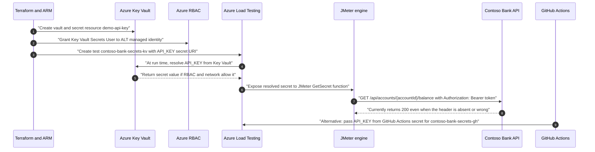

# 24 — Secrets from Key Vault in Azure Load Testing

> **Section goal:** Answer the customer question honestly: this demo kit has a Key Vault secret-resolution test, but today it proves only that Azure Load Testing can be configured to fetch and send a secret-shaped parameter. It does **not** prove the Contoso Bank application validates that secret. The live deployment also shows the older repo narrative is too absolute: this vault currently has public network access disabled, yet the named Key Vault run still executed many samples with zero request errors.

**Format:** Code walkthrough + optional live portal check · **Audience:** Security architecture, platform engineering, DevSecOps, financial-services governance

---

## 24.1 Plain answer to the customer question

Yes, the repo ships a test case for this:

| Item | Current state |
|---|---|
| Key Vault test ID | `contoso-bank-secrets-kv` in [`loadtests/config/secrets-demo.yaml`](../loadtests/config/secrets-demo.yaml) |
| Script | [`loadtests/jmeter/contoso-bank-secrets.jmx`](../loadtests/jmeter/contoso-bank-secrets.jmx) |
| Secret name exposed to the test | `API_KEY` |
| Secret source | Key Vault secret URI `https://kv-loadtest-27d2e5.vault.azure.net/secrets/demo-api-key` |
| Wire location | HTTP `Authorization` header, as `Bearer ${__GetSecret(API_KEY)}` |
| App endpoint hit by the secured sampler | `GET /api/accounts/${accountId}/balance` |
| Current verdict | **Not airtight.** It does not prove application-side authentication. |

What it proves today:

- The test definition can carry a **Key Vault secret URI** instead of a secret value (`loadtests/config/secrets-demo.yaml`, lines 61-63).
- Azure Load Testing can store that secret parameter on the test definition (`az load test show` reports `API_KEY` as an `AKV_SECRET_URI`).
- The JMeter plan is wired to send the resolved value as an HTTP header (`loadtests/jmeter/contoso-bank-secrets.jmx`, lines 45-46).

What it does **not** prove today:

- It does **not** prove the application rejects requests without the token. `src/main.py` has no `Authorization`, API-key, `Header`, `Depends`, `Security`, or `HTTPBearer` validation path. The only `request.headers` reads found are for `X-Correlation-Id` (`src/main.py`, lines 452 and 919), and the balance endpoint itself is declared without any dependency (`src/main.py`, line 731).
- It does **not** prove the secret resolved to a non-empty or correct value. The live run `contoso-bank-secrets-kv-runall-20260915-102506` executed `14,644` total samples with `0.0%` errors, but the application also returns `200` with no `Authorization` header and with a deliberately wrong bearer token.
- It does **not** support the repo's older absolute claim that this subscription's Key Vault policy necessarily makes `contoso-bank-secrets-kv` fail at run time. The vault does report `publicNetworkAccess: "Disabled"` and this CLI caller is blocked from data-plane secret reads, but the named run still reached engine execution. Treat the policy trap as **"can fail unless the Azure Load Testing-to-Key Vault path is admitted"**, not **"public access disabled guarantees run-time failure"**.
- It does **not** prove the secret value is the right value. Because the app ignores the header, any value, an empty value, or no header still results in successful application responses today.

Blunt demo line:

> **This is currently a secret-transport demo, not an authentication demo.** It shows where a Key Vault secret-shaped value would be fetched and placed on the wire, but the Contoso Bank API does not validate it. A run with an empty or wrong token would very likely look the same at the application layer.

---

## 24.2 Repository facts from the audit

| File | Line-level fact | Meaning |
|---|---|---|
| `loadtests/config/secrets-demo.yaml` | Lines 36-41 define `testId: contoso-bank-secrets-kv`, display name `Contoso Bank - Key Vault Secrets`, and `testPlan: ../jmeter/contoso-bank-secrets.jmx`. | The Key Vault test exists as a first-class Azure Load Testing YAML definition. |
| `loadtests/config/secrets-demo.yaml` | Lines 49-58 set non-secret `env` values such as `BASE_URL`, `threads`, `rampup`, `duration`, and `accountId`. | The host and load shape are not secret and are stored plainly. |
| `loadtests/config/secrets-demo.yaml` | Lines 61-63 define `API_KEY` as a Key Vault secret URI. | The YAML stores a URI, not the secret value. |
| `loadtests/config/secrets-demo.yaml` | Lines 23-25 explicitly state that the Contoso Bank API does not currently validate the `Authorization` header. | The current repo already documents the core limitation. |
| `loadtests/jmeter/contoso-bank-secrets.jmx` | Line 13 reads `BASE_URL` from `System.getenv("BASE_URL")`. | Non-secret environment variables are read by JMeter from the load-test engine environment. |
| `loadtests/jmeter/contoso-bank-secrets.jmx` | Lines 45-46 set the `Authorization` header to `Bearer ${__GetSecret(API_KEY)}`. | The secret is placed in a header, not in a query string or body. |
| `loadtests/jmeter/contoso-bank-secrets.jmx` | Lines 66-81 call `/api/accounts/${accountId}/balance` and assert HTTP `200`. | The main sampler expects success when the header is present. |
| `loadtests/jmeter/contoso-bank-secrets.jmx` | Lines 88-103 call `/health` and assert HTTP `200`. | The script also sends the same header to a health endpoint that should not require authentication. |
| `src/main.py` | Lines 549, 560, 645, 676, 720, 731, 772, 802, 862, and 870 declare endpoints with no authentication dependency. | No route is protected by an API key today. |
| `src/main.py` | Lines 731-769 implement `GET /api/accounts/{account_id}/balance`; the first branch is a `404` check, not an auth check. | Missing or wrong `Authorization` cannot change the result today. |
| `infra/main.tf` | Lines 253-263 create the Azure Load Testing resource with a system-assigned identity. | The default Key Vault resolution identity is the load test resource identity. |
| `infra/main.tf` | Lines 291-322 create Key Vault with RBAC enabled, `public_network_access_enabled = var.key_vault_public_network_access_enabled`, and `ignore_changes` for that setting. | Terraform expresses public access, but deliberately tolerates policy drift. |
| `infra/main.tf` | Lines 330-343 grant `Key Vault Secrets User` to the load-test identity and `Key Vault Secrets Officer` to the deployer. | The intended RBAC model is present. |
| `infra/main.tf` | Lines 347-363 seed `demo-api-key` through `azapi_resource.demo_api_key`. | The demo secret is created through ARM; do not replace the demo value with a real credential because it would land in Terraform state. |
| `infra/main.tf` | Lines 366-382 create the load-test `OperationLogs` diagnostic setting. | The kit has audit evidence for load-test resource operations. |
| `tools/provision_loadtests.ps1` | Lines 195-231 retarget Key Vault secret URIs under `loadtests/**` and deliberately drop a version segment. | Recreated vaults keep working by using versionless current-secret URIs. |
| `tools/provision_loadtests.ps1` | Lines 632-670 attempt a best-effort Key Vault secret seed and warn that `contoso-bank-secrets-kv` validates at create time but fails at run time when public network access is disabled. | The PowerShell hook recognises a real policy trap, but its current warning is too absolute for the live environment. |
| `tools/provision_loadtests.sh` | Lines 156-176 and 467-547 implement the same retargeting and seed-warning behaviour for POSIX shells. | Linux/macOS hook behaviour matches PowerShell. |
| `.github/workflows/loadtest.yml` | Lines 127-132 map `contoso-bank-secrets-kv` to `secrets-demo.yaml` and create an override test ID `contoso-bank-secrets-gh`. | The same JMX can run with two secret sources. |
| `.github/workflows/loadtest.yml` | Lines 157-161 pass `secrets.DEMO_API_KEY` as the Azure Load Testing test secret named `API_KEY`. | The GitHub Actions path bypasses Key Vault at run time. |

---

## 24.3 End-to-end flow



Detailed flow for `contoso-bank-secrets-kv`:

1. **Terraform creates the vault and seed secret.** `infra/main.tf` creates `azurerm_key_vault.this`, enables RBAC, assigns roles, and creates `azapi_resource.demo_api_key`. This is a fake demo secret path only; real bank credentials must never be put into Terraform state.
2. **Terraform grants the load-test identity access.** The Azure Load Testing resource has a system-assigned identity, and `azurerm_role_assignment.key_vault_secrets_user` grants it `Key Vault Secrets User` on the vault.
3. **The test definition stores the URI.** `loadtests/config/secrets-demo.yaml` stores `API_KEY` with a Key Vault URI under `secrets:`. Microsoft Learn confirms that secret parameters use the secret name expected by the script and a Key Vault secret identifier as the value.
4. **Azure Load Testing resolves at run time.** The load-test service uses the configured Key Vault reference identity. If no explicit `keyVaultReferenceIdentity` or `referenceIdentities` entry is supplied, this demo uses the load-test resource's system-assigned identity.
5. **JMeter reads the secret.** The JMX uses Azure Load Testing's custom `GetSecret` function: `${__GetSecret(API_KEY)}`. Microsoft Learn states this function works only when the JMeter script runs in Azure Load Testing, not when run locally.
6. **JMeter sends the secret to the app.** The script sends `Authorization: Bearer ${__GetSecret(API_KEY)}` on the `/api/accounts/${accountId}/balance` and `/health` samplers. It is not in the URL, not in query parameters, and not in the request body.
7. **The application ignores it today.** `GET /api/accounts/{account_id}/balance` returns data without requiring a key. Live read-only checks returned `200` for both no `Authorization` header and a deliberately wrong `Authorization` header.

---

## 24.4 Two supported secret sources

Azure Load Testing supports two practical ways to supply the `API_KEY` test secret for this repo.

| Source | How it works | Identity required | Network requirement | When to use | Bank recommendation |
|---|---|---|---|---|---|
| **Key Vault secret URI** | YAML stores `secrets: - name: API_KEY; value: https://...vault.azure.net/secrets/demo-api-key`. Azure Load Testing resolves the value at run time and JMeter reads it with `${__GetSecret(API_KEY)}`. | Load-test resource managed identity with secret `Get` permission. In this repo that is `Key Vault Secrets User` on the vault. Microsoft Learn confirms both system-assigned and user-assigned identities are supported; YAML `referenceIdentities` can set `kind: KeyVault` with `type: UserAssigned` or `SystemAssigned`. | The vault data plane must be reachable to Azure Load Testing through permitted public access, trusted Microsoft services bypass, or an approved private networking design. If policy forces public access off and blocks every trusted/private path, resolution fails. The live run proves public access disabled alone is not enough evidence to say it will fail. | Production-like governance, auditability, rotation, and no secret value in CI/CD configuration. | **Recommended source of record for a bank.** Prefer a user-assigned identity when the identity lifecycle should survive resource replacement or be governed separately; system-assigned is acceptable for a simple demo. |
| **CI/CD pipeline secret** | `.github/workflows/loadtest.yml` passes `${{ secrets.DEMO_API_KEY }}` to `azure/load-testing@v1` as a run-time test secret named `API_KEY`; the workflow override creates test ID `contoso-bank-secrets-gh`. | GitHub Actions OIDC identity needs permission to run/update the Azure Load Testing test. No Key Vault identity is needed for this run-time path. | No Key Vault data-plane call during the run. The runner still needs Azure Load Testing data-plane access and the app endpoint must be reachable. | Demo green path in a governed subscription where Key Vault network policy blocks run-time resolution. | Useful as a short-term demo or pipeline bridge, but weaker as a bank control because the secret is duplicated into the CI/CD secret store. Use only with repository/environment protections and rotation discipline. |

Learn-backed identity note: Azure Load Testing managed identities support both **system-assigned** and **user-assigned** identities, and the YAML reference supports `referenceIdentities` with `kind: KeyVault`, `type: UserAssigned`, and the user-assigned identity resource ID. That means user-assigned identity is supported for Key Vault secret resolution; it is not limited to the system-assigned identity.

---

## 24.5 Current live deployment check

Read-only checks were run against:

| Resource | Result |
|---|---|
| Subscription | `1da52b57-468a-4dc6-ba36-1255cc1f6e8e` |
| Resource group | `rg-loadtest` |
| Load test resource | `alt-loadtest-27d2e5` |
| Key Vault | `kv-loadtest-27d2e5` |
| App | `app-loadtest-27d2e5.azurewebsites.net` |

Observed state:

| Check | Result |
|---|---|
| `az keyvault show --query "{pna:properties.publicNetworkAccess,acls:properties.networkAcls,rbac:properties.enableRbacAuthorization}"` | Returned `{ "pna": "Disabled", "acls": null, "rbac": true }`. Public network access is **Disabled** right now. |
| `az keyvault secret show --query "{id:id,enabled:attributes.enabled,updated:attributes.updated}"` | Failed before returning metadata with `ForbiddenByConnection`: public network access is disabled and the request was not from a trusted service or approved private link. No secret value was read or printed. This proves the present CLI caller cannot use the vault data plane; it does not prove Azure Load Testing cannot. |
| `az resource show` for `Microsoft.KeyVault/vaults/secrets/demo-api-key` | Confirmed ARM metadata only: the secret resource exists, `enabled` is `true`, and the `secretUri` is `https://kv-loadtest-27d2e5.vault.azure.net/secrets/demo-api-key`. No secret value was read or printed. |
| `az load show` | Load test resource identity type was `SystemAssigned`; principal ID was present. |
| `az role assignment list` | The load-test principal had `Key Vault Secrets User` on the vault; the deployer had `Key Vault Secrets Officer`. |
| `az load test show --test-id contoso-bank-secrets-kv` | The test exists; `API_KEY` is stored as an `AKV_SECRET_URI`; `keyVaultReferenceIdentity` was null, so the system-assigned identity is the implied path. |
| `az load test-run show --test-run-id contoso-bank-secrets-kv-runall-20260915-102506` | Returned `status: DONE`, `testResult: FAILED`, `sampleCount: 14644`, `errorCount: 0.0`, and `errorPct: 0.0`. The `percentage(error) > 5` criterion passed, but `avg(response_time_ms) > 500` and `GetBalanceWithSecretHeader: p95(response_time_ms) > 800` failed. This differs from the supplied "PASSED (0/4 criteria failed)" summary for the same run ID. |
| `curl`/`Invoke-WebRequest` without auth | `/health` returned `200`; `/api/accounts/ACC-1001/balance` returned `200`. |
| `curl`/`Invoke-WebRequest` with a wrong bearer token | `/health` returned `200`; `/api/accounts/ACC-1001/balance` returned `200`. |

Live verdict:

> Case **(b)** is the right answer for the customer's core question: the path "works" only in the sense that the test can run and the app returns success, because nothing verifies the secret. The live run with `14,644` samples and `0.0%` errors proves requests completed; it does not prove the `Authorization` header held a non-empty or correct Key Vault value. Separately, the older repo narrative that `publicNetworkAccess=Disabled` guarantees this test's run-time failure is misleading for this subscription. The accurate statement is that the Key Vault path **can** fail when Azure Load Testing is not admitted to the vault data plane.

### 24.5.1 Wording changes recommended for the older narrative

Do not edit these files casually during the demo, but the following wording should be changed in a follow-up PR because the current live evidence contradicts the absolute "will fail" phrasing.

| File | Current claim to soften | Suggested replacement wording |
|---|---|---|
| `docs/11-security-compliance-network.md` | Subscription policy can make `contoso-bank-secrets-kv` validate at create time and fail at run time. | "Subscription policy can make Key Vault secret resolution fail at run time if Azure Load Testing is not admitted to the vault data plane. In the current live environment, public network access is disabled but the named Key Vault run still executed; because the app does not validate the header, that run is not proof of a correct secret." |
| `docs/20-private-network-integration.md` | The `contoso-bank-secrets-kv` problem is described as validating successfully but failing at run time in this subscription. | "This is a potential failure mode, not a deterministic outcome for every run. Verify the exact vault network posture, trusted-service/private-link path, and run statistics. A completed run with zero errors still does not prove secret correctness unless the target endpoint rejects missing or wrong tokens." |
| `docs/21-solution-architecture.md` | "Known policy trap" says the test validates at create time and fails at run time. | "Known policy trap: Key Vault network policy can break run-time secret resolution. Validate it empirically for the environment. Also validate application-side enforcement; otherwise a green run only proves request execution." |
| `infra/main.tf` comment above `azurerm_key_vault.this` | "Consequence to explain in the demo: Load Testing cannot resolve `${__GetSecret(...)}` from a vault whose public access is disabled unless the customer adds a private networking design for the service." | "Consequence to explain in the demo: Key Vault network policy can block run-time `${__GetSecret(...)}` resolution unless Azure Load Testing is admitted through trusted-service bypass or an approved private networking design. Do not assume `publicNetworkAccess=Disabled` alone guarantees failure; verify with an actual run and application-side negative test." |
| `tools/provision_loadtests.ps1` and `tools/provision_loadtests.sh` warning text | "Consequence: `contoso-bank-secrets-kv` will validate at create time but FAIL at run time." | "Consequence: `contoso-bank-secrets-kv` may validate at create time but fail at run time if Azure Load Testing cannot reach the Key Vault data plane. If a run completes, it still does not prove the secret value unless the application rejects missing or wrong tokens." |

---

## 24.6 What is needed to make the demo airtight

Do **not** make these changes casually in the middle of a customer demo. Treat them as the concrete implementation plan for the parent session or a follow-up PR.

### 24.6.1 Protect exactly one endpoint

Protect `GET /api/accounts/{account_id}/balance`, because that is the sampler already used by `GetBalanceWithSecretHeader`.

Sketch for `src/main.py`:

```python
from hmac import compare_digest
from typing import Annotated

from fastapi import Depends, Header, HTTPException


def expected_demo_api_key() -> str:
    expected = os.getenv("DEMO_API_KEY", "").strip()
    if not expected:
        raise HTTPException(status_code=500, detail="Demo API key is not configured")
    return expected


async def require_demo_api_key(
    authorization: Annotated[str | None, Header(alias="Authorization")] = None,
) -> None:
    scheme, _, supplied = (authorization or "").partition(" ")
    if scheme.lower() != "bearer" or not compare_digest(supplied, expected_demo_api_key()):
        raise HTTPException(
            status_code=401,
            detail="Invalid or missing API key",
            headers={"WWW-Authenticate": "Bearer"},
        )


@app.get(
    "/api/accounts/{account_id}/balance",
    tags=["accounts"],
    dependencies=[Depends(require_demo_api_key)],
)
async def get_balance(account_id: str) -> dict[str, Any]:
    ...
```

Implementation notes:

- Use constant-time comparison (`hmac.compare_digest`) so the demo does not teach a timing side channel.
- Source the expected value from secure configuration (`DEMO_API_KEY`), not from source code.
- For a bank-grade path, set the App Service app setting from Key Vault or a protected deployment secret. If using an App Service Key Vault reference, give the app's managed identity the least privilege needed and make sure its Key Vault network path works too.
- Leave `/health` unauthenticated so platform health probes and portal demos stay simple.

### 24.6.2 Keep the positive JMeter test

The positive JMX should continue to send the header:

```xml
<stringProp name="Header.name">Authorization</stringProp>
<stringProp name="Header.value">Bearer ${__GetSecret(API_KEY)}</stringProp>
```

For readability and easier debugging, consider changing the direct call into a user-defined variable:

```xml
<elementProp name="udv_apiKey" elementType="Argument">
  <stringProp name="Argument.name">udv_apiKey</stringProp>
  <stringProp name="Argument.value">${__GetSecret(API_KEY)}</stringProp>
  <stringProp name="Argument.metadata">=</stringProp>
</elementProp>

<stringProp name="Header.name">Authorization</stringProp>
<stringProp name="Header.value">Bearer ${udv_apiKey}</stringProp>
```

The positive YAML remains a Key Vault URI test:

```yaml
testId: contoso-bank-secrets-kv
secrets:
  - name: API_KEY
    value: https://<vault-name>.vault.azure.net/secrets/demo-api-key
failureCriteria:
  clientMetrics:
    - percentage(error) > 5
```

If the bank wants user-assigned identity separation, add:

```yaml
referenceIdentities:
  - kind: KeyVault
    type: UserAssigned
    value: /subscriptions/<sub-id>/resourceGroups/<rg>/providers/Microsoft.ManagedIdentity/userAssignedIdentities/<identity-name>
```

### 24.6.3 Add the negative proof

Add a second, deliberately failing test that calls the protected balance endpoint **without** the `API_KEY` secret. Its purpose is not to pass; its purpose is to prove that the app rejects unauthenticated traffic and that the load-test gate catches it.

Suggested YAML shape:

```yaml
version: v0.1
testId: contoso-bank-secrets-negative
displayName: Contoso Bank - Missing API Key Must Fail
description: Proves the balance endpoint rejects missing API keys.
testType: JMX
testPlan: ../jmeter/contoso-bank-secrets-negative.jmx
engineInstances: 1
env:
  - name: BASE_URL
    value: app-loadtest-27d2e5.azurewebsites.net
  - name: accountId
    value: ACC-1001
failureCriteria:
  clientMetrics:
    - percentage(error) > 0
autoStop:
  errorPercentage: 90
  timeWindow: 60
```

Suggested negative JMX assertions:

- Make only the protected balance request.
- Do **not** configure the `Authorization` header.
- Keep the response assertion at `200`, so the expected `401` is counted as an error and breaches `percentage(error) > 0`.
- Add a separate optional debugging assertion only when developing locally, not in the customer run, to show that the raw response code is `401`.

Expected evidence after the change:

| Run | Expected result |
|---|---|
| Positive run with `API_KEY` resolved | `GET /api/accounts/{account_id}/balance` returns `200`; failure criteria do not breach. |
| Negative run without `API_KEY` | The protected sampler receives `401`; JMeter marks the sampler failed because it expected `200`; `percentage(error) > 0` breaches; the run fails. |
| `/health` without `API_KEY` | Still returns `200`. |

That pair is the airtight proof: the secret is fetched, carried on the wire, accepted by the app, and absence of the secret fails.

---

## 24.7 Certificates and environment variables alongside secrets

Azure Load Testing supports three separate parameter categories. Do not blur them in front of a bank security team.

| Parameter type | What it is for | How the repo uses or would use it | Learn-verified behaviour |
|---|---|---|---|
| Secret | Sensitive string such as API key, bearer token, password, or credential. | `API_KEY` in `secrets-demo.yaml` and `loadtest.yml`. JMeter reads it with `${__GetSecret(API_KEY)}`. | Azure Load Testing supports Azure Key Vault secrets and CI/CD secret stores. JMeter uses the custom `GetSecret` function; Locust receives secrets as environment variables. `GetSecret` works only inside Azure Load Testing. |
| Certificate | Client certificate for mTLS. | Not currently used by the Contoso Bank JMX, but the YAML would use `certificates:` with a Key Vault certificate/secret URI. | Azure Load Testing supports PKCS#12/PFX client certificates stored in Key Vault. For JMeter, the service injects the certificate into web requests. For Locust, certificates are available under `ALT_CERTIFICATES_DIR`. Azure Load Testing retrieves certificates as secrets so the private key is available. |
| Environment variable | Non-sensitive parameter such as host, load shape, duration, or account ID. | `BASE_URL`, `threads`, `rampup`, `duration`, and `accountId` in `secrets-demo.yaml`; `BASE_URL` is read in JMeter using `System.getenv("BASE_URL")`. | YAML and CI/CD workflow `env` parameters are available to the test engine. Microsoft Learn positions environment variables for non-sensitive values and secrets for sensitive values. |

Example certificate reference:

```yaml
certificates:
  - name: mtls-client
    value: https://<vault-name>.vault.azure.net/certificates/<certificate-name>/<version>
```

Example non-secret environment variable:

```yaml
env:
  - name: BASE_URL
    value: app-loadtest-27d2e5.azurewebsites.net
```

---

## 24.8 Troubleshooting

| Symptom | Likely cause | Fix |
|---|---|---|
| Secret resolves to empty string | The configured secret name does not match the JMeter `GetSecret` argument; the CI/CD run did not pass a value; the JMX is being run locally where Azure Load Testing's `GetSecret` function is unavailable; or the test was rerun from the portal after a pipeline-only secret was used. | Make the YAML/action secret name exactly match `${__GetSecret(API_KEY)}`; pass the secret again for each CI/CD run; do not rely on local JMeter for `GetSecret`; use a safe diagnostic assertion on response code only, never print the secret. |
| `403` from Key Vault | The load-test managed identity lacks secret `Get` permission, the role assignment has not propagated, or the vault firewall/network rules block the caller. | Confirm `Key Vault Secrets User` on the vault for the exact load-test identity or selected user-assigned identity; wait for RBAC propagation; confirm the vault network path. |
| Vault public access disabled by policy | Azure Policy changed the effective Key Vault network posture after Terraform creation. In the live check, `publicNetworkAccess` was `Disabled`. | Get a policy exemption or approved design for trusted Microsoft services/private endpoint access; otherwise use the CI/CD secret path only as a demo workaround. |
| Test validates but fails at run time | Test creation validates the shape of the Key Vault URI and test definition, but the actual secret value is fetched at run time. Network or RBAC failures surface later. | Run a cheap pre-flight after provisioning that checks the load-test identity, role assignment, vault network setting, and test definition. Do not assume create/update success proves run-time secret access. |
| `contoso-bank-secrets-kv` fails while `contoso-bank-secrets-gh` runs | Key Vault data-plane access is blocked, but the GitHub Actions secret path bypasses Key Vault resolution during the run. | Use `contoso-bank-secrets-gh` only for the green demo path; fix the Key Vault network path before presenting it as the bank-grade pattern. |
| App returns `200` without `Authorization` | Current `src/main.py` does not enforce an API key on any endpoint. | Add the FastAPI dependency in §24.6.1 to `GET /api/accounts/{account_id}/balance`, then add the negative test in §24.6.3. |
| Secret visible in results/logs | The script logged headers, placed the secret in a URL/query/body, used a Debug Sampler, echoed pipeline inputs, or put sensitive values in sampler names. | Keep the secret in the `Authorization` header; never put it in query strings, request names, assertions, variables displayed by debug output, or pipeline logs; disable request-header logging in result artefacts; review JTL/log settings before sharing results. |
| `Key Vault Secrets User` exists but secret access still fails | RBAC is correct but the vault data plane is unreachable to the caller. This is the current CLI data-plane pattern, but the named Azure Load Testing run still executed. | Treat RBAC and network as separate gates. Fix or document the network policy/private endpoint/trusted bypass path; do not keep adding duplicate role assignments. |

---

## 24.9 Governance notes for financial services

| Control | Recommended demo position |
|---|---|
| Secret rotation | Use Key Vault as the source of record and use versionless secret URIs for normal runs so rotation advances automatically to the current version. Use versioned URIs only for forensic replay or controlled rollback. |
| Least privilege | Grant only `Key Vault Secrets User` to the load-test identity for run-time reads. Grant `Key Vault Secrets Officer` only to the deployment/rotation identity that creates or updates the demo secret. Prefer a user-assigned identity when the bank wants identity lifecycle, RBAC, and approvals separated from the load-test resource lifecycle. |
| No secret in source control | Keep only Key Vault URIs, secret names, and non-secret environment variables in Git. Do not place a real secret in Terraform variables, YAML, JMX, README examples, GitHub Actions logs, or test artefacts. |
| No secret in the test definition | Microsoft Learn states that Azure Load Testing stores only the Key Vault secret URI for Key Vault-backed secrets and fetches the value for each test run. Pipeline-provided secret values are not available after the run, but they are still copied into the CI/CD secret store and should be treated as duplicated custody. |
| Audit evidence | The repo already creates an Azure Load Testing diagnostic setting for `OperationLogs` (`infra/main.tf`, lines 366-382). Microsoft Learn maps this category to the `AzureLoadTestingOperation` table for operations such as test and test-run creation. For full secret-read evidence, also enable Key Vault diagnostic logs in a bank deployment. |
| Network governance | Decide explicitly whether the vault permits trusted Microsoft services, private endpoint only, or a Network Security Perimeter design. The current live subscription demonstrates why this must be verified empirically before the demo: public network access is disabled and CLI data-plane reads are blocked, yet the named Azure Load Testing run executed. |

---

## 24.10 Presenter script

Use this short version with the customer:

> "We do have a Key Vault secret test: `contoso-bank-secrets-kv`. The YAML contains only the Key Vault URI, Azure Load Testing resolves `API_KEY` with the load-test managed identity, and JMeter sends it as a bearer token in the `Authorization` header. But the current application does not validate the header, so a green response or a zero-error run does not prove authentication or a correct secret value. In this subscription the vault public network access is disabled and CLI data-plane reads are blocked, but the named Azure Load Testing run still executed; so the old 'will fail' wording is too strong. For a bank, the proper final design is Key Vault plus least-privilege managed identity plus a negative 401 test."

---

## 24.11 References verified

- Microsoft Learn — [Use secrets and environment variables in Azure Load Testing](https://learn.microsoft.com/azure/app-testing/load-testing/how-to-parameterize-load-tests): verifies Key Vault secret URI parameters, CI/CD secret-store injection, `${__GetSecret(...)}` for JMeter, Locust secret environment variables, non-secret environment variables, and the FAQ that Key Vault-backed secret values are not stored by the service.
- Microsoft Learn — [Load test secured endpoints with Azure Load Testing](https://learn.microsoft.com/azure/app-testing/load-testing/how-to-test-secured-endpoints): verifies shared-secret authentication flow, GitHub Actions `secrets` input, use of `Authorization` headers, client certificates, and managed-identity authentication scenarios.
- Microsoft Learn — [Configure a load test in YAML](https://learn.microsoft.com/azure/app-testing/load-testing/reference-test-config-yaml): verifies `secrets`, `env`, `certificates`, `keyVaultReferenceIdentity`, and `referenceIdentities` syntax, including `kind: KeyVault` and `type: UserAssigned` or `SystemAssigned`.
- Microsoft Learn — [Use managed identities for Azure Load Testing](https://learn.microsoft.com/azure/app-testing/load-testing/how-to-use-a-managed-identity): verifies system-assigned and user-assigned managed identities for Azure Load Testing and their use for securely reading secrets or certificates from Key Vault.
- Microsoft Learn — [Monitoring Azure Load Testing](https://learn.microsoft.com/azure/app-testing/load-testing/monitor-load-testing) and [Monitor Azure Load Testing data reference](https://learn.microsoft.com/azure/app-testing/load-testing/monitor-load-testing-reference): verify diagnostic settings and operational logs for Azure Load Testing.
- Microsoft Learn — [Supported logs for `microsoft.loadtestservice/loadtests`](https://learn.microsoft.com/azure/azure-monitor/reference/supported-logs/microsoft-loadtestservice-loadtests-logs) and [AzureLoadTestingOperation table](https://learn.microsoft.com/azure/azure-monitor/reference/tables/azureloadtestingoperation): verify the `OperationLogs` category and its audit table.
- Microsoft Learn — [Configure network security for Azure Key Vault](https://learn.microsoft.com/azure/key-vault/general/network-security) and [Virtual network service endpoints for Azure Key Vault](https://learn.microsoft.com/azure/key-vault/general/overview-vnet-service-endpoints#grant-access-to-trusted-azure-services): verify firewall, public access disabled, private endpoint, and trusted Microsoft services bypass behaviour.
