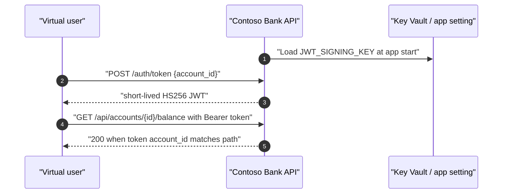

# 25 — Simulating JWT User Identity

> **Section goal:** decide how to model authenticated banking users in the Contoso Bank load tests without accidentally load testing Microsoft Entra ID, leaking credentials, or producing optimistic performance numbers.
>
> This is a planning document only. It deliberately does **not** change `src/main.py`, the JMeter plans, the Locust script, or the YAML definitions.

---

## 25.1 Why identity changes a load test

The current Contoso Bank API has **no real authentication**. `src/main.py` exposes `/health`, `/ready`, `/status`, the unauthenticated `/admin/*` control plane, and the banking endpoints:

| Area | Endpoints in this kit | Current auth state |
|---|---|---|
| Operations | `GET /health`, `GET /ready`, `GET /`, `GET /status` | No auth |
| Admin control plane | `GET /admin/config`, `GET /admin/presets`, `POST /admin/config`, `POST /admin/reset` | No auth |
| Accounts | `GET /api/accounts`, `GET /api/accounts/{account_id}/balance`, `GET /api/accounts/{account_id}/transactions` | No auth |
| Payments | `POST /api/transfers`, `GET /api/transfers/{transaction_id}` | No auth |
| Reporting | `GET /api/statements/{account_id}` | No auth |

That is fine for the existing demo because the performance defects are in the request handlers, database-pool simulation, cache, transfer lock, third-party check simulation and CPU-bound statement generation. But identity changes the measurements in ways that matter to a bank:

| Identity behaviour | Why it changes the result |
|---|---|
| **Per-user tokens** | Different `sub`, `oid`, account, role and entitlement claims can drive different authorisation branches, cache keys and downstream calls. |
| **One shared token** | Can hide contention in token validation caches, entitlements caches, session stores, policy engines and downstream account-authorisation services. It often produces optimistic numbers. |
| **No token at all** | Isolates the API handler path from identity-provider latency and throttling, which can be the right experiment when you want to measure only the application. |
| **Real identity-provider calls during ramp-up** | Can turn the identity provider into the bottleneck before the banking API is under meaningful load. |

The honest counter-argument is important: **testing with authentication disabled is legitimate when the test objective is to isolate application performance from the identity provider**. If the question is "does the balance endpoint fall over because the DB pool is too small?", auth can be deliberately out of scope. If the question is "can 1,000 customers sign in and use payments at market open?", auth must be in scope.

---

## 25.2 Option comparison

| Option | Realism | Setup effort | Blast radius on identity provider | Cost | Rate-limit risk at 1,000+ VUs | Suitability for a bank non-production environment |
|---|---:|---:|---:|---:|---:|---|
| **A. Pre-minted token pool** | High if tokens come from the same issuer and contain per-user claims | Medium | Low during the run; token minting happens before it | Low to medium | Low during the run; risk moves to pre-mint job | Good for pre-prod when token lifetime covers the run and test users are approved |
| **B. Token fetched once per virtual user at start-up** | High for sign-in-adjacent journeys | Medium | Medium to high during ramp-up | Low to medium | High if all VUs start together | Use cautiously; ramp slowly and cache tokens |
| **C. OAuth 2.0 client credentials against Microsoft Entra ID** | Medium; app identity, not user identity | Medium | Low if one token per engine and cached | Low unless using chargeable external identity features | Medium if token caching is wrong; Microsoft documents 429 + `Retry-After` when called too frequently | Good for service-to-service APIs; weak for retail customer identity |
| **D. ROPC / test user accounts** | High-ish for password-based user tokens, but not modern sign-in | High | High; uses user passwords and interactive controls do not apply | Medium operational overhead | High at scale; also fails under MFA/federation constraints | Poor; expect a bank security team to reject it |
| **E. Locally signed test JWTs** | Medium to high for API authorisation paths; not a real sign-in | Low to medium | None | Free | None against the identity provider | **Best fit for this kit and most performance tests** when the goal is API capacity |
| **F. Mocked/bypass auth header** | Low | Low | None | Free | None | Acceptable for early bottleneck isolation; weak evidence for secured banking paths |

**Recommendation for this kit:** use **E. Locally signed test JWTs**, preferably issued by a self-contained `/auth/token` endpoint in the demo app. It exercises `Authorization: Bearer ...`, token parsing, expiry handling and per-account authorisation without calling Microsoft Entra ID during the measured run. It is deterministic, free, self-contained, and cannot leak a production credential.

**Recommendation for the customer's real system:** use the option that matches the test objective:

| Test objective | Use this option |
|---|---|
| Measure pure API capacity without identity-provider noise | Locally signed test JWTs in a controlled non-production environment |
| Measure the real end-to-end sign-in journey | A carefully rate-limited real identity flow in a non-production tenant, usually not the same test as the API capacity test |
| Test service-to-service APIs | Client credentials, token per engine/process, cached and refreshed |
| Prove authorisation branches per customer segment | Pre-minted per-user token pool, or locally signed test JWTs with realistic claims |
| Fast developer smoke or PR gate | Auth disabled, or a bypass header, with the limitation stated clearly |

---

## 25.3 Option A — pre-minted token pool

Generate a pool of short-lived JWTs before the run, one row per virtual user or per test account, then feed them into the test exactly like `loadtests/data/accounts.csv`. The existing JMeter plan already uses a `CSVDataSet` named **Accounts CSV**, and `loadtests/config/peak-load.yaml` uploads `../data/accounts.csv` through `configurationFiles` with `splitAllCSVs: true`.

### Token data file

```csv
accountId,customerName,sortCode,segment,token,expiresAt
ACC-1001,Alice Fairweather,20-45-11,retail,eyJhbGciOiJIUzI1NiIs...,2026-09-15T10:30:00Z
ACC-1002,Benjamin Osei,20-45-11,retail,eyJhbGciOiJIUzI1NiIs...,2026-09-15T10:30:00Z
```

For the Contoso Bank JMX, either extend `accounts.csv` with `token,expiresAt`, or add a second CSV. Extending the existing file is simpler because the token and `accountId` stay on the same row.

### JMeter sketch

```xml
<CSVDataSet guiclass="TestBeanGUI" testclass="CSVDataSet" testname="Accounts CSV with Tokens" enabled="true">
  <stringProp name="filename">accounts-with-tokens.csv</stringProp>
  <stringProp name="fileEncoding">UTF-8</stringProp>
  <stringProp name="variableNames">accountId,customerName,sortCode,segment,token,expiresAt</stringProp>
  <boolProp name="ignoreFirstLine">true</boolProp>
  <stringProp name="delimiter">,</stringProp>
  <boolProp name="quotedData">false</boolProp>
  <boolProp name="recycle">true</boolProp>
  <boolProp name="stopThread">false</boolProp>
  <stringProp name="shareMode">shareMode.all</stringProp>
</CSVDataSet>

<HeaderManager guiclass="HeaderPanel" testclass="HeaderManager" testname="HTTP Header Manager" enabled="true">
  <collectionProp name="HeaderManager.headers">
    <elementProp name="" elementType="Header">
      <stringProp name="Header.name">Content-Type</stringProp>
      <stringProp name="Header.value">application/json</stringProp>
    </elementProp>
    <elementProp name="" elementType="Header">
      <stringProp name="Header.name">Accept</stringProp>
      <stringProp name="Header.value">application/json</stringProp>
    </elementProp>
    <elementProp name="" elementType="Header">
      <stringProp name="Header.name">Authorization</stringProp>
      <stringProp name="Header.value">Bearer ${token}</stringProp>
    </elementProp>
  </collectionProp>
</HeaderManager>
```

### Locust sketch

```python
import csv
import itertools
from pathlib import Path
from threading import Lock

from locust import HttpUser, between, task

TOKEN_ROWS = list(csv.DictReader(Path("accounts-with-tokens.csv").open()))
TOKEN_ITER = itertools.cycle(TOKEN_ROWS)
TOKEN_LOCK = Lock()


class RetailBankingCustomer(HttpUser):
    wait_time = between(0.5, 1.0)

    def on_start(self):
        with TOKEN_LOCK:
            row = next(TOKEN_ITER)
        self.account_id = row["accountId"]
        self.auth_headers = {"Authorization": f"Bearer {row['token']}"}

    @task
    def check_balance(self):
        self.client.get(
            f"/api/accounts/{self.account_id}/balance",
            headers=self.auth_headers,
            name="GetBalance",
        )
```

### Lifetime rule

Token lifetime must be longer than **test duration + ramp-up + queueing/cleanup margin**, or the graph will show a sudden cliff of `401` responses when the pool expires. For a 15-minute peak run, do not mint 15-minute tokens just before pressing Run; there is always delay between token creation, file upload, engine start and full ramp.

This option is realistic, but it creates an operational job: someone or something has to mint and protect the CSV before every run. Treat that CSV as a secret artefact; do not commit it.

---

## 25.4 Option B — token fetched once per virtual user at start-up

Each virtual user requests a token during its start-up path, stores it in memory, and reuses it for banking requests. This is closer to a real session than a static token pool, but it can overload the token issuer if the ramp is aggressive.

### JMeter pattern

In JMeter, `vars` are thread-local. A `setUp Thread Group` is useful for pre-run work, but it cannot directly set the main thread group's per-thread variables unless it writes to a shared structure such as `props`, a queue, or a generated CSV. For this kit, the least surprising approach is a **Once Only Controller** or first-request **JSR223 PreProcessor** inside the `Retail Banking Customers` thread group.

```groovy
// JSR223 PreProcessor, language: groovy
// Runs before the first banking request in a thread; token is cached in thread-local vars.
if (vars.get("access_token")) {
    return
}

def baseUrl = "https://" + vars.get("udv_baseUrl")
def accountId = vars.get("accountId")
def body = groovy.json.JsonOutput.toJson([account_id: accountId])

def connection = new URL(baseUrl + "/auth/token").openConnection()
connection.setRequestMethod("POST")
connection.setDoOutput(true)
connection.setRequestProperty("Content-Type", "application/json")
connection.outputStream.withWriter("UTF-8") { it << body }

def parsed = new groovy.json.JsonSlurper().parse(connection.inputStream)
vars.put("access_token", parsed.access_token as String)
vars.put("access_token_expires_at", parsed.expires_at as String)
```

Then add a normal header manager:

```xml
<elementProp name="" elementType="Header">
  <stringProp name="Header.name">Authorization</stringProp>
  <stringProp name="Header.value">Bearer ${access_token}</stringProp>
</elementProp>
```

If a strict pre-run token phase is required, use a `setUp Thread Group` to populate a `java.util.concurrent.ConcurrentLinkedQueue` in `props`, then have main threads poll a token on first use:

```groovy
// setUp Thread Group / JSR223 Sampler
import java.util.concurrent.ConcurrentLinkedQueue

def queue = new ConcurrentLinkedQueue()
// Fill queue by calling /auth/token or by reading a generated token file.
props.put("tokenPool", queue)

// Main Thread Group / JSR223 PreProcessor
def queueFromSetup = props.get("tokenPool")
def token = queueFromSetup?.poll()
if (!token) {
    throw new IllegalStateException("No token available for this JMeter thread")
}
vars.put("access_token", token as String)
```

### Locust pattern

Locust's `on_start` is exactly the right hook:

```python
import random
from datetime import datetime, timezone

from locust import HttpUser, between, task

ACCOUNT_IDS = [f"ACC-{1000 + i}" for i in range(50)]


class RetailBankingCustomer(HttpUser):
    wait_time = between(0.5, 1.0)

    def on_start(self):
        self.account_id = random.choice(ACCOUNT_IDS)
        self._fetch_token()

    def _fetch_token(self):
        response = self.client.post(
            "/auth/token",
            json={"account_id": self.account_id},
            name="IssueToken",
        )
        response.raise_for_status()
        payload = response.json()
        self.auth_headers = {"Authorization": f"Bearer {payload['access_token']}"}
        self.token_expires_at = payload["expires_at"]

    @task(60)
    def check_balance(self):
        self.client.get(
            f"/api/accounts/{self.account_id}/balance",
            headers=self.auth_headers,
            name="GetBalance",
        )
```

### Thread-safety and caching notes

- Cache the token on the virtual user/thread object, not in a single global variable.
- If tokens are shared from a setup phase, use a thread-safe queue; never use a plain list with `pop()` from many JMeter threads.
- Ramp up deliberately. A 1,000-VU test that requests 1,000 tokens in the first second is mostly a token-endpoint test.
- Refresh before expiry, not after the first `401`. A wall of expired tokens produces a sharp error spike that is easy to misread as an application regression.

---

## 25.5 Option C — OAuth 2.0 client credentials against Microsoft Entra ID

Client credentials is an app-only flow. It is useful for service-to-service APIs, but it does **not** simulate a retail banking customer because there is no user context. Microsoft Learn describes it as a confidential client using its own credentials rather than impersonating a user, commonly for daemon or service-account scenarios.

The setup is one Microsoft Entra app registration for the load test client, one application permission/role assignment to the API, and one cached access token per load engine or Locust process.

The token endpoint shape is:

```http
POST https://login.microsoftonline.com/{tenant}/oauth2/v2.0/token
Content-Type: application/x-www-form-urlencoded

client_id={application-client-id}
&scope={api-application-id-uri}/.default
&client_secret={client-secret}
&grant_type=client_credentials
```

For this kit, the only defensible load-test pattern is **one token per engine/process**, cached and refreshed before expiry. Do not request one Microsoft Entra token per virtual user unless the purpose of the test is explicitly to measure identity-provider behaviour.

### JMeter sketch

Use a `setUp Thread Group` with one thread per engine to acquire an app token and store it in JMeter properties:

```groovy
// setUp Thread Group / JSR223 Sampler, language: groovy
import groovy.json.JsonSlurper
import java.net.URLEncoder

def tenant = System.getenv("ENTRA_TENANT_ID")
def clientId = System.getenv("ENTRA_CLIENT_ID")
def clientSecret = vars.get("udv_entraClientSecret") // from ${__GetSecret(ENTRA_CLIENT_SECRET)}
def scope = URLEncoder.encode(System.getenv("ENTRA_SCOPE"), "UTF-8")

def form = "client_id=${URLEncoder.encode(clientId, 'UTF-8')}" +
    "&scope=${scope}" +
    "&client_secret=${URLEncoder.encode(clientSecret, 'UTF-8')}" +
    "&grant_type=client_credentials"

def connection = new URL("https://login.microsoftonline.com/${tenant}/oauth2/v2.0/token").openConnection()
connection.setRequestMethod("POST")
connection.setDoOutput(true)
connection.setRequestProperty("Content-Type", "application/x-www-form-urlencoded")
connection.outputStream.withWriter("UTF-8") { it << form }

def token = new JsonSlurper().parse(connection.inputStream)
props.put("engine_access_token", token.access_token as String)
props.put("engine_access_token_expires_at_epoch", (System.currentTimeMillis() / 1000L + (token.expires_in as long) - 300L) as String)
```

Header:

```xml
<stringProp name="Header.name">Authorization</stringProp>
<stringProp name="Header.value">Bearer ${__property(engine_access_token)}</stringProp>
```

### Locust sketch

Acquire once on test start, store it in process memory, and refresh with a lock:

```python
import os
import time
from threading import Lock

import requests
from locust import HttpUser, events, task

TOKEN = None
TOKEN_REFRESH_AT = 0
TOKEN_LOCK = Lock()


def refresh_entra_token():
    global TOKEN, TOKEN_REFRESH_AT
    with TOKEN_LOCK:
        if TOKEN and time.time() < TOKEN_REFRESH_AT:
            return
        tenant = os.environ["ENTRA_TENANT_ID"]
        response = requests.post(
            f"https://login.microsoftonline.com/{tenant}/oauth2/v2.0/token",
            data={
                "client_id": os.environ["ENTRA_CLIENT_ID"],
                "client_secret": os.environ["ENTRA_CLIENT_SECRET"],
                "scope": os.environ["ENTRA_SCOPE"],
                "grant_type": "client_credentials",
            },
            timeout=10,
        )
        response.raise_for_status()
        payload = response.json()
        TOKEN = payload["access_token"]
        TOKEN_REFRESH_AT = time.time() + int(payload["expires_in"]) - 300


@events.test_start.add_listener
def on_test_start(environment, **_kwargs):
    refresh_entra_token()


class ApiClient(HttpUser):
    @task
    def call_api(self):
        refresh_entra_token()
        self.client.get(
            "/api/accounts/ACC-1001/balance",
            headers={"Authorization": f"Bearer {TOKEN}"},
            name="GetBalance",
        )
```

### Rate-limit note

Microsoft Learn verifies that Microsoft Entra ID can throttle token requests. For client credentials, MSAL documentation says the service can return `429 Too Many Requests` with a `Retry-After: 60` header when applications call the authentication API too frequently, most often when token caching is not used. Learn does **not** publish a single universal numeric request-per-second budget for this endpoint in the pages verified for this document, so any proposed budget is **⚠️ verify with the customer's tenant, Microsoft account team, or a controlled non-production test**.

---

## 25.6 Option D — ROPC / test user accounts

Resource Owner Password Credentials means the test script sends a username and password directly to Microsoft Entra ID and receives tokens. It is tempting because it looks like "one token per user", but it is the wrong default for a bank.

Microsoft Learn says plainly:

- Microsoft recommends you **do not use** ROPC when possible.
- ROPC is incompatible with MFA.
- Users that require MFA are blocked.
- It is not supported for hybrid identity federation scenarios where users are redirected to an on-premises identity provider.
- Accounts without passwords, such as FIDO, SMS sign-in and Authenticator-app flows, cannot use it.
- It requires a high degree of trust in the application because the application handles user passwords.

### Worked example, included to recognise and reject it

```http
POST https://login.microsoftonline.com/{tenant}/oauth2/v2.0/token
Content-Type: application/x-www-form-urlencoded

client_id={application-client-id}
&scope={api-scope}
&username=loadtest-user-0001@contoso.example
&password={test-user-password}
&grant_type=password
```

A bank security team will push back because this creates a password inventory, bypasses modern interactive controls, conflicts with MFA/Conditional Access expectations, and trains teams to automate user-password handling. If it is ever used, constrain it to a separate test tenant, test-only users, no production data, short runs, and written security approval. For this kit, do not use it.

---

## 25.7 Option E — locally signed test JWTs

The application validates JWTs signed by a **test-only signing key** or a static JWKS in the load-test environment. The identity provider is not called during the measured part of the run.

This is usually the right answer for a performance test because:

1. It exercises the application's bearer-token parsing, signature validation, expiry checks and account-authorisation branches.
2. It removes Microsoft Entra ID, federation, MFA and Conditional Access from the measurement.
3. It is deterministic: the same claims produce the same app path run after run.
4. It is free and self-contained.
5. It cannot leak a real production credential if the signing key exists only in the test environment and has no trust in production.

### Worked JWT shape

```json
{
  "iss": "contoso-bank-loadtest",
  "aud": "contoso-bank-api",
  "sub": "ACC-1001",
  "account_id": "ACC-1001",
  "segment": "retail",
  "roles": ["customer"],
  "iat": 1789462800,
  "exp": 1789466400
}
```

For the demo API, `sub` and `account_id` are enough to enforce "a customer can read their own balance, transactions and statement, and can initiate transfers only from their own account." Segment and role claims let the bank discuss entitlement caches and policy paths without introducing a real identity provider.

### JMeter local-signing sketch

If the token is minted inside JMeter rather than by `/auth/token`, the signing key is a secret parameter:

```xml
<elementProp name="jwtSecret" elementType="Argument">
  <stringProp name="Argument.name">udv_jwtSigningKey</stringProp>
  <stringProp name="Argument.value">${__GetSecret(JWT_SIGNING_KEY)}</stringProp>
  <stringProp name="Argument.metadata">=</stringProp>
</elementProp>
```

In practice, implementing JWT signing in Groovy correctly is more work than adding `/auth/token` to this FastAPI app. For this kit, prefer the endpoint proposal in §25.10.

### Locust local-signing sketch

If Locust signs tokens itself, upload a `requirements.txt` containing `PyJWT`, read the signing key from an environment variable, and keep the token in memory:

```python
import os
import time

import jwt


def issue_test_token(account_id: str) -> str:
    now = int(time.time())
    return jwt.encode(
        {
            "iss": os.getenv("JWT_ISSUER", "contoso-bank-loadtest"),
            "aud": os.getenv("JWT_AUDIENCE", "contoso-bank-api"),
            "sub": account_id,
            "account_id": account_id,
            "iat": now,
            "exp": now + int(os.getenv("JWT_TTL_SECONDS", "3600")),
        },
        os.environ["JWT_SIGNING_KEY"],
        algorithm="HS256",
    )
```

PyJWT's documented API is `jwt.encode(payload, key, algorithm="HS256")` and `jwt.decode(token, key, algorithms=["HS256"])`.

---

## 25.8 Option F — mocked or bypass authentication

The lowest-effort approach is a private test-environment shortcut:

```http
GET /api/accounts/ACC-1001/balance
X-LoadTest-User: ACC-1001
X-LoadTest-Auth: {shared-test-secret}
```

The app accepts those headers only when `ENABLE_AUTH_BYPASS=true` and only outside production. The shared bypass secret still belongs in Key Vault or CI/CD secrets; it must never be hard-coded in the JMX, Locust file or repository.

This is acceptable when:

- The objective is early bottleneck isolation.
- The test environment has no production data.
- The shortcut cannot be enabled in production.
- The report states that real token validation and authorisation were not measured.

It is not enough for a bank's sign-off test of a secured API path.

---

## 25.9 Where the secret material lives

The rule is simple: **signing keys, client secrets and bypass secrets do not live in source control**.

This repo already demonstrates the right pattern:

| Existing artefact | What it proves |
|---|---|
| `loadtests/config/secrets-demo.yaml` | Stores only a Key Vault secret URI under `secrets`; the actual value lives in Key Vault. |
| `loadtests/jmeter/contoso-bank-secrets.jmx` | Retrieves the secret at run time with `${__GetSecret(API_KEY)}` and sends it in an `Authorization` header. |
| `.github/workflows/loadtest.yml` | Uses GitHub Actions secrets (`DEMO_API_KEY`) and passes them to `azure/load-testing@v1`; it also logs into Azure with OIDC rather than a stored Azure password. |

Azure Load Testing supports both patterns:

| Secret source | JMeter access | Locust access | Good use |
|---|---|---|---|
| Azure Key Vault | `${__GetSecret(NAME)}` | `os.getenv("NAME")` | Presenter-run and portal-run tests |
| CI/CD secret store | `${__GetSecret(NAME)}` via action/task secret input | `os.getenv("NAME")` | GitHub Actions or Azure Pipelines |
| Source control | Do not use | Do not use | Never |

For the self-contained `/auth/token` proposal, the best setup is:

- The **app** reads `JWT_SIGNING_KEY` from an App Service app setting, ideally a Key Vault reference.
- The **load test** calls `/auth/token` and never sees the signing key.
- If the load test itself mints tokens, `JWT_SIGNING_KEY` is supplied as an Azure Load Testing secret or CI/CD secret and read only at run time.
- Test results and logs must never include full bearer tokens. Log token `sub`, `aud`, `iss` and expiry only if needed.

---

## 25.10 Minimal implementation proposal for this kit

Add a switchable auth layer to the demo app and keep the default behaviour unchanged. This makes the demo self-contained and free, while preserving all existing no-auth tests.

### Behaviour

| Setting | Default | Purpose |
|---|---:|---|
| `require_auth` / `REQUIRE_AUTH` | `false` | Keeps existing tests working until explicitly enabled. |
| `jwt_issuer` / `JWT_ISSUER` | `contoso-bank-loadtest` | Expected `iss` claim. |
| `jwt_audience` / `JWT_AUDIENCE` | `contoso-bank-api` | Expected `aud` claim. |
| `jwt_ttl_seconds` / `JWT_TTL_SECONDS` | `3600` | Short-lived demo tokens; tune above test duration. |
| `JWT_SIGNING_KEY` | secret | HS256 signing key; excluded from `/admin/config` responses. |

The `/admin/config` preset mechanism should gain a normal `require_auth` toggle but **not** expose the signing key. The presets can leave `require_auth` unchanged so presenters do not accidentally break existing chapters.

### FastAPI code sketch

This matches the current `src/main.py` style: dataclass-backed `DemoConfig`, `_env_bool` / `_env_int`, Pydantic v2 models, `HTTPException`, and runtime updates through `/admin/config`.

```python
from datetime import datetime, timedelta, timezone
from typing import Any

import jwt
from fastapi import Depends, Header, HTTPException
from jwt import InvalidTokenError
from pydantic import BaseModel, ConfigDict, Field


@dataclass
class DemoConfig:
    # Existing settings omitted for brevity.
    require_auth: bool = field(default_factory=lambda: _env_bool("REQUIRE_AUTH", False))
    jwt_issuer: str = field(default_factory=lambda: os.getenv("JWT_ISSUER", "contoso-bank-loadtest"))
    jwt_audience: str = field(default_factory=lambda: os.getenv("JWT_AUDIENCE", "contoso-bank-api"))
    jwt_ttl_seconds: int = field(default_factory=lambda: _env_int("JWT_TTL_SECONDS", 3600))

    @property
    def jwt_signing_key(self) -> str:
        value = os.getenv("JWT_SIGNING_KEY")
        if not value:
            raise RuntimeError("JWT_SIGNING_KEY is required when auth is enabled")
        return value

    def as_dict(self) -> dict[str, Any]:
        return {
            # Existing settings omitted for brevity.
            "require_auth": self.require_auth,
            "jwt_issuer": self.jwt_issuer,
            "jwt_audience": self.jwt_audience,
            "jwt_ttl_seconds": self.jwt_ttl_seconds,
        }


class ConfigUpdate(BaseModel):
    model_config = ConfigDict(extra="forbid")

    # Existing fields omitted for brevity.
    require_auth: bool | None = None
    jwt_issuer: str | None = None
    jwt_audience: str | None = None
    jwt_ttl_seconds: int | None = None


class TokenRequest(BaseModel):
    account_id: str = Field(..., examples=["ACC-1001"])


def _bearer_token(authorization: str | None) -> str:
    if not authorization or not authorization.startswith("Bearer "):
        raise HTTPException(status_code=401, detail="Missing bearer token")
    return authorization.removeprefix("Bearer ").strip()


async def current_identity(authorization: str | None = Header(default=None)) -> dict[str, Any] | None:
    if not CONFIG.require_auth:
        return None

    try:
        return jwt.decode(
            _bearer_token(authorization),
            CONFIG.jwt_signing_key,
            algorithms=["HS256"],
            audience=CONFIG.jwt_audience,
            issuer=CONFIG.jwt_issuer,
        )
    except InvalidTokenError as exc:
        raise HTTPException(status_code=401, detail="Invalid bearer token") from exc


def _require_account(identity: dict[str, Any] | None, account_id: str) -> None:
    if not CONFIG.require_auth:
        return
    if identity is None or identity.get("account_id") != account_id:
        raise HTTPException(status_code=403, detail="Token is not authorised for this account")


@app.post("/auth/token", tags=["auth"])
async def issue_token(request: TokenRequest) -> dict[str, Any]:
    if request.account_id not in ACCOUNTS:
        raise HTTPException(status_code=404, detail=f"Account {request.account_id} not found")

    now = datetime.now(timezone.utc)
    expires_at = now + timedelta(seconds=CONFIG.jwt_ttl_seconds)
    claims = {
        "iss": CONFIG.jwt_issuer,
        "aud": CONFIG.jwt_audience,
        "sub": request.account_id,
        "account_id": request.account_id,
        "roles": ["customer"],
        "iat": int(now.timestamp()),
        "exp": int(expires_at.timestamp()),
    }
    return {
        "token_type": "Bearer",
        "expires_at": expires_at.isoformat(),
        "access_token": jwt.encode(claims, CONFIG.jwt_signing_key, algorithm="HS256"),
    }


@app.get("/api/accounts/{account_id}/balance", tags=["accounts"])
async def get_balance(
    account_id: str,
    identity: dict[str, Any] | None = Depends(current_identity),
) -> dict[str, Any]:
    _require_account(identity, account_id)
    # Existing handler body follows.
```

Apply the same dependency to:

| Endpoint | Auth rule |
|---|---|
| `GET /api/accounts` | Require any valid token if `require_auth=true`, or leave unauthenticated if it is only used as a demo catalogue. |
| `GET /api/accounts/{account_id}/balance` | `identity["account_id"] == account_id` |
| `GET /api/accounts/{account_id}/transactions` | `identity["account_id"] == account_id` |
| `POST /api/transfers` | `identity["account_id"] == transfer.from_account` |
| `GET /api/transfers/{transaction_id}` | Either store `from_account` on the transfer and match it, or keep this endpoint unauthenticated for correlated demo reads. Prefer matching. |
| `GET /api/statements/{account_id}` | `identity["account_id"] == account_id` |
| `/admin/*` | Do **not** use the customer token. If secured later, use a separate admin mechanism. |

### JMeter changes for this kit

The existing JMX already has:

- `${__P(...)}` properties for load shape.
- `Accounts CSV` with `accountId`.
- A global `HTTP Header Manager`.
- `BASE_URL` read from the YAML `env` block.

Minimal change:

1. Add a **Once Only Controller** at the start of the `Retail Banking Customers` thread group.
2. Inside it, add an HTTP sampler:

```text
Name: IssueToken
Method: POST
Path: /auth/token
Body: {"account_id":"${accountId}"}
```

3. Add a JSON extractor:

```text
Name: Extract access token
Variable name: access_token
JSONPath: $.access_token
Default: TOKEN_NOT_FOUND
```

4. Add `Authorization` to the existing header manager:

```xml
<elementProp name="" elementType="Header">
  <stringProp name="Header.name">Authorization</stringProp>
  <stringProp name="Header.value">Bearer ${access_token}</stringProp>
</elementProp>
```

5. Add a response assertion on `IssueToken` for `200`, and fail fast if `TOKEN_NOT_FOUND`.

If token refresh is needed for a soak test, replace the Once Only Controller with a JSR223 PreProcessor that checks `access_token_expires_at` and refreshes a few minutes before expiry.

### Locust changes for this kit

The current `RetailBankingCustomer.on_start` chooses one account and then all tasks use that account. Add token issuance there and pass the header to each request:

```python
def on_start(self):
    self.account_id = random.choice(ACCOUNT_IDS)
    response = self.client.post(
        "/auth/token",
        json={"account_id": self.account_id},
        name="IssueToken",
    )
    response.raise_for_status()
    token = response.json()["access_token"]
    self.auth_headers = {"Authorization": f"Bearer {token}"}


@task(60)
def check_balance(self):
    self.client.get(
        f"/api/accounts/{self.account_id}/balance",
        headers=self.auth_headers,
        name="GetBalance",
    )
```

Repeat `headers=self.auth_headers` on transactions, transfers, transfer status and statements.

### YAML and environment wiring

For JMeter and Locust tests that call `/auth/token`, the load engine needs only non-secret switches:

```yaml
env:
  - name: BASE_URL
    value: app-loadtest-27d2e5.azurewebsites.net
  - name: AUTH_MODE
    value: contoso-local-token
  - name: JWT_TTL_SECONDS
    value: "3600"
```

For the app, set these as App Service application settings through Terraform/azd, not through the load-test YAML:

```text
REQUIRE_AUTH=true
JWT_ISSUER=contoso-bank-loadtest
JWT_AUDIENCE=contoso-bank-api
JWT_TTL_SECONDS=3600
JWT_SIGNING_KEY=@Microsoft.KeyVault(SecretUri=https://<vault>.vault.azure.net/secrets/contoso-loadtest-jwt-signing-key)
```

If the presenter wants to flip auth at run time using the existing `/admin/config` mechanism:

```bash
curl -X POST "https://$SERVICE_API_HOSTNAME/admin/config" \
  -H "Content-Type: application/json" \
  -d '{"require_auth": true}'
```

Keep `require_auth=false` as the default so every existing no-auth chapter and CI gate still works.

### Mermaid view of the recommended flow



---

## 25.11 Performance considerations at token scale

| Risk | How it appears in results | Mitigation |
|---|---|---|
| Token endpoint becomes the bottleneck | `IssueToken` has high p95/p99 before the banking endpoints are saturated; app CPU or identity-provider throttling rises during ramp-up | Pre-mint tokens, call `/auth/token` once per VU with a gentle ramp, or issue one app token per engine for client credentials |
| Token expiry mid-run | Sudden cliff of `401` responses at the token lifetime boundary; error percentage spikes sharply while response time may drop because requests fail early | Token TTL > run duration, or refresh before expiry with jitter |
| JWT signature verification CPU | Higher CPU per request, especially with asymmetric algorithms and large request volume | Use the same algorithm as the real API where possible; measure separately; cache validated token metadata only until `exp` |
| Large tokens and claims | Increased request bytes, more TLS record pressure, slightly more parsing and logging risk | Keep claims representative but not bloated; do not put PII or full entitlement lists in the token unless that is real production behaviour |
| Validated-token cache hides work | Unrealistically high cache hit rate if every VU shares one token | Use per-user tokens or realistic token reuse patterns |
| Logging leaks tokens | Full bearer tokens in worker logs, failed assertions or result artefacts | Never log `Authorization`; redact headers; log claim summaries only |

Caching validated tokens can be legitimate: many API gateways and application layers cache JWT validation results or JWKS keys. The cache key must include the full token or a safe hash of it, respect `exp`, and be bounded. Do not use one shared token just to make that cache look good.

---

## 25.12 What to say when the security team objects

Use this language with a sceptical banking security team:

| Objection | Response |
|---|---|
| "Are you using production credentials?" | No. The recommended kit flow uses test-only JWTs signed by a non-production key that is not trusted by production. |
| "Will this hit our real tenant?" | Not for the recommended performance test. Microsoft Entra ID is out of the measurement. If real sign-in is tested, use a separate non-production tenant and a separate run. |
| "Where is the secret?" | In Key Vault or the CI/CD secret store. The repo stores only secret names or Key Vault URIs, following `loadtests/config/secrets-demo.yaml` and `.github/workflows/loadtest.yml`. |
| "Who can read the secret?" | The app managed identity or the Azure Load Testing resource managed identity, scoped to `Get` on the relevant secret. |
| "Can we audit it?" | Yes. Key Vault access, Azure Load Testing runs, GitHub Actions runs and App Service configuration changes all have control-plane/audit trails when diagnostic settings are enabled. |
| "Do tokens get written to results?" | They must not. The plan should redact `Authorization`, avoid debug samplers that print headers, and avoid token values in assertion messages, request names and logs. |
| "What limits the blast radius?" | Non-production tenant/environment, no production trust, short-lived tokens, managed identity to Key Vault, no production data, and a runtime switch that defaults to existing no-auth behaviour. |

---

## 25.13 Which option should we use?

| Decision point | Choose |
|---|---|
| Do we need to measure the real sign-in journey and identity-provider capacity? | Run a separate real-auth test in a non-production tenant, with explicit rate-limit planning. Do not mix it with the API capacity test. |
| Do we need user-specific authorisation paths in the API measurement? | Use locally signed test JWTs or a pre-minted token pool. |
| Do we need service-to-service auth only? | Use Microsoft Entra client credentials, one cached token per engine/process, refresh before expiry. |
| Do we only need to isolate app bottlenecks for a demo or PR gate? | Keep auth disabled, or use a bypass header, and state that identity is out of scope. |
| Is anyone proposing ROPC? | Reject by default; use only with written approval, test users and a separate test tenant. |

**Single recommendation for this kit:** implement the self-contained `/auth/token` endpoint with locally signed HS256 JWTs and a switchable `require_auth` setting. It adds the minimum believable identity simulation, keeps the current no-auth tests working, avoids Microsoft Entra throttling/cost/noise, and can be implemented in under an hour because the API already has an `/admin/config` runtime switch pattern and the JMeter/Locust scripts already carry per-user `accountId`.

**Single recommendation for the customer's real system:** split the tests. Use locally signed or pre-minted non-production JWTs for API capacity and authorisation-path performance; run a separate, lower-rate, explicitly approved identity-provider test if they need evidence for sign-in throughput.

---

## 25.14 Verified facts and references

| Fact used in this document | Verification |
|---|---|
| Azure Load Testing uses Apache JMeter 5.6.3 and supports thread groups, functions, samplers, preprocessors, postprocessors, configuration elements and JSR223 scripts. | [Supported Apache JMeter features in Azure Load Testing](https://learn.microsoft.com/azure/app-testing/load-testing/resource-jmeter-support) |
| Azure Load Testing supports JMeter plugins from `jmeter-plugins.org` and custom plugin JAR uploads. | [Supported Apache JMeter features in Azure Load Testing](https://learn.microsoft.com/azure/app-testing/load-testing/resource-jmeter-support), [Customize a load test with Apache JMeter plugins](https://learn.microsoft.com/azure/app-testing/load-testing/how-to-use-jmeter-plugins) |
| Azure Load Testing engines use Standard_D4d_v4 VMs; JMeter engines use JDK 21/JMeter 5.6.3; Locust engines use Python 3.9.19/Locust 2.33.2. | [Key concepts for new Azure Load Testing users](https://learn.microsoft.com/azure/app-testing/load-testing/concept-load-testing-concepts) |
| Locust tests can upload supporting Python files, CSV files, requirements files and configuration files; Azure Load Testing runs Locust scripts in LocalRunner mode on all engine instances. | [Quickstart: Create and run a load test by using a Locust script and Azure Load Testing](https://learn.microsoft.com/azure/app-testing/load-testing/quickstart-create-run-load-test-with-locust) |
| YAML supports `testType: JMX` and `testType: Locust`, `testPlan`, `configurationFiles`, `splitAllCSVs`, `properties.userPropertyFile`, `secrets` and `env`. | [Configure a load test in YAML](https://learn.microsoft.com/azure/app-testing/load-testing/reference-test-config-yaml) |
| Azure Load Testing supports secrets from Key Vault or CI/CD secret stores; JMeter retrieves them with `GetSecret`; Locust reads them as environment variables; `GetSecret` works only when running in Azure Load Testing. | [Use secrets and environment variables in Azure Load Testing](https://learn.microsoft.com/azure/app-testing/load-testing/how-to-parameterize-load-tests) |
| Azure Load Testing uses a managed identity to read Key Vault secrets/certificates, and that identity needs permission to read them. | [Use secrets and environment variables in Azure Load Testing](https://learn.microsoft.com/azure/app-testing/load-testing/how-to-parameterize-load-tests), [Use managed identities for Azure Load Testing](https://learn.microsoft.com/azure/app-testing/load-testing/how-to-use-a-managed-identity) |
| Microsoft Entra client credentials uses `POST https://login.microsoftonline.com/{tenant}/oauth2/v2.0/token` with `client_id`, `{resource}/.default` scope, `client_secret` or certificate/federated credential, and `grant_type=client_credentials`; refresh tokens are not issued for this flow. | [Microsoft identity platform and the OAuth 2.0 client credentials flow](https://learn.microsoft.com/entra/identity-platform/v2-oauth2-client-creds-grant-flow) |
| Microsoft Entra ID can throttle token requests; for client credentials, MSAL guidance says the service can return `429 Too Many Requests` with `Retry-After: 60`, commonly when token caching is not used. | [Understanding client and server throttling in MSAL.NET](https://learn.microsoft.com/entra/msal/dotnet/advanced/client-and-server-throttling) |
| Microsoft recommends not using ROPC when possible; ROPC is incompatible with MFA, does not support personal accounts, blocks users requiring MFA, does not work with passwordless accounts, and is not supported for hybrid identity federation redirects. | [Microsoft identity platform and OAuth 2.0 Resource Owner Password Credentials](https://learn.microsoft.com/entra/identity-platform/v2-oauth-ropc) |
| PyJWT supports `jwt.encode(..., algorithm="HS256")` and `jwt.decode(..., algorithms=["HS256"])`. | [PyJWT usage examples](https://pyjwt.readthedocs.io/en/stable/usage.html) |

**Unverified / needs customer-specific confirmation:** Microsoft Learn verifies throttling behaviour for Microsoft Entra token requests, but the pages checked here do not provide a universal numeric token-endpoint rate limit for a customer's tenant and app. Any 1,000+ VU real-token plan must treat the allowed token acquisition rate as **⚠️ verify** with Microsoft/customer tenant owners before the test window.
